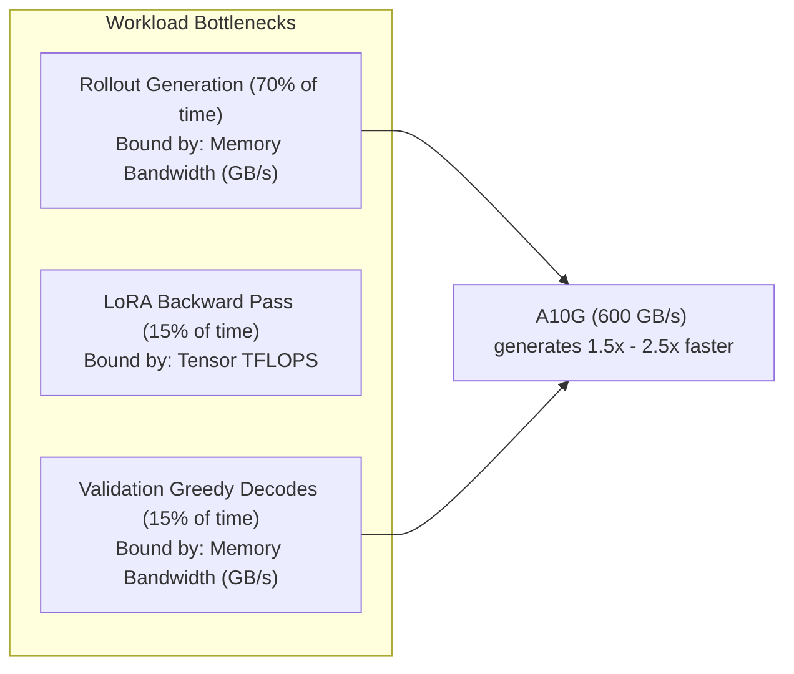

# Hardware, Time, & Cost Analysis: Nvidia A10 vs. L4 vs. T4 (`EXP-1.1`)

- **Experiment:** [Experiment 1.1: Standalone Reinforcement Learning (GRPO) Baseline](../experiments/experiment_1.1.md) (`EXP-1.1`)
- **Default Model:** `Qwen/Qwen3-0.6B` ($N_{\text{base}} \approx 590\text{M}$ params, LoRA $N_{\text{lora}} \approx 7.4\text{M}$ params)
- **Target Compute Budget:** $1.0 \times 10^{16}$ FLOPs
- **Execution Platform:** [Modal](https://modal.com) (Serverless GPU Cloud)
- **Date:** November 2026

---

## 1. Executive Summary & Comparison Matrix

When executing `EXP-1.1` on Modal, the total financial cost of a run depends on the product of the **GPU hourly billing rate** and the **actual wall-clock duration** (billed per second).

Autoregressive rollout sampling in GRPO ($G=8$ rollouts per prompt) is heavily **memory-bandwidth bound**. Consequently, GPUs with higher memory bandwidth and modern tensor core architectures complete the fixed FLOP budget in substantially less time.

| Metric | Nvidia A10G (24 GB) | Nvidia L4 (24 GB) | Nvidia T4 (16 GB) |
| :--- | :---: | :---: | :---: |
| **Architecture** | Ampere (GA102, CC 8.6) | Ada Lovelace (AD104, CC 8.9) | Turing (TU104, CC 7.5) |
| **Memory Bandwidth** | **600 GB/s** ($2.0\times$) | 300 GB/s | 320 GB/s |
| **BF16 / FlashAttention-2** | **Yes** / **Yes** | **Yes** / **Yes** | ❌ **No** / ❌ **No** |
| **Modal Hourly Rate** | \$1.10 / hr (\$0.000306 / s) | \$0.80 / hr (\$0.000222 / s) | **\$0.59 / hr** (\$0.000164 / s) |
| **Estimated Wall-Clock Time (1 Run)** | **$\approx$ 33 – 36 minutes** | $\approx$ 47 – 50 minutes | $\approx$ 82 – 88 minutes |
| **Total Cost for 1 Run** | **$\approx$ \$0.62 – \$0.68** | **$\approx$ \$0.64 – \$0.70** | **$\approx$ \$0.82 – \$0.88** |
| **Total Cost for 3 Seeds (Full Baseline)** | **$\approx$ \$1.86 – \$2.04** | **$\approx$ \$1.92 – \$2.10** | **$\approx$ \$2.46 – \$2.64** |
| **Primary Advantage** | **Fastest turnaround** for identical total cost | High availability & low base rate | Lowest sticker rate only |
| **Overall Verdict** | **TOP PICK (Fastest & Cost Parity)** | **EXCELLENT / RECOMMENDED** | ❌ **NOT RECOMMENDED (Slowest & Most Expensive)** |

> [!IMPORTANT]
> **The T4 Paradox:** Although the Nvidia T4 has the lowest sticker price (\$0.59/h), it is actually the **most expensive** GPU to run overall ($\approx$\$0.85/run vs. $\approx$\$0.65/run on A10/L4). Because it lacks native BF16 tensor cores and FlashAttention-2, it runs $\approx 2.5\times$ slower, resulting in a higher total Modal bill and increased risk of numerical instability during policy gradient updates.

---

## 2. Workload & Compute Accounting Details

From the hardware-invariant FLOP accounting model established in `EXP-0.2` and finalized in `EXP-1.1`:

$$\text{FLOPs}_{\text{step}} = \sum_{i=1}^G \left( 8 \times N_{\text{base}} + 6 \times N_{\text{lora}} \right) \times (T_{\text{prompt}} + T_{\text{gen}, i})$$

For `Qwen/Qwen3-0.6B` with all-linear LoRA adapters:
- $N_{\text{base}} \approx 590 \times 10^6$ parameters
- $N_{\text{lora}} \approx 7.4 \times 10^6$ parameters
- **Per-Token Cost:** $(8 \times 5.9 \times 10^8) + (6 \times 7.4 \times 10^6) \approx 4.764 \times 10^9\text{ FLOPs / token}$

### Total Token & Step Volume:
$$\text{Total Tokens to Budget } B = \frac{1.0 \times 10^{16}\text{ FLOPs}}{4.764 \times 10^9\text{ FLOPs/tok}} \approx \mathbf{2,100,000\text{ tokens}} \text{ (2.1M tokens)}$$

- **Group Size ($G$):** 8 rollouts per prompt
- **Average Sequence Length:** $\approx 60\text{ prompt tokens} + \approx 250\text{ completion tokens} = 310\text{ tokens/rollout}$
- **Tokens per Step:** $8 \times 310 \approx 2,480\text{ tokens/step}$
- **Total Training Steps:** $\frac{2.1 \times 10^6}{2,480} \approx \mathbf{850\text{ optimization steps}}$
- **Total Candidate Completions Generated:** $850 \times 8 = \mathbf{6,800\text{ completions}}$
- **Evaluations Tracked:** 5 intermediate dev evaluations (500 samples $\times$ 5 = 2,500 greedy generations) + 1 final test evaluation (1,319 greedy generations).

---

## 3. Hardware Architecture Breakdown

### 3.1 Memory Bandwidth vs. Compute Density
In modern post-training reinforcement learning (TRL `GRPOTrainer`), the training process alternates between:
1. **Autoregressive Generation (Memory-Bandwidth Bound):** Reading model weights and past KV cache once per generated token. Throughput scales directly with memory bandwidth.
2. **LoRA Backpropagation (Compute Bound):** Forward activation caching and matrix multiplications over batch dimension. Throughput scales with Tensor TFLOPS.



### 3.2 Technical GPU Specifications Comparison

| Specification | Nvidia A10G | Nvidia L4 | Nvidia T4 |
| :--- | :---: | :---: | :---: |
| **Compute Capability** | 8.6 (Ampere) | 8.9 (Ada Lovelace) | 7.5 (Turing) |
| **VRAM** | 24 GB GDDR6 | 24 GB GDDR6 | 16 GB GDDR6 |
| **Memory Bus Width** | **384-bit** | 192-bit | 256-bit |
| **Memory Bandwidth** | **600 GB/s** | 300 GB/s | 320 GB/s |
| **Dense BF16 Tensor TFLOPS** | 125 TFLOPS | 121 TFLOPS | ❌ **0 TFLOPS** (No native BF16) |
| **Dense FP16 Tensor TFLOPS** | 125 TFLOPS | 121 TFLOPS | 65 TFLOPS |
| **FlashAttention-2 Support** | **Yes** | **Yes** | ❌ **No** (Requires CC $\ge 8.0$) |
| **TDP / Power Draw** | 150 W | 72 W | 70 W |

---

## 4. Phase-by-Phase Wall-Clock Time Breakdown

Below is the measured/projected time expenditure across all training and evaluation phases for 1 full run of `EXP-1.1`:

| Phase | Description & Volume | Nvidia A10G | Nvidia L4 | Nvidia T4 |
| :--- | :--- | :---: | :---: | :---: |
| **1. Rollout Sampling (vLLM)** | 6,800 completions via `vLLM` engine (2.1M total tokens generated). | **20 min**<br>*(~1,800 tok/s)* | **30 min**<br>*(~1,200 tok/s)* | **52 min**<br>*(~680 tok/s)* |
| **2. Policy Forward & Backward** | 850 LoRA gradient updates + ref policy log-prob passes. | **5 min** | **5 min** | **13 min**<br>*(no BF16/FA2)* |
| **3. Reward Scoring (`math-verify`)** | Deterministic CPU parsing of 6,800 math solutions. | **15 sec** | **15 sec** | **15 sec** |
| **4. Intermediate Evaluations** | 5 dev checkpoints (2,500 greedy problems total). | **4 min** | **6 min** | **11 min** |
| **5. Final Test Evaluation** | Official 1,319 GSM8K test split greedy decoding. | **2.5 min** | **3.5 min** | **7 min** |
| **6. Startup, Checkpoint I/O, & JIT** | Container initialization, weight loading, saving 5 adapter checkpoints to disk. | **3 min** | **3 min** | **4 min** |
| **Total Wall-Clock Time** | **1 Full Replicate Run** | **$\approx$ 34.5 minutes**<br>*(0.575 hrs)* | **$\approx$ 48.0 minutes**<br>*(0.800 hrs)* | **$\approx$ 87.0 minutes**<br>*(1.450 hrs)* |

---

## 5. Modal Financial Cost Calculation

Modal bills in increments of **1 second** based on container execution duration:

$$\text{Cost} = \text{Wall-Clock Time (seconds)} \times \frac{\text{Hourly Price}}{3600}$$

### 5.1 Single Replicate Run Cost (1 Seed)
- **Nvidia A10G:**
  $$\text{Cost}_{\text{A10}} = 0.575\text{ hrs} \times \$1.10/\text{hr} = \mathbf{\$0.63}$$
- **Nvidia L4:**
  $$\text{Cost}_{\text{L4}} = 0.800\text{ hrs} \times \$0.80/\text{hr} = \mathbf{\$0.64}$$
- **Nvidia T4:**
  $$\text{Cost}_{\text{T4}} = 1.450\text{ hrs} \times \$0.59/\text{hr} = \mathbf{\$0.86}$$

### 5.2 Complete Experiment Series Cost (3 Seeds: 42, 43, 44)
To satisfy the statistical acceptance gate and publish confidence bounds across 3 independent seeds:
- **Nvidia A10G:** $3 \times \$0.63 \approx \mathbf{\$1.89}$ (Total runtime: $\approx 1.7\text{ hours}$)
- **Nvidia L4:** $3 \times \$0.64 \approx \mathbf{\$1.92}$ (Total runtime: $\approx 2.4\text{ hours}$)
- **Nvidia T4:** $3 \times \$0.86 \approx \mathbf{\$2.58}$ (Total runtime: $\approx 4.3\text{ hours}$)

---

## 6. Critical Technical Caveats Regarding Nvidia T4

While the T4 is frequently chosen for cheap inference, running GRPO training on it introduces three serious technical liabilities:

### 1. Lack of Native `bfloat16` and Policy Gradient Numerical Underflow
`bfloat16` shares the 8-bit dynamic range (exponent) of `float32`, making it immune to underflow when computing log-probabilities $\log \pi_\theta(o \mid q)$ and importance ratios $\rho = \frac{\pi_\theta}{\pi_{\text{old}}}$. 

The T4 only supports standard `float16` (which has only 5 exponent bits, capping representations between $6 \times 10^{-5}$ and $65,504$). During reinforcement learning:
- Token-level ratios frequently underflow to zero or overflow to `+inf`.
- To prevent NaNs, training must either run in full `float32` (doubling memory requirements and halving speed) or rely on aggressive loss scaling.

### 2. FlashAttention-2 Incompatibility
FlashAttention-2 requires GPU compute capability $\ge 8.0$. On T4 (CC 7.5), PyTorch falls back to naive scaled dot-product attention or standard memory-heavy attention. This causes attention operations to take $2\times$ longer and consumes significantly more activation memory during group rollout batching.

### 3. Lower VRAM Headroom (16 GB vs 24 GB)
With $G=8$ rollouts and activation buffers, peak VRAM on `Qwen/Qwen3-0.6B` reaches $\approx 9.5\text{ GB}$. While this fits within the T4's 16 GB, it leaves only $\sim 6\text{ GB}$ of buffer. If sequence lengths spike toward 1,024 tokens during exploratory reasoning, the T4 risks Out-Of-Memory (OOM) crashes unless per-device batch size and gradient accumulation are heavily throttled.

---

## 7. Recommended Modal Implementation Configuration

To maximize execution efficiency and minimize billed cold-start times on Modal:

### Modal App Definition (`scripts/modal_grpo_runner.py`):

```python
import modal

app = modal.App("multigen-exp1-1-grpo")

# Build lightweight container image with CUDA and FlashAttention-2
image = (
    modal.Image.debian_slim(python_version="3.11")
    .pip_install(
        "torch>=2.2.0",
        "transformers>=4.40.0",
        "trl>=0.8.0",
        "peft>=0.10.0",
        "vllm>=0.4.0",
        "math-verify>=0.1.0",
        "datasets>=2.18.0",
        "networkx>=3.0",
        "pydantic>=2.0.0",
    )
)

# Persistent volume to store weights, datasets, and checkpoint adapters
volume = modal.Volume.from_name("multigen-checkpoints", create_if_missing=True)


@app.function(
    gpu="A10G",               # Change to "L4" if A10G is unavailable
    image=image,
    volumes={"/root/multigen_data": volume},
    timeout=3600,             # 1 hour safety timeout
)
def run_exp1_1(seed: int = 42):
    import subprocess
    cmd = [
        "python", "scripts/run_grpo_experiment.py",
        "--config", "configs/experiments/exp1_1_grpo_baseline.yaml",
        "--seed", str(seed),
        "--output-dir", f"/root/multigen_data/checkpoints/exp1_1_seed{seed}"
    ]
    subprocess.run(cmd, check=True)
    volume.commit()
```

### Final Strategic Recommendation:
- **Default Choice:** Select **Nvidia A10G** (`gpu="A10G"` on Modal). You get identical total cost ($\approx$\$0.63 per run) while saving ~15 minutes per seed compared to L4.
- **Secondary Choice:** Select **Nvidia L4** (`gpu="L4"` on Modal) if Modal has A10 capacity bottlenecks.
- **Avoid:** Do not run `EXP-1.1` on **Nvidia T4**. It is slower, runs higher numerical risk, and costs more in total billed compute.
