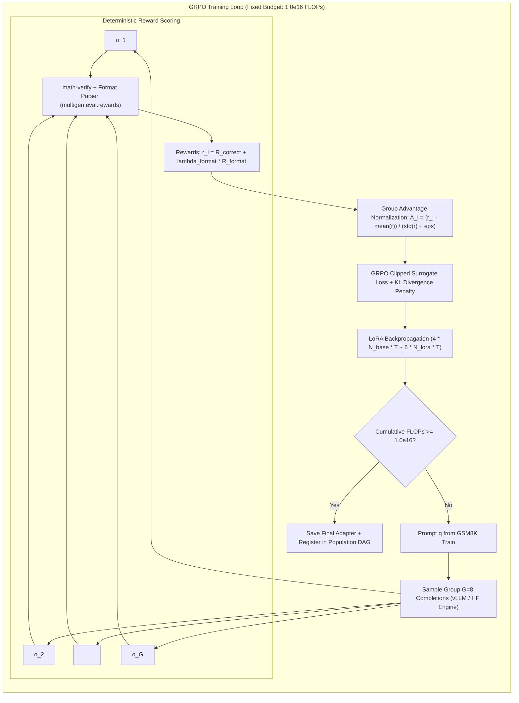

# Experiment 1.1: Standalone Reinforcement Learning (GRPO) Baseline (`EXP-1.1`)

- **Sequential Position:** Step 2 (Phase 1: Foundational Baselines & Mixed Learning)
- **Status:** Specification (Pre-Implementation)
- **Parent Plans:** [Sequential Experiment Plan](../experiment_plan.md) | [Implementation Plan](../implementaiton_plan.md)
- **Preceding Dependencies:** [Experiment 0.1: Verifier Calibration & Baseline Zero-Shot Evaluation](experiment_0.1.md) (`EXP-0.1`), [Experiment 0.2: Compute Accounting & FLOPs Normalization Calibration](experiment_0.2.md) (`EXP-0.2`)
- **Default Model:** `Qwen/Qwen3-0.6B`

---

## 1. Objective & Scope

`EXP-1.1` is the primary reinforcement learning baseline in Phase 1 of the Multigen-RL framework. It establishes the single-agent RL performance ceiling and learning trajectory under a strictly capped compute budget ($1.0 \times 10^{16}$ FLOPs) using Group Relative Policy Optimization (GRPO) without external teacher supervision.

### Core Objectives:
1. **Establish the Pure RL Performance Benchmark:** Determine how effectively the base model (`Qwen/Qwen3-0.6B`) adapts its mathematical reasoning through self-exploration and binary outcome rewards, serving as the pure RL anchor for testing **Hypothesis H1** (Mixed Learning vs. Single Paradigms).
2. **Implement Core Population & Lineage Infrastructure:**
   - Define structured Pydantic data schemas in `multigen/core/schema.py` (`TrainingRecipe`, `CapabilityProfile`, `ModelNode`).
   - Implement the Directed Acyclic Graph (DAG) population manager in `multigen/core/population_dag.py` wrapping NetworkX, registering the base model as the root node (`node_0`).
3. **Build the Production GRPO Runner (`multigen/training/grpo_runner.py`):** Wrap Hugging Face `trl.GRPOTrainer` with Parameter-Efficient Fine-Tuning (PEFT/LoRA), integrating the deterministic math verifier (`multigen/eval/rewards.py`) and the compute budget callback (`FLOPBudgetCallback` from `EXP-0.2`).
4. **Profile RL Dynamics Under Strict Budgeting:** Track policy loss, group advantage statistics, KL divergence against the reference policy, output token length evolution, format compliance, and test accuracy across 3 distinct random seeds (42, 43, 44).

---

## 2. Mathematical Formulation & Optimization Dynamics



### 2.1 The GRPO Objective
Group Relative Policy Optimization eliminates the memory and compute overhead of training a separate parametric value model / critic (as in PPO). Instead, for each query $q \sim \mathcal{D}_{\text{train}}$, the policy samples a group of $G$ outputs $\{o_1, o_2, \dots, o_G\} \sim \pi_{\theta_{\text{old}}}(q)$.

The group normalized advantage $\hat{A}_i$ for each completion $o_i$ is computed relative to the empirical mean and standard deviation of rewards within the group:

$$\bar{r} = \frac{1}{G} \sum_{j=1}^{G} r_j, \quad \sigma_r = \sqrt{\frac{1}{G} \sum_{j=1}^{G} (r_j - \bar{r})^2 + \epsilon_{\text{adv}}}$$

$$\hat{A}_i = \frac{r_i - \bar{r}}{\sigma_r}$$

The policy parameters $\theta$ (LoRA adapter weights) are optimized via the clipped surrogate objective with a reference model KL penalty:

$$\mathcal{J}_{\text{GRPO}}(\theta) = \mathbb{E}_{q \sim \mathcal{D}, \{o_i\}_{i=1}^G \sim \pi_{\theta_{\text{old}}}} \left[ \frac{1}{G} \sum_{i=1}^G \min \left( \rho_i(\theta) \hat{A}_i, \, \text{clip}(\rho_i(\theta), 1 - \epsilon_{\text{clip}}, 1 + \epsilon_{\text{clip}}) \hat{A}_i \right) - \beta D_{\text{KL}}(\pi_\theta \parallel \pi_{\text{ref}}) \right]$$

where:
- $\rho_i(\theta) = \frac{\pi_\theta(o_i \mid q)}{\pi_{\theta_{\text{old}}}(o_i \mid q)}$ is the token-level importance sampling ratio.
- $\epsilon_{\text{clip}} = 0.2$ is the clipping boundary preventing destabilizing policy updates.
- $\beta = 0.04$ is the KL penalty coefficient.
- $D_{\text{KL}}(\pi_\theta \parallel \pi_{\text{ref}})$ is computed using the unbiased Schulman estimator:
  $$D_{\text{KL}}(\pi_\theta \parallel \pi_{\text{ref}}) = \frac{\pi_{\text{ref}}(o_i \mid q)}{\pi_\theta(o_i \mid q)} - \log \frac{\pi_{\text{ref}}(o_i \mid q)}{\pi_\theta(o_i \mid q)} - 1$$

### 2.2 Reward Function Formulation
For each completion $o$, the total reward $R(q, o)$ is composed of mathematical correctness and structural encapsulation:

$$R(q, o) = R_{\text{correctness}}(o, y^*) + \lambda_{\text{format}} R_{\text{format}}(o)$$

1. **Mathematical Correctness ($R_{\text{correctness}} \in \{0.0, 1.0\}$):**
   - Extracts answer candidate from $o$ via `extract_answer(o, allow_last_number_fallback=False)`.
   - Compares candidate against gold target $y^*$ using `verify_math_answer(pred, gold)` (`math-verify`).
   - Binary: $1.0$ if equivalent, $0.0$ otherwise.
2. **Format Adherence ($R_{\text{format}} \in \{0.0, 1.0\}$):**
   - Verified via `format_reward_fn(o)`.
   - Requires non-empty `<think>...</think>` reasoning followed strictly by `<answer>...</answer>`.
3. **Format Weight ($\lambda_{\text{format}}$):** Default is set to $0.1$. Correctness remains the dominant optimization signal while providing gradient guidance for structured output generation.

### 2.3 Parameterization (LoRA)
To support multi-branch populations without excessive storage overhead, training optimizes Low-Rank Adaptation (LoRA) matrices on top of frozen `Qwen/Qwen3-0.6B`:
- **Frozen Base Parameters ($N_{\text{base}}$):** $\approx 590 \times 10^6$ parameters.
- **LoRA Configuration:**
  - Rank: $r = 16$
  - Scaling factor: $\alpha = 32$ (scaling $\frac{\alpha}{r} = 2.0$)
  - Dropout: $0.05$
  - Target modules: All linear projections (`q_proj`, `k_proj`, `v_proj`, `o_proj`, `gate_proj`, `up_proj`, `down_proj`).
  - Trainable parameters ($N_{\text{lora}}$): $\approx 7.4 \times 10^6$ ($\sim 1.2\%$ parameter overhead, $\sim 28\text{ MB}$ checkpoint size).

### 2.4 Compute Budget & Step Translation
Under the standardized FLOP formulations established in `EXP-0.2`:

$$\text{FLOPs}_{\text{step}} = G \times \left[ \underbrace{2 N_{\text{base}} T_{\text{total}}}_{\text{Rollout Gen}} + \underbrace{2 N_{\text{base}} T_{\text{total}}}_{\text{Ref Pass}} + \underbrace{(4 N_{\text{base}} + 6 N_{\text{lora}}) T_{\text{total}}}_{\text{LoRA Backward Pass}} \right]$$

$$\approx G \times (8 N_{\text{base}} + 6 N_{\text{lora}}) \times T_{\text{total}}$$

With $N_{\text{base}} \approx 5.9 \times 10^8$, $G = 8$, prompt length $T_{\text{prompt}} \approx 60$, and average completion length $\bar{T}_{\text{gen}} \approx 250$ tokens ($T_{\text{total}} \approx 310$):

$$\text{FLOPs}_{\text{step}} \approx 8 \times (8 \times 5.9 \times 10^8) \times 310 \approx 1.17 \times 10^{13} \text{ FLOPs/step}$$

$$\text{Total Steps to Budget } (1.0 \times 10^{16}\text{ FLOPs}) \approx \frac{1.0 \times 10^{16}}{1.17 \times 10^{13}} \approx 850 \text{ to } 1,200 \text{ steps}$$

*(Exact step count varies dynamically as the policy learns longer or shorter chain-of-thought rationales. `FLOPBudgetCallback` halts training dynamically at $1.0 \times 10^{16}$ FLOPs regardless of step count.)*

---

## 3. Architecture & Implementation Details

```text
multigen-rl/
├── multigen/
│   ├── core/
│   │   ├── __init__.py
│   │   ├── schema.py               # Pydantic data contracts (ModelNode, TrainingRecipe, etc.)
│   │   └── population_dag.py       # NetworkX lineage tracker & JSON serialization
│   ├── training/
│   │   ├── __init__.py
│   │   └── grpo_runner.py          # TRL GRPOTrainer wrapper + vLLM / HF backend + budget callback
│   ├── accounting/
│   │   ├── flops.py                # Parameter & FLOP equations (from EXP-0.2)
│   │   └── tracker.py              # FLOPAccumulator & FLOPBudgetCallback (from EXP-0.2)
│   └── eval/
│       ├── rewards.py              # Verified math-verify reward callbacks (from EXP-0.1)
│       └── evaluator.py            # GSM8KEvaluator extended to support PEFT adapters
├── configs/
│   └── experiments/
│       └── exp1_1_grpo_baseline.yaml # Production configuration for EXP-1.1
├── scripts/
│   └── run_grpo_experiment.py      # Standalone CLI driver for EXP-1.1
└── tests/
    ├── test_schema.py              # Unit tests for Pydantic schema validation
    ├── test_population_dag.py      # Unit tests for NetworkX lineage tracking
    └── test_grpo_runner.py         # Unit tests for training setup & callback wiring
```

### 3.1 Pydantic Core Schemas (`multigen/core/schema.py`)

Define explicit, immutable contracts for lineage tracking and reproducibility:

```python
from datetime import datetime
from typing import Any, Dict, List, Literal, Optional
from pydantic import BaseModel, Field


class TrainingRecipe(BaseModel):
    """Specification of training parameters that produced a model node."""
    algorithm: Literal["grpo", "sft", "mixed"] = "grpo"
    base_model_name_or_path: str = "Qwen/Qwen3-0.6B"
    parent_adapter_path: Optional[str] = None
    
    # LoRA Hyperparameters
    lora_rank: int = 16
    lora_alpha: int = 32
    lora_dropout: float = 0.05
    target_modules: List[str] = Field(
        default_factory=lambda: [
            "q_proj", "k_proj", "v_proj", "o_proj",
            "gate_proj", "up_proj", "down_proj"
        ]
    )
    
    # Algorithm-specific hyperparameters (GRPO)
    group_size: int = 8
    learning_rate: float = 2e-5
    kl_beta: float = 0.04
    clip_epsilon: float = 0.2
    weight_decay: float = 0.01
    warmup_ratio: float = 0.1
    max_prompt_length: int = 512
    max_completion_length: int = 512
    temperature: float = 0.9
    
    # Reward coefficients
    correctness_reward_weight: float = 1.0
    format_reward_weight: float = 0.1
    
    # Compute budget cap
    target_flop_budget: float = 1.0e16
    seed: int = 42


class CapabilityProfile(BaseModel):
    """Evaluation scorecard for a model checkpoint on a standard benchmark."""
    benchmark: str = "gsm8k"
    split: Literal["dev", "test"] = "test"
    num_shots: int = 0
    accuracy: float
    permissive_accuracy: float
    format_compliance_rate: float
    mean_completion_tokens: float
    error_indices: List[int] = Field(default_factory=list)
    evaluated_at: datetime = Field(default_factory=datetime.utcnow)
    wall_time_seconds: float = 0.0


class ModelNode(BaseModel):
    """A single model checkpoint node in the population lineage DAG."""
    node_id: str
    parent_ids: List[str] = Field(default_factory=list)
    depth: int = 0
    recipe: TrainingRecipe
    capability_profile: Optional[CapabilityProfile] = None
    intermediate_evaluations: List[Dict[str, Any]] = Field(default_factory=list)
    adapter_path: Optional[str] = None
    cumulative_flops: float = 0.0
    created_at: datetime = Field(default_factory=datetime.utcnow)
    metadata: Dict[str, Any] = Field(default_factory=dict)
```

### 3.2 Population Lineage DAG (`multigen/core/population_dag.py`)

A NetworkX `DiGraph` wrapper that manages experiment lineage, records compute paths, and persists state to `population_dag.json`:

```python
import json
import networkx as nx
from typing import List, Optional
from multigen.core.schema import ModelNode, TrainingRecipe


class PopulationDAG:
    """Directed Acyclic Graph managing model lineage, recipes, and compute trees."""
    
    def __init__(self):
        self.graph = nx.DiGraph()
        self._ensure_root_node()

    def _ensure_root_node(self) -> None:
        """Register the frozen base model as node_0 if DAG is empty."""
        if "node_0" not in self.graph:
            root_recipe = TrainingRecipe(
                algorithm="sft",
                base_model_name_or_path="Qwen/Qwen3-0.6B",
                target_flop_budget=0.0,
            )
            root_node = ModelNode(
                node_id="node_0",
                parent_ids=[],
                depth=0,
                recipe=root_recipe,
                adapter_path=None,
                cumulative_flops=0.0,
                metadata={"description": "Frozen base model root node (Qwen/Qwen3-0.6B)"}
            )
            self.add_node(root_node)

    def add_node(self, node: ModelNode) -> None:
        self.graph.add_node(node.node_id, data=node.model_dump())
        for parent_id in node.parent_ids:
            if parent_id in self.graph:
                self.graph.add_edge(parent_id, node.node_id)

    def get_node(self, node_id: str) -> Optional[ModelNode]:
        if node_id in self.graph:
            return ModelNode.model_validate(self.graph.nodes[node_id]["data"])
        return None

    def get_lineage(self, node_id: str) -> List[str]:
        """Return the ancestor node path from root to node_id."""
        return nx.ancestors(self.graph, node_id)

    def save_to_json(self, filepath: str) -> None:
        data = {
            "nodes": [self.graph.nodes[n]["data"] for n in self.graph.nodes],
            "edges": list(self.graph.edges),
        }
        with open(filepath, "w") as f:
            json.dump(data, f, indent=2, default=str)

    @classmethod
    def load_from_json(cls, filepath: str) -> "PopulationDAG":
        dag = cls()
        with open(filepath, "r") as f:
            data = json.load(f)
        dag.graph.clear()
        for node_dict in data["nodes"]:
            node = ModelNode.model_validate(node_dict)
            dag.graph.add_node(node.node_id, data=node.model_dump())
        for u, v in data["edges"]:
            dag.graph.add_edge(u, v)
        return dag
```

### 3.3 GRPO Training Runner (`multigen/training/grpo_runner.py`)

The runner integrates `trl.GRPOTrainer` with the project's accounting callback, PEFT adapter setup, and verifiers:

```python
import os
import torch
from peft import LoraConfig, get_peft_model
from transformers import AutoTokenizer, AutoModelForCausalLM
from trl import GRPOConfig, GRPOTrainer

from multigen.accounting.tracker import FLOPBudgetCallback, FLOPAccumulator
from multigen.accounting.flops import extract_param_counts
from multigen.eval.rewards import correctness_reward_fn, format_reward_fn
from multigen.core.schema import TrainingRecipe


class GRPORunner:
    """Orchestrates GRPO training using TRL, Peft, and custom FLOP budgeting."""
    
    def __init__(self, recipe: TrainingRecipe, output_dir: str):
        self.recipe = recipe
        self.output_dir = output_dir
        os.makedirs(output_dir, exist_ok=True)
        
    def train(self, train_dataset, eval_dataset=None):
        # 1. Load Tokenizer & Base Model
        tokenizer = AutoTokenizer.from_pretrained(
            self.recipe.base_model_name_or_path,
            trust_remote_code=True
        )
        if tokenizer.pad_token is None:
            tokenizer.pad_token = tokenizer.eos_token
            
        model = AutoModelForCausalLM.from_pretrained(
            self.recipe.base_model_name_or_path,
            torch_dtype=torch.bfloat16 if torch.cuda.is_available() else torch.float32,
            device_map="auto" if torch.cuda.is_available() else None,
            trust_remote_code=True,
        )
        
        # 2. Attach LoRA Adapter
        peft_config = LoraConfig(
            r=self.recipe.lora_rank,
            lora_alpha=self.recipe.lora_alpha,
            lora_dropout=self.recipe.lora_dropout,
            target_modules=self.recipe.target_modules,
            bias="none",
            task_type="CAUSAL_LM",
        )
        model = get_peft_model(model, peft_config)
        
        # 3. Setup FLOP Accounting Callback
        param_counts = extract_param_counts(model)
        accumulator = FLOPAccumulator(
            n_base_params=param_counts.frozen_params,
            n_lora_params=param_counts.trainable_params,
            is_lora=True,
        )
        budget_callback = FLOPBudgetCallback(
            accumulator=accumulator,
            target_budget_flops=self.recipe.target_flop_budget,
            output_dir=self.output_dir,
        )
        
        # 4. Configure TRL GRPOConfig
        training_args = GRPOConfig(
            output_dir=self.output_dir,
            learning_rate=self.recipe.learning_rate,
            num_generations=self.recipe.group_size,
            max_prompt_length=self.recipe.max_prompt_length,
            max_completion_length=self.recipe.max_completion_length,
            temperature=self.recipe.temperature,
            beta=self.recipe.kl_beta,
            epsilon=self.recipe.clip_epsilon,
            weight_decay=self.recipe.weight_decay,
            warmup_ratio=self.recipe.warmup_ratio,
            logging_steps=10,
            save_strategy="steps",
            save_steps=100,
            per_device_train_batch_size=1,
            gradient_accumulation_steps=1,
            use_vllm=torch.cuda.is_available(), # Graceful fallback to PyTorch on non-CUDA
            fp16=False,
            bf16=torch.cuda.is_available(),
        )
        
        # 5. Build Reward Callbacks
        def combined_correctness(prompts, completions, **kwargs):
            return correctness_reward_fn(prompts, completions, **kwargs)

        def combined_format(prompts, completions, **kwargs):
            raw_scores = format_reward_fn(prompts, completions, **kwargs)
            return [s * self.recipe.format_reward_weight for s in raw_scores]

        # 6. Instantiate Trainer & Run
        trainer = GRPOTrainer(
            model=model,
            reward_funcs=[combined_correctness, combined_format],
            args=training_args,
            train_dataset=train_dataset,
            eval_dataset=eval_dataset,
            callbacks=[budget_callback],
        )
        
        trainer.train()
        
        # 7. Save Final Adapter
        final_adapter_dir = os.path.join(self.output_dir, "final_adapter")
        model.save_pretrained(final_adapter_dir)
        tokenizer.save_pretrained(final_adapter_dir)
        
        return {
            "adapter_path": final_adapter_dir,
            "cumulative_flops": budget_callback.current_flops,
            "total_steps": trainer.state.global_step,
        }
```

### 3.4 Integration with Evaluator (`multigen/eval/evaluator.py`)
Extend `GSM8KEvaluator` to accept `adapter_path: Optional[str] = None`. When specified:
1. Load base model `Qwen/Qwen3-0.6B`.
2. Wrap using `peft.PeftModel.from_pretrained(base_model, adapter_path)`.
3. Execute standard greedy decoding ($T=0$) across GSM8K `test` split (1,319 problems) to compute final `CapabilityProfile`.

### 3.5 Experiment Configuration (`configs/experiments/exp1_1_grpo_baseline.yaml`)

```yaml
experiment_id: "exp1_1_grpo_baseline"
description: "Phase 1 Standalone RL (GRPO) Baseline at strict 1.0e16 FLOPs budget"

model:
  name_or_path: "Qwen/Qwen3-0.6B"
  torch_dtype: "bfloat16"

peft:
  type: "lora"
  rank: 16
  alpha: 32
  dropout: 0.05
  target_modules:
    - "q_proj"
    - "k_proj"
    - "v_proj"
    - "o_proj"
    - "gate_proj"
    - "up_proj"
    - "down_proj"

grpo:
  group_size: 8
  learning_rate: 2.0e-5
  kl_beta: 0.04
  clip_epsilon: 0.2
  weight_decay: 0.01
  warmup_ratio: 0.1
  max_prompt_length: 512
  max_completion_length: 512
  temperature: 0.9

rewards:
  correctness_weight: 1.0
  format_weight: 0.1

budget:
  target_flops: 1.0e16
  intermediate_eval_interval_flops: 2.0e15

dataset:
  name: "openai/gsm8k"
  subset: "main"
  train_split: "train"
  dev_split: "dev"
  test_split: "test"

output:
  checkpoints_dir: "checkpoints/exp1_1_grpo"
  dag_path: "population_dag.json"
  eval_output_dir: "evals"

seeds:
  - 42
  - 43
  - 44
```

---

## 4. Key Decisions & Considerations (Requiring Review / Alignment)

The following key technical decisions govern the implementation of `EXP-1.1`. Each item details the options, architectural trade-offs, and recommended default choice:

### 4.1 Decision 1: Format Reward Weight ($\lambda_{\text{format}}$) & Penalty Mechanics

- **Context:** If the model fails to output `<think>...</think><answer>...</answer>`, the verifier cannot parse the answer. However, if format rewards are weighted too heavily, the policy engages in "format gaming"—generating perfectly formatted incorrect answers to maximize reward without engaging in reasoning.
- **Options:**
  - **Option A ($\lambda_{\text{format}} = 0.1$ additive, 0.0 floor - Recommended):** Correctness yields $+1.0$; valid format yields $+0.1$. Max reward $= 1.1$. Wrong answer with valid format $= 0.1$. Wrong answer with invalid format $= 0.0$.
  - **Option B (Strict Multiplicative Gating $R = R_{\text{correct}} \times R_{\text{format}}$):** The model receives $0.0$ if formatting fails, regardless of whether the final answer is buried in prose.
  - **Option C (Negative Format Penalty $-0.5$):** Penalize unformatted completions with negative rewards.
- **Trade-off Analysis:** Option B causes severe gradient starvation early in training when the base 0.6B model has $<20\%$ format compliance—the policy receives zero gradient across entire groups and cannot learn. Option C introduces reward scaling instability and inflates advantage variance. Option A provides smooth shaping: the model rapidly learns formatting early on, followed by continuous mathematical optimization.
- **Recommendation:** **Adopt Option A ($\lambda_{\text{format}} = 0.1$ additive).**

---

### 4.2 Decision 2: GRPO Group Size $G$ vs. VRAM & Advantage Variance

- **Context:** GRPO normalizes advantages across $G$ candidate completions per prompt.
- **Options:**
  - **Option A ($G = 8$ - Recommended):** Standard DeepSeek / TRL configuration. Samples 8 rollouts per prompt.
  - **Option B ($G = 4$):** Halves rollout generation time and VRAM footprint.
  - **Option C ($G = 16$):** Produces higher quality advantage estimates with lower variance.
- **Trade-off Analysis:** With $G=4$, groups frequently sample either all incorrect answers ($\{0, 0, 0, 0\}$) or all identical correct answers ($\{1, 1, 1, 1\}$). When $\sigma_r = 0$, all advantages become zero and the optimization step is wasted. $G=8$ provides an optimal balance between advantage variance reduction and single-GPU memory fit (fits comfortably on 24GB/40GB GPUs with `Qwen/Qwen3-0.6B`).
- **Recommendation:** **Adopt Option A ($G = 8$).**

---

### 4.3 Decision 3: Prompt Formatting in Training (0-Shot Instruction vs. 4-Shot Exemplars)

- **Context:** `EXP-0.1` evaluated `Qwen/Qwen3-0.6B` under both 0-shot and 4-shot prompting. For RL training, every prompt token incurs generation and backward pass FLOPs ($8 N_{\text{base}} T$).
- **Options:**
  - **Option A (0-Shot with Clear System Prompt - Recommended):** Include explicit instructions in the prompt (e.g., *"Solve the following math problem. Put your reasoning inside <think>...</think> and your final numerical answer inside <answer>...</answer>."*).
  - **Option B (4-Shot Exemplars in Prompt):** Prepend the 4 fixed GSM8K demonstrations to every training prompt.
- **Trade-off Analysis:** Option B inflates prompt length from $\approx 60$ tokens to $\approx 450$ tokens per sample. Across $G=8$ rollouts, prepending 4 exemplars consumes $>65\%$ of the total $1.0 \times 10^{16}$ FLOP budget purely on processing fixed exemplar prompts rather than learning new problem rollouts. Option A trains the policy to internalize the format directly into model weights while maximizing unique training problem throughput.
- **Recommendation:** **Adopt Option A (0-Shot with explicit system/user instructions).**

---

### 4.4 Decision 4: Reference Policy KL Penalty ($\beta$) & Policy Drift Control

- **Context:** GRPO uses $\beta D_{\text{KL}}(\pi_\theta \parallel \pi_{\text{ref}})$ to prevent the policy from collapsing or drifting too far from the base language distribution.
- **Options:**
  - **Option A (Fixed $\beta = 0.04$ - Recommended):** DeepSeekMath standard.
  - **Option B ($\beta = 0.0$ / R1-Zero Style):** No KL penalty; relies solely on clipping $\epsilon_{\text{clip}} = 0.2$ to constrain updates.
  - **Option C (Adaptive KL Target):** Dynamically scales $\beta$ up or down based on current KL divergence.
- **Trade-off Analysis:** While 70B+ models can train with $\beta=0.0$ (DeepSeek-R1-Zero), small 0.6B models are highly vulnerable to policy collapse, repetitive token degeneration, and language degeneration when $\beta=0$. A fixed $\beta=0.04$ provides stable regularization without hyperparameter tuning overhead.
- **Recommendation:** **Adopt Option A (Fixed $\beta = 0.04$).**

---

### 4.5 Decision 5: LoRA Target Modules Scope

- **Context:** PEFT allows adapting only attention projections (`q_proj`, `v_proj`) or all linear projections across both attention and MLP blocks.
- **Options:**
  - **Option A (All Linear Projections - Recommended):** `q_proj`, `k_proj`, `v_proj`, `o_proj`, `gate_proj`, `up_proj`, `down_proj`.
  - **Option B (Attention Only):** `q_proj`, `v_proj`.
- **Trade-off Analysis:** For mathematical reasoning, multi-layer perceptron (MLP) blocks store factual associations and step-by-step procedural transforms. Adapting all linear layers adds negligible parameter overhead ($\sim 1.2\%$ vs $\sim 0.4\%$, still $<30\text{ MB}$ per adapter) while yielding substantially higher downstream reasoning performance.
- **Recommendation:** **Adopt Option A (All Linear Projections).**

---

### 4.6 Decision 6: Intermediate Checkpointing & Evaluation Cadence

- **Context:** To plot accurate learning curves across the $1.0 \times 10^{16}$ FLOP allocation and support peer-distillation branching in later experiments (`EXP-3.1`), intermediate checkpoints must be saved.
- **Options:**
  - **Option A (FLOP-Based Intervals - Recommended):** Evaluate and save adapters every $2.0 \times 10^{15}$ FLOPs (producing checkpoints at 20%, 40%, 60%, 80%, and 100% of budget).
  - **Option B (Step-Based Intervals):** Evaluate and save every 250 global steps.
- **Trade-off Analysis:** Step-based checkpointing ignores dynamic completion length variation. As the model learns longer chains of thought, steps become more compute-heavy. FLOP-based intervals guarantee that learning curves directly measure performance per unit of hardware-invariant compute.
- **Recommendation:** **Adopt Option A (Evaluate & checkpoint every $2.0 \times 10^{15}$ FLOPs).**

---

### 4.7 Decision 7: Hardware & Execution Backend Fallback (CUDA vLLM vs. macOS MPS/CPU)

- **Context:** High-throughput GRPO rollout sampling relies on `vllm` (`use_vllm=True` in `GRPOConfig`). However, developers and CI environments frequently run on macOS (Apple Silicon MPS) or CPU where `vllm` is unsupported.
- **Options:**
  - **Option A (Auto-Detecting Dynamic Backend - Recommended):** If `torch.cuda.is_available()`, enable `vllm` rollout acceleration. If CUDA is unavailable, gracefully fall back to Hugging Face native generation (`use_vllm=False`), allowing local testing and unit tests to pass cleanly on macOS.
  - **Option B (Hard CUDA Dependency):** Require CUDA and fail immediately if `vllm` cannot be initialized.
- **Trade-off Analysis:** Option A preserves fast production training on GPU clusters while maintaining testability and developer experience on Mac workstations.
- **Recommendation:** **Adopt Option A (Auto-detecting dynamic backend).**

---

## 5. Execution Workflow & Acceptance Gate

### 5.1 CLI Execution Commands

Execute the baseline across 3 seeds to establish statistical significance:

```bash
# 1. Run unit tests verifying schemas, DAG management, and runner wiring
pytest tests/test_schema.py tests/test_population_dag.py tests/test_grpo_runner.py -v

# 2. Run EXP-1.1 GRPO Training (Seeds 42, 43, 44)
python scripts/run_grpo_experiment.py \
    --config configs/experiments/exp1_1_grpo_baseline.yaml \
    --seed 42 \
    --output-dir checkpoints/exp1_1_grpo_seed42

python scripts/run_grpo_experiment.py \
    --config configs/experiments/exp1_1_grpo_baseline.yaml \
    --seed 43 \
    --output-dir checkpoints/exp1_1_grpo_seed43

python scripts/run_grpo_experiment.py \
    --config configs/experiments/exp1_1_grpo_baseline.yaml \
    --seed 44 \
    --output-dir checkpoints/exp1_1_grpo_seed44

# 3. Evaluate Final Checkpoints on Full GSM8K Test Split (1,319 examples)
python scripts/evaluate_baseline.py \
    --model Qwen/Qwen3-0.6B \
    --adapter checkpoints/exp1_1_grpo_seed42/final_adapter \
    --split test \
    --num-shots 0 \
    --output evals/exp1_1_grpo_seed42_test.json
```

### 5.2 Acceptance Criteria Checklist

- [ ] **Unit Tests Passing:** `tests/test_schema.py`, `tests/test_population_dag.py`, and `tests/test_grpo_runner.py` pass 100%.
- [ ] **Loss & Gradient Stability:** Policy loss converges smoothly; gradient norms remain bounded ($< 1.0$) with 0 unhandled NaN or Inf exceptions.
- [ ] **Format Compliance Gate:** $\ge 95.0\%$ of generated test completions adhere strictly to `<think>...</think><answer>...</answer>` tags.
- [ ] **Accuracy Gate:** GSM8K `dev` accuracy improves by $\ge 12.0$ percentage points over the frozen 0-shot base model (`node_0`).
- [ ] **Strict Compute Termination:** Training terminates automatically via `FLOPBudgetCallback` within $\pm 0.5\%$ of $1.0 \times 10^{16}$ FLOPs.
- [ ] **Lineage DAG Registration:** Checkpoints `exp1_1_grpo_seed42`, `exp1_1_grpo_seed43`, and `exp1_1_grpo_seed44` are registered as child nodes of `node_0` in `population_dag.json` along with complete `CapabilityProfile` and recipe metadata.
- [ ] **Learning Curves Logged:** FLOP-indexed intermediate accuracy, entropy, completion length, and KL divergence curves saved to `evals/exp1_1_learning_curves.json`.

---

## 6. Artifact Specifications & Outputs

Upon successful completion of `EXP-1.1`, the following artifacts will be saved to disk:

| Path | Format | Description |
| :--- | :--- | :--- |
| `population_dag.json` | JSON | NetworkX DAG state registering `node_0` (base) and `exp1_1_grpo_seed{42,43,44}` nodes with recipes and evaluation metrics. |
| `checkpoints/exp1_1_grpo_seed{42,43,44}/final_adapter/` | PEFT / SafeTensors | Trained LoRA adapter weights ($\approx 28\text{ MB}$ per seed). |
| `checkpoints/exp1_1_grpo_seed{42,43,44}/intermediate_flops_{2,4,6,8}e15/` | PEFT / SafeTensors | Checkpoints saved at 20%, 40%, 60%, and 80% budget intervals. |
| `evals/exp1_1_grpo_seed{42,43,44}_test.json` | JSON | Comprehensive test evaluation results, failure index set $\mathcal{E}_{\text{rl}}$, and format compliance rates. |
| `evals/exp1_1_learning_curves.json` | JSON | Time-series metrics (FLOPs, step, dev accuracy, loss, KL, mean length) across all 3 seeds. |
