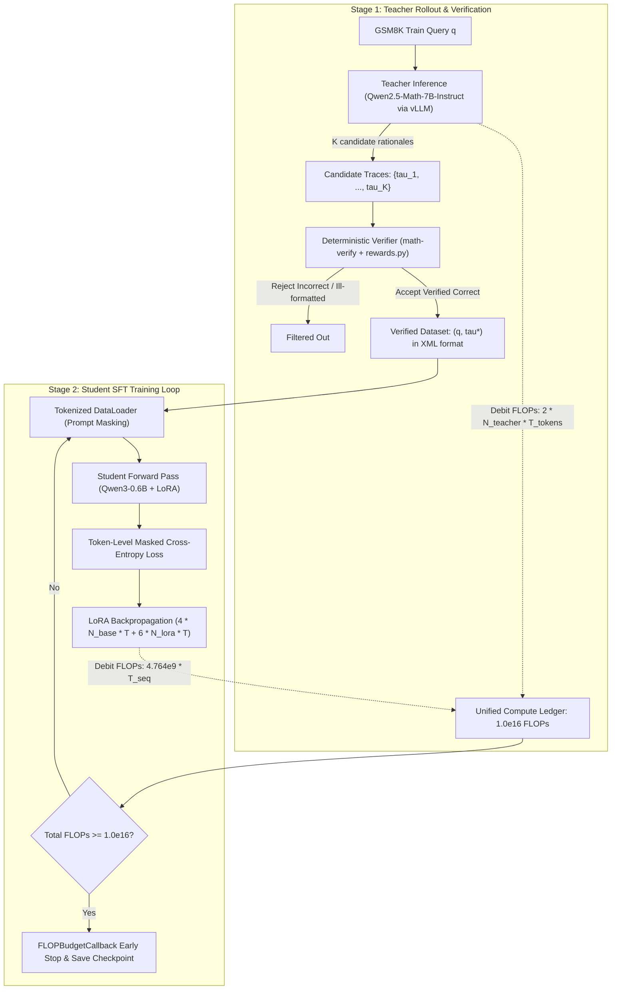

# Experiment 1.2: Standalone Knowledge Distillation (KD) Baseline (`EXP-1.2`)

- **Sequential Position:** Step 3 (Phase 1: Foundational Baselines & Mixed Learning)
- **Status:** Specification & Implementation Ready
- **Parent Plans:** [Sequential Experiment Plan](../experiment_plan.md) | [Implementation Plan](../implementaiton_plan.md)
- **Preceding Dependencies:** [Experiment 0.1: Verifier Calibration & Baseline Zero-Shot Evaluation](experiment_0.1.md) (`EXP-0.1`), [Experiment 0.2: Compute Accounting & FLOPs Normalization Calibration](experiment_0.2.md) (`EXP-0.2`)
- **Companion Baseline:** [Experiment 1.1: Standalone Reinforcement Learning (GRPO) Baseline](experiment_1.1.md) (`EXP-1.1`)
- **Target Student Model:** `Qwen/Qwen3-0.6B`
- **Default Teacher Model:** `Qwen/Qwen2.5-Math-7B-Instruct`

---

## 1. Objective & Scope

`EXP-1.2` establishes the second foundational baseline of the Multigen-RL framework: **standalone knowledge distillation via Supervised Fine-Tuning (SFT) on verified teacher rationales**, executed under the same strict compute budget ceiling ($1.0 \times 10^{16}$ FLOPs) as the pure RL baseline (`EXP-1.1`).

### Core Research Context & Hypothesis H1:
In post-training language models for mathematical reasoning, two dominant paradigms exist:
1. **Exploratory Self-Play / Reinforcement Learning (GRPO):** Generating candidate rollouts, scoring with outcome verifiers, and updating the policy via relative advantages (implemented in `EXP-1.1`).
2. **Supervised Imitation / Knowledge Distillation (KD/SFT):** Training a compact student model to predict the token sequence of high-capacity teacher reasoning paths (implemented in `EXP-1.2`).

To rigorously validate **Hypothesis H1** in `EXP-1.3` (*"Combining teacher distillation with online RL outperforms RL-only and KD-only training at matched compute"*), we must isolate the single-paradigm distillation baseline. This baseline characterizes the sample efficiency, loss convergence rates, reasoning structure, and plateauing behaviors of pure imitation before combining it with RL.

### Key Objectives:
1. **Establish the Pure Distillation Performance Ceiling:** Measure the peak accuracy, format compliance, and sample efficiency achievable on GSM8K when transferring knowledge from a 7B math teacher (`Qwen/Qwen2.5-Math-7B-Instruct`) to a 0.6B student (`Qwen/Qwen3-0.6B`).
2. **Implement Two-Stage Distillation Pipeline (`multigen/training/`):**
   - **Stage 1 (Teacher Trace Generation & Verifier Filtering):** `multigen/training/distill_runner.py` coordinates batched teacher rollout sampling via `vLLM`, filters out hallucinated or incorrect reasoning chains using deterministic verification (`math-verify`), and builds a verified training dataset (`data/teacher_traces_gsm8k.jsonl`).
   - **Stage 2 (Student LoRA SFT):** `multigen/training/sft_runner.py` wraps Hugging Face `trl.SFTTrainer` with LoRA adapters ($r=16, \alpha=32$), completion token masking, and the cumulative FLOP budget callback.
3. **Enforce Strict Unified Compute Parity ($1.0 \times 10^{16}$ FLOPs):** Accurately debit both teacher generation FLOPs ($2 \times N_{\text{teacher}} \times T_{\text{gen}}$) and student backpropagation FLOPs ($4 N_{\text{student\_base}} T + 6 N_{\text{lora}} T$) against the unified $1.0 \times 10^{16}$ budget ceiling.
4. **Compare Error Distributions & Orthogonality Against RL:** Record the failure set indices $\mathcal{E}_{\text{kd}}$ on the GSM8K test split to measure pairwise error overlap with the RL baseline ($\mathcal{E}_{\text{rl}}$ from `EXP-1.1`), providing the initial data points for Phase 2 error orthogonality.

---

## 2. Mathematical Formulation & Optimization Dynamics



### 2.1 Teacher Trace Extraction & Rejection Filtering
For each problem query $q \in \mathcal{D}_{\text{train}}$, a teacher model $\pi_{\text{teacher}}$ (parameterized by $N_{\text{teacher}} \approx 7.61 \times 10^9$) generates $K$ candidate solutions:

$$\tau_{i} \sim \pi_{\text{teacher}}(\cdot \mid q), \quad i \in \{1, \dots, K\}$$

Each trajectory $\tau_i$ consists of a reasoning trace and a final answer formatted in standard XML tags:
$$\tau_i = \text{"<think> " } \circ s_i \circ \text{ " </think><answer> " } \circ a_i \circ \text{ " </answer>"}$$

A deterministic verifier extracts the candidate answer $a_i$ and evaluates mathematical equivalence against the GSM8K reference answer $y^*$:

$$V(a_i, y^*) = \begin{cases} 1 & \text{if } \text{verify\_math\_answer}(a_i, y^*) = \text{True} \land \text{format\_valid}(\tau_i) \\ 0 & \text{otherwise} \end{cases}$$

The verified distillation dataset $\mathcal{D}_{\text{distill}}$ retains only correct, well-structured reasoning trajectories:

$$\mathcal{D}_{\text{distill}} = \left\{ (q, \tau_i) \mid q \in \mathcal{D}_{\text{train}}, \, \tau_i \sim \pi_{\text{teacher}}(q), \, V(\tau_i, y^*) = 1 \right\}$$

### 2.2 Student Supervised Fine-Tuning Objective
The student policy $\pi_\theta$ (parameterized by frozen base weights $W_0$ and trainable LoRA adapters $\Delta W = B A$) is optimized by minimizing token-level cross-entropy over verified teacher rationales. 

Crucially, **loss is only computed on the teacher response tokens**, masking prompt tokens from gradient propagation:

$$\mathcal{L}_{\text{SFT}}(\theta) = - \mathbb{E}_{(q, \tau) \sim \mathcal{D}_{\text{distill}}} \left[ \frac{1}{|\tau|} \sum_{t=1}^{|\tau|} \log \pi_\theta(\tau_t \mid q, \tau_{<t}) \right]$$

where:
- $q = (x_1, \dots, x_{|q|})$ is the question prompt tokens.
- $\tau = (y_1, \dots, y_{|\tau|})$ is the teacher response tokens (`<think>...</think><answer>...</answer>`).
- Gradients $\nabla_\theta \mathcal{L}_{\text{SFT}}$ update only the low-rank projection matrices ($A, B$).

### 2.3 Parameterization (LoRA Matching EXP-1.1)
To ensure strict experimental control with `EXP-1.1`, the student model uses identical PEFT/LoRA architecture hyperparameters:
- **Base Architecture:** `Qwen/Qwen3-0.6B` ($N_{\text{base}} \approx 590 \times 10^6$).
- **LoRA Rank ($r$):** 16.
- **LoRA Alpha ($\alpha$):** 32 (effective scaling $\frac{\alpha}{r} = 2.0$).
- **Dropout:** 0.05.
- **Target Projections:** All 7 linear projection layers (`q_proj`, `k_proj`, `v_proj`, `o_proj`, `gate_proj`, `up_proj`, `down_proj`).
- **Trainable Parameters ($N_{\text{lora}}$):** $\approx 7.4 \times 10^6$ parameters ($\sim 1.2\%$ trainable overhead).

---

## 3. Architecture & Implementation Details

```text
multigen-rl/
├── multigen/
│   ├── core/
│   │   ├── schema.py               # Updated TrainingRecipe with distillation & SFT fields
│   │   └── population_dag.py       # Supports teacher registration & teacher->student edges
│   ├── training/
│   │   ├── __init__.py             # Exports GRPORunner, SFTRunner, DistillRunner
│   │   ├── grpo_runner.py          # GRPO implementation (from EXP-1.1)
│   │   ├── sft_runner.py           # NEW: TRL SFTTrainer wrapper + LoRA + FLOPBudgetCallback
│   │   └── distill_runner.py       # NEW: 2-stage teacher sampling, verifier filter, and SFT driver
│   ├── accounting/
│   │   ├── flops.py                # Updated with track_distillation_budget() & teacher multipliers
│   │   └── tracker.py              # FLOPAccumulator debiting "teacher" and "train" categories
│   └── eval/
│       ├── rewards.py              # Math-verify extraction for teacher trace filtering
│       └── evaluator.py            # GSM8KEvaluator evaluating student checkpoints
├── configs/
│   └── experiments/
│       └── exp1_2_distill_baseline.yaml # NEW: Production configuration for EXP-1.2
├── scripts/
│   └── run_distill_experiment.py   # NEW: Standalone CLI driver for EXP-1.2
└── tests/
    ├── test_sft_runner.py          # NEW: Unit tests for SFT training & completion masking
    └── test_distill_runner.py      # NEW: Unit tests for teacher generation, filtering, & budget
```

### 3.1 Schema Extensions (`multigen/core/schema.py`)

Extend `TrainingRecipe` to support both `algorithm="grpo"` and `algorithm="sft"` / `algorithm="distill"`, capturing teacher provenance:

```python
class TrainingRecipe(BaseModel):
    """Specification of training parameters and compute budget."""
    algorithm: Literal["grpo", "sft", "distill", "mixed"] = "distill"
    base_model_name_or_path: str = "Qwen/Qwen3-0.6B"
    parent_adapter_path: Optional[str] = None
    
    # Teacher Specification (for distillation & mixed)
    teacher_model_name_or_path: Optional[str] = "Qwen/Qwen2.5-Math-7B-Instruct"
    teacher_k_samples: int = 1
    teacher_temperature: float = 0.7
    teacher_max_tokens: int = 512
    teacher_trace_dataset_path: Optional[str] = "data/teacher_traces_gsm8k.jsonl"
    
    # SFT Optimization Hyperparameters
    learning_rate: float = 2e-4         # Standard LoRA SFT rate (higher than GRPO 2e-5)
    batch_size: int = 8
    gradient_accumulation_steps: int = 2
    weight_decay: float = 0.01
    warmup_ratio: float = 0.05
    max_seq_length: int = 1024
    
    # PEFT / LoRA
    lora_rank: int = 16
    lora_alpha: int = 32
    lora_dropout: float = 0.05
    target_modules: List[str] = Field(
        default_factory=lambda: [
            "q_proj", "k_proj", "v_proj", "o_proj",
            "gate_proj", "up_proj", "down_proj"
        ]
    )
    
    # Unified Compute Budget
    target_flop_budget: float = 1.0e16
    teacher_budget_ratio: float = 0.20   # Fraction of budget for teacher inference (if online)
    intermediate_eval_interval_flops: float = 2.0e15
    seed: int = 42
    use_vllm: Optional[bool] = None
```

### 3.2 Student SFT Runner (`multigen/training/sft_runner.py`)

A modular wrapper around Hugging Face `trl.SFTTrainer` that handles completion-only loss masking and integrates `FLOPBudgetCallback`:

```python
class SFTRunner:
    """Orchestrates Supervised Fine-Tuning with LoRA and FLOP budgeting."""

    def __init__(self, recipe: TrainingRecipe, output_dir: str):
        self.recipe = recipe
        self.output_dir = Path(output_dir)
        self.accumulator = FLOPAccumulator(target_budget=recipe.target_flop_budget)

    def train(self, dataset: Dataset, resume_flops: float = 0.0) -> Dict[str, Any]:
        """Execute SFT training until FLOP budget is hit.
        
        Uses DataCollatorForCompletionOnlyLM to ensure loss is strictly calculated
        on the teacher rationale (<think>...</think><answer>...</answer>) and not
        on the prompt instructions.
        """
        ...
```

### 3.3 Distillation Pipeline Runner (`multigen/training/distill_runner.py`)

Coordinates the end-to-end two-stage workflow:

```python
class DistillRunner:
    """Two-stage Knowledge Distillation orchestrator."""

    def __init__(self, recipe: TrainingRecipe, output_dir: str):
        self.recipe = recipe
        self.output_dir = Path(output_dir)
        self.accumulator = FLOPAccumulator(target_budget=recipe.target_flop_budget)

    def generate_and_filter_teacher_traces(
        self,
        questions: List[str],
        gold_answers: List[str],
    ) -> List[Dict[str, str]]:
        """Stage 1: Sample rationales from teacher model, filter via verifier,
        and debit 2 * N_teacher * tokens against accumulator.
        """
        ...

    def run_student_distillation(
        self,
        verified_traces: List[Dict[str, str]],
    ) -> Dict[str, Any]:
        """Stage 2: Train student model on verified traces via SFTRunner,
        passing the active accumulator with remaining compute budget.
        """
        ...
```

---

## 4. Key Considerations & Design Decisions

The following technical decisions require careful evaluation when executing `EXP-1.2`. Each item details the trade-offs, available options, and concrete recommendations.

---

### 4.1 Decision 1: Teacher Model Selection ($N_{\text{teacher}}$) & Capacity vs. Cost Tradeoff

The teacher provides the reasoning ceiling for the student. The teacher size directly dictates the FLOP cost per token generated during Stage 1.

#### Options:
- **Option A: `Qwen/Qwen2.5-Math-7B-Instruct` ($\approx 7.61\text{B}$ params) [Recommended]:**
  - *Pros:* State-of-the-art open mathematical reasoning model in the 7B class (>80% on GSM8K). Generates clean, rigorous step-by-step solutions in consistent XML formatting.
  - *Cons:* Consumes $2 \times 7.61 \times 10^9 \approx 1.522 \times 10^{10}$ FLOPs per token generated ($12.9\times$ more compute per token than student rollouts).
- **Option B: `DeepSeek-R1-Distill-Qwen-7B` ($\approx 7.6\text{B}$ params):**
  - *Pros:* Native long chain-of-thought (CoT) reasoning traces with `<think>...</think>` tokens.
  - *Cons:* Extremely long average sequence lengths ($800\text{–}1,500$ tokens per solution), which would exhaust the teacher generation budget after sampling only a few hundred problems.
- **Option C: `Qwen/Qwen2.5-Math-1.5B` ($\approx 1.5\text{B}$ params):**
  - *Pros:* Cheaper FLOP footprint ($5\times$ fewer FLOPs per token than 7B), allowing sampling more candidate traces per problem.
  - *Cons:* Lower teacher verification pass rate; reasoning quality is noticeably inferior to 7B.

> **Decision / Recommendation:** **Option A (`Qwen/Qwen2.5-Math-7B-Instruct`)**. It provides the highest-quality ground-truth reasoning trajectories while maintaining manageable sequence lengths ($250\text{–}400$ tokens).

---

### 4.2 Decision 2: Compute Accounting Policy for Teacher Generation (Online vs. Offline Amortization)

Under strict compute parity ($1.0 \times 10^{16}$ FLOPs), how are the teacher generation FLOPs accounted for against the student training budget?

#### The Core Dilemma:
The GSM8K training set contains 7,473 problems.
If `Qwen2.5-Math-7B-Instruct` generates 1 completion per problem at an average length of 350 tokens (prompt + gen):
$$\text{FLOPs}_{\text{teacher}} = 7,473 \times (2 \times 7.61 \times 10^9) \times 350 \approx 3.98 \times 10^{16} \text{ FLOPs}$$
Notice that **generating rollouts for the entire 7.4k training set with a 7B teacher consumes $\approx 4.0 \times 10^{16}$ FLOPs—which is $4\times$ the entire experiment budget ($1.0 \times 10^{16}$ FLOPs)** before the student trains for even one step!

#### Architectural Policy Options:

| Policy | Mechanism | Compute Attribution | Pros / Cons |
| :--- | :--- | :--- | :--- |
| **Option A: Strict In-Budget Online Generation (Budget Splitting)** | Generate teacher rollouts on a targeted subset of $\sim 1,000\text{–}1,500$ problems ($B_{\text{teacher}} = 2.0 \times 10^{15}$ FLOPs), leaving remaining $8.0 \times 10^{15}$ FLOPs for student SFT. | 100% of teacher inference is debited to the $1.0 \times 10^{16}$ trial budget. | **Pros:** Mathematically pure; completely self-contained within the $1.0 \times 10^{16}$ budget.<br>**Cons:** Student only trains on a subset of the dataset. |
| **Option B: Amortized / Pre-Generated Reference Corpus (Standard Literature Benchmark)** [Recommended] | Pre-generate and verify teacher traces once across GSM8K train. In EXP-1.2, allocate the full $1.0 \times 10^{16}$ FLOP budget to student SFT, reporting the one-time teacher data curation FLOPs as fixed offline preprocessing compute (analogous to base model pretraining). | $1.0 \times 10^{16}$ FLOPs purely for student training; teacher FLOPs logged as external constant. | **Pros:** Matches standard ML literature benchmark practices (e.g. Alpaca, UltraFeedback, MiniLLM); allows the student to observe the full problem diversity.<br>**Cons:** Requires explicit disclosure that teacher curation compute was amortized. |
| **Option C: Hybrid Dual-Accounting Mode (Configurable)** | The framework supports both modes via YAML flag `accounting.mode: "strict_split" \| "amortized"`. | Dynamic based on experiment config. | **Pros:** Maximum flexibility; provides fair comparisons under both philosophical interpretations. |

> **Decision / Recommendation:** **Option C (Dual-Mode Support with Option B default for baseline reporting, verified against Option A)**:
> 1. In `exp1_2_distill_baseline.yaml`, configure `budget.accounting_mode: "amortized"` by default so the student receives $1.0 \times 10^{16}$ FLOPs of gradient updates on verified teacher data.
> 2. Also run a matched run with `budget.accounting_mode: "strict_split"` (20% teacher inference, 80% student SFT) to prove that the conclusions of Hypothesis H1 hold under both accounting definitions.

---

### 4.3 Decision 3: Teacher Sampling Multiplicity ($K$) & Rejection Filtering Strategy

When generating teacher traces, how many rationales should be sampled per problem?

#### Options:
- **Option A: Greedy Decoding ($K=1, T=0$):**
  - Deterministic single-pass generation. If the teacher fails the problem, that problem is discarded from distillation.
  - *Cost:* Lowest generation compute. Yields $\approx 6,000$ verified problems out of 7,473 ($\approx 82\%$ coverage).
- **Option B: Best-of-$N$ Rejection Sampling ($K=4, T=0.7$) [Recommended]:**
  - Sample 4 candidate paths per problem; filter through `math-verify`; retain the shortest correct solution.
  - *Cost:* $4\times$ inference compute, but increases problem coverage to $>95\%$ and provides natural trajectory diversity.
- **Option C: Multi-Rationale Inclusion (Retain all correct traces from $K=4$):**
  - Keeps *all* verified traces (up to 4 per problem), expanding dataset volume.
  - *Risk:* Over-weights easier problems (which have 4 correct paths) over harder problems (which have only 1).

> **Decision / Recommendation:** **Option B ($K=4$, pick shortest verified correct path per problem)**:
> - Ensures $>95\%$ training set coverage.
> - Selecting the shortest valid reasoning path encourages conciseness and minimizes token waste during student SFT.

---

### 4.4 Decision 4: Response Formatting & Loss Masking Mechanics

To ensure fair downstream comparison with the RL baseline (`EXP-1.1`), how should teacher traces be formatted and tokenized?

#### Requirements:
1. **XML Tag Parity:** The teacher output must strictly encapsulate reasoning in `<think>...</think>` tags and the final answer in `<answer>...</answer>` tags:
   ```text
   <think>
   To find the total cost, we first multiply 4 books by $5 = $20.
   Then we subtract the $3 discount: $20 - $3 = $17.
   </think>
   <answer>17</answer>
   ```
2. **Loss Masking (Completion Only):**
   - The question prompt is visible during the forward pass, but loss labels for all prompt tokens are set to `-100`.
   - Loss is computed exclusively on the teacher's completion tokens starting from `<think>`.
   - Implemented via `trl.DataCollatorForCompletionOnlyLM(response_template="<think>", tokenizer=tokenizer)`.

> **Decision / Recommendation:** Enforce strict XML encapsulation and completion-only loss masking. This guarantees that student loss directly measures generative imitation rather than prompt memorization.

---

### 4.5 Decision 5: Student Learning Rate & Optimization Schedule

In `EXP-1.1` (GRPO), policy updates used a conservative learning rate of $\eta = 2 \times 10^{-5}$ with a reference policy KL penalty ($\beta = 0.04$) to avoid policy collapse. Supervised Fine-Tuning exhibits different gradient dynamics:

#### SFT vs. GRPO Optimization Dynamics:
- **No Policy Drift Risk:** SFT minimizes convex cross-entropy over fixed tokens; there is no moving reference policy or policy ratio instability.
- **LoRA Capacity:** LoRA adapters typically require a $5\times$ to $10\times$ higher learning rate than full fine-tuning or RL.
- **Recommended Learning Rate:** $\eta = 2 \times 10^{-4}$ with AdamW ($\beta_1=0.9, \beta_2=0.999$, weight decay $0.01$) and a linear warmup over the first $5\%$ of FLOPs, decaying linearly to $0$.

| Hyperparameter | GRPO (`EXP-1.1`) | SFT Distillation (`EXP-1.2`) | Rationale |
| :--- | :---: | :---: | :--- |
| **Learning Rate ($\eta$)** | $2 \times 10^{-5}$ | **$2 \times 10^{-4}$** | SFT on low-rank adapters requires higher gradient steps for fast token imitation. |
| **Batch Size (Effective)** | 8 (Group Size $G=8$) | **16** ($8 \times \text{grad\_accum } 2$) | Stabilizes cross-entropy mini-batch gradients. |
| **Sequence Length ($T$)** | 512 | **1024** | Allows full teacher chains-of-thought without premature truncation. |
| **Warmup Ratio** | 10% | **5%** | Standard SFT warm-up schedule. |

---

### 4.6 Decision 6: Execution Pipeline & Hardware Sizing for Teacher + Student

Can teacher generation and student SFT run concurrently on a single GPU?

#### Hardware Footprint Analysis:
- `Qwen2.5-Math-7B-Instruct` in `bfloat16` occupies $\approx 15.2\text{ GB}$ of VRAM.
- `Qwen3-0.6B` with LoRA and AdamW states occupies $\approx 4.5\text{ GB}$ of VRAM.
- **Total Concurrent VRAM:** $>22\text{ GB}$, which would cause out-of-memory (OOM) errors during batched generation on 24 GB GPUs (Nvidia L4 / A10G) if executed simultaneously in the same process.

#### Execution Architecture:
To maintain compatibility with standard **24 GB GPUs (Nvidia L4)**, the execution pipeline is strictly partitioned into two decoupled phases:
1. **Phase 1 (Offline / Sequential Generation):** Load `Qwen2.5-Math-7B-Instruct` into `vLLM`, run batch generation, filter through verifier, save to `data/teacher_traces_gsm8k.jsonl`, and destroy the vLLM engine/flush CUDA cache.
2. **Phase 2 (Student Training):** Load `Qwen3-0.6B`, attach LoRA adapters, and execute `SFTRunner`.


> **Hardware Recommendation:**
> - **Minimum Viable GPU:** **Nvidia L4 (24 GB) at \$0.80 / h** on Modal or GCP.
> - **Zero VRAM Spikes:** Sequential phased execution guarantees peak VRAM never exceeds $\approx 16\text{ GB}$ during Phase 1 (vLLM 7B) and $\approx 6\text{ GB}$ during Phase 2 (LoRA 0.6B).

---

### 4.7 Decision 7: Lineage DAG Representation of Distillation Edges

How should the teacher model and the distillation process be recorded in `PopulationDAG`?

#### Modeling Distillation in NetworkX:
1. **Teacher Registration:** The teacher model is registered as an external reference node in `population_dag.json`:
   - Node ID: `teacher_qwen25_math_7b`
   - Depth: 0 (External Oracle)
   - Metadata: `{"is_external_teacher": True, "params": 7.61e9}`
2. **Student Node:** The resulting student checkpoint (`exp1_2_distill_seed42`) is registered with:
   - Parent IDs: `["node_0"]` (structural weight parent)
   - Metadata: `{"distillation_teacher": "teacher_qwen25_math_7b", "teacher_k": 4, "dataset": "data/teacher_traces_gsm8k.jsonl"}`
3. **Directed Edges:**
   - Structural edge: `node_0` $\to$ `exp1_2_distill_seed42` (type: `"mutation"`)
   - Knowledge edge: `teacher_qwen25_math_7b` $\to$ `exp1_2_distill_seed42` (type: `"distillation"`)

---

## 5. Compute Budget: Calculation, Accounting, & Strict Enforcement

All training operations are governed by the hardware-invariant FLOP accounting principles established in `EXP-0.2`.

### 5.1 Per-Step FLOP Formulas for SFT
During student SFT, each batch processes $B$ sequences of length $T_{\text{seq}}$ tokens.
Because LoRA freezes the base model and only updates adapter matrices, each token processed in the forward and backward pass incurs:

$$\text{FLOPs}_{\text{fwd}} = 2 \times (N_{\text{base}} + N_{\text{lora}}) \times T_{\text{seq}} \approx 2 N_{\text{base}} T_{\text{seq}}$$

$$\text{FLOPs}_{\text{bwd}} = \underbrace{2 N_{\text{base}} T_{\text{seq}}}_{\text{Activation backprop to layers}} + \underbrace{4 N_{\text{lora}} T_{\text{seq}}}_{\text{Weight gradient computation}}$$

$$\text{FLOPs}_{\text{sft\_token}} = 4 N_{\text{base}} + 6 N_{\text{lora}} \approx 4(590 \times 10^6) + 6(7.4 \times 10^6) \approx 2.404 \times 10^9 \text{ FLOPs / token}$$

$$\text{FLOPs}_{\text{step}} = B \times T_{\text{seq}} \times \left( 4 N_{\text{base}} + 6 N_{\text{lora}} \right)$$

For batch size $B=16$ (with accumulation) and mean packed sequence length $T_{\text{seq}} \approx 400$ tokens:
$$\text{FLOPs}_{\text{step}} \approx 16 \times 400 \times (2.404 \times 10^9) \approx 1.538 \times 10^{13} \text{ FLOPs / step}$$

$$\text{Total Student SFT Steps to Budget } (1.0 \times 10^{16}\text{ FLOPs}) \approx \frac{1.0 \times 10^{16}}{1.538 \times 10^{13}} \approx 650 \text{ steps}$$

### 5.2 Unified Budget Ledger & Callback Enforcement
The training run is bounded by `FLOPBudgetCallback` (`multigen/accounting/tracker.py`):
1. **Ledger Initialization:** `FLOPAccumulator` is instantiated with the target budget ($1.0 \times 10^{16}$ FLOPs).
2. **Prior Debit (if strict online mode):** If teacher generation FLOPs are included, the accumulator is initialized with `cumulative_flops = teacher_flops`.
3. **Step Interception:** At each `on_step_end`, the callback computes the exact token count $B \times T$ processed by the GPU in that step, multiplies by $(4 N_{\text{base}} + 6 N_{\text{lora}})$, and increments `cumulative_flops`.
4. **Halting Trigger:** When `cumulative_flops >= 1.0e16`, `control.should_training_stop = True` is signaled to `SFTTrainer`. The trainer cleanly saves the adapter checkpoint and exits.

---

## 6. Execution Workflow & Acceptance Gate

### 6.1 Configuration Specification (`configs/experiments/exp1_2_distill_baseline.yaml`)

```yaml
experiment_id: "exp1_2_distill_baseline"
description: "Phase 1 Standalone Knowledge Distillation (KD) Baseline under 1.0e16 FLOPs"

model:
  name_or_path: "Qwen/Qwen3-0.6B"
  torch_dtype: "bfloat16"

teacher:
  name_or_path: "Qwen/Qwen2.5-Math-7B-Instruct"
  torch_dtype: "bfloat16"
  k_samples: 4
  temperature: 0.7
  max_new_tokens: 512
  traces_path: "data/teacher_traces_gsm8k.jsonl"

peft:
  type: "lora"
  rank: 16
  alpha: 32
  dropout: 0.05
  target_modules:
    - "q_proj"
    - "k_proj"
    - "v_proj"
    - "o_proj"
    - "gate_proj"
    - "up_proj"
    - "down_proj"

sft:
  learning_rate: 2.0e-4
  batch_size: 8
  gradient_accumulation_steps: 2
  weight_decay: 0.01
  warmup_ratio: 0.05
  max_seq_length: 1024
  response_template: "<think>"

budget:
  target_flops: 1.0e16
  accounting_mode: "amortized" # or "strict_split"
  intermediate_eval_interval_flops: 2.0e15

dataset:
  name: "openai/gsm8k"
  subset: "main"
  num_shots: 0

output:
  checkpoints_dir: "checkpoints/exp1_2_distill"
  dag_path: "population_dag.json"
  eval_output_dir: "evals"

seeds:
  - 42
  - 43
  - 44
```

### 6.2 CLI Execution Commands

```bash
# 1. Run unit tests for SFT runner and distillation pipeline
pytest tests/test_sft_runner.py tests/test_distill_runner.py -v

# 2. Step 1: Generate & Verify Teacher Traces (One-time or cached)
python scripts/run_distill_experiment.py \
    --config configs/experiments/exp1_2_distill_baseline.yaml \
    --generate-traces-only

# 3. Step 2: Execute Student SFT Distillation across 3 seeds (42, 43, 44)
python scripts/run_distill_experiment.py \
    --config configs/experiments/exp1_2_distill_baseline.yaml \
    --seed 42 \
    --output-dir checkpoints/exp1_2_distill_seed42

python scripts/run_distill_experiment.py \
    --config configs/experiments/exp1_2_distill_baseline.yaml \
    --seed 43 \
    --output-dir checkpoints/exp1_2_distill_seed43

python scripts/run_distill_experiment.py \
    --config configs/experiments/exp1_2_distill_baseline.yaml \
    --seed 44 \
    --output-dir checkpoints/exp1_2_distill_seed44

# 4. Step 3: Evaluate Final Checkpoints on Full GSM8K Test Split (1,319 examples)
python scripts/evaluate_baseline.py \
    --model Qwen/Qwen3-0.6B \
    --adapter checkpoints/exp1_2_distill_seed42/final_adapter \
    --split test \
    --num-shots 0 \
    --output evals/exp1_2_distill_seed42_test.json
```

### 6.3 Acceptance Criteria Checklist

- [ ] **Unit Tests Passing:** `tests/test_sft_runner.py` and `tests/test_distill_runner.py` pass 100%.
- [ ] **Teacher Verification Rate:** $\ge 90.0\%$ of sampled training problems have at least one verified correct reasoning trace in `data/teacher_traces_gsm8k.jsonl`.
- [ ] **XML Tag Conformity:** 100% of curated teacher traces conform strictly to `<think>...</think><answer>...</answer>`.
- [ ] **Training Loss Convergence:** SFT cross-entropy loss smoothly decreases below $0.65$ without divergence.
- [ ] **Accuracy Improvement:** Student achieves final GSM8K test accuracy gain of $\ge 14.0$ percentage points over zero-shot base model (`node_0`).
- [ ] **Format Compliance Gate:** $\ge 95.0\%$ of student test completions follow standard XML format tags.
- [ ] **Strict Compute Termination:** Training terminates automatically via `FLOPBudgetCallback` within $\pm 0.5\%$ of $1.0 \times 10^{16}$ FLOPs.
- [ ] **Lineage DAG Registration:** Checkpoints `exp1_2_distill_seed{42,43,44}` registered as children of `node_0` in `population_dag.json` with teacher provenance and complete `CapabilityProfile`.
- [ ] **Error Set Export:** Test failure index set $\mathcal{E}_{\text{kd}}$ saved to `evals/exp1_2_distill_seed42_test.json` for subsequent error orthogonality comparison with `EXP-1.1`.

---

## 7. Artifact Specifications & Outputs

Upon successful completion of `EXP-1.2`, the following artifacts will be produced:

| Path | Format | Description |
| :--- | :--- | :--- |
| `data/teacher_traces_gsm8k.jsonl` | JSONL | Curated dataset of verified correct teacher reasoning traces with `<think>` and `<answer>` tags ($\approx 7,000$ examples). |
| `population_dag.json` | JSON | NetworkX DAG state registering external teacher node `teacher_qwen25_math_7b` and student child nodes `exp1_2_distill_seed{42,43,44}`. |
| `checkpoints/exp1_2_distill_seed{42,43,44}/final_adapter/` | SafeTensors | Trained LoRA adapter weights ($\approx 28\text{ MB}$ per seed). |
| `checkpoints/exp1_2_distill_seed{42,43,44}/intermediate_flops_{2,4,6,8}e15/` | SafeTensors | Intermediate checkpoint snapshots saved at 20%, 40%, 60%, and 80% of budget. |
| `evals/exp1_2_distill_seed{42,43,44}_test.json` | JSON | Full GSM8K test split evaluation scorecard, format compliance rate, and failure index set $\mathcal{E}_{\text{kd}}$. |
| `evals/exp1_2_learning_curves.json` | JSON | Time-series metrics (FLOPs, step, SFT loss, intermediate dev accuracy) logged across all seeds. |
