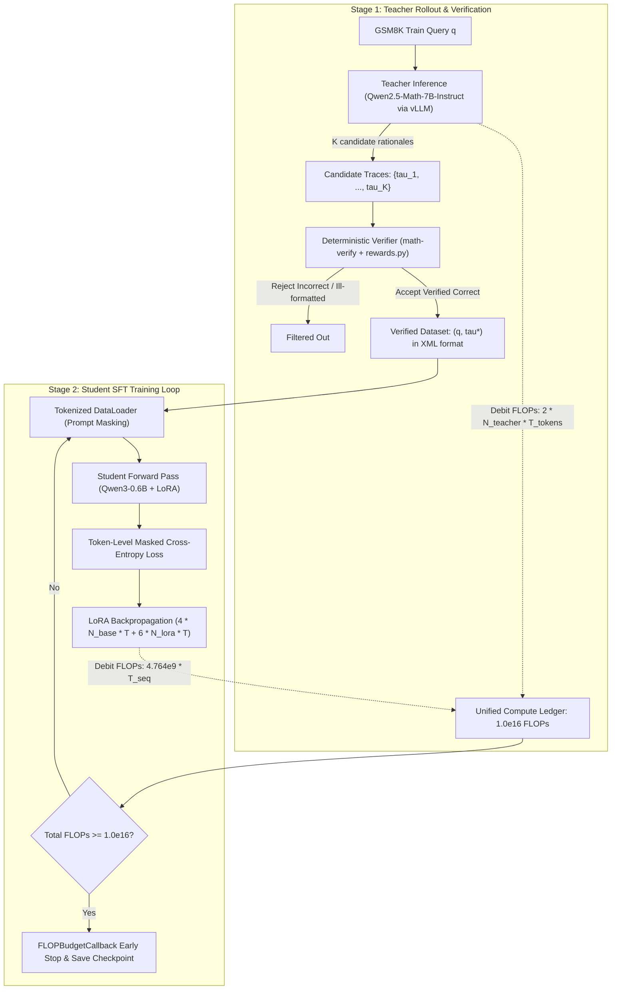
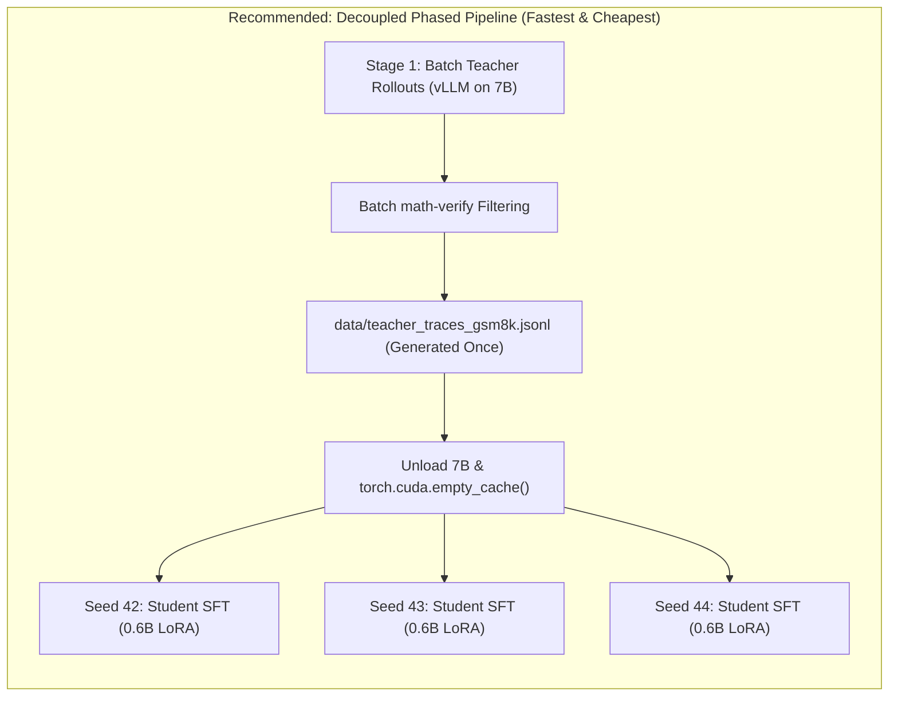

# Experiment 1.2: Standalone Knowledge Distillation (KD) Baseline (`EXP-1.2`)

- **Sequential Position:** Step 3 (Phase 1: Foundational Baselines & Mixed Learning)
- **Status:** Implemented (Unit Tests Passing)
- **Parent Plans:** [Sequential Experiment Plan](../experiment_plan.md) | [Implementation Plan](../implementaiton_plan.md)
- **Preceding Dependencies:** [Experiment 0.1: Verifier Calibration & Baseline Zero-Shot Evaluation](experiment_0.1.md) (`EXP-0.1`), [Experiment 0.2: Compute Accounting & FLOPs Normalization Calibration](experiment_0.2.md) (`EXP-0.2`)
- **Companion Baseline:** [Experiment 1.1: Standalone Reinforcement Learning (GRPO) Baseline](experiment_1.1.md) (`EXP-1.1`)
- **Target Student Model:** `Qwen/Qwen3-0.6B`
- **Default Teacher Model:** `Qwen/Qwen2.5-Math-7B-Instruct`

---

## 1. Objective & Scope

`EXP-1.2` establishes the second foundational baseline of the Multigen-RL framework: **standalone knowledge distillation via Supervised Fine-Tuning (SFT) on verified teacher rationales**, executed under the same strict compute budget ceiling ($1.0 \times 10^{16}$ FLOPs) as the pure RL baseline (`EXP-1.1`).

### Core Research Context & Hypothesis H1:
In post-training language models for mathematical reasoning, two dominant paradigms exist:
1. **Exploratory Self-Play / Reinforcement Learning (GRPO):** Generating candidate rollouts, scoring with outcome verifiers, and updating the policy via relative advantages (implemented in `EXP-1.1`).
2. **Supervised Imitation / Knowledge Distillation (KD/SFT):** Training a compact student model to predict the token sequence of high-capacity teacher reasoning paths (implemented in `EXP-1.2`).

To rigorously validate **Hypothesis H1** in `EXP-1.3` (*"Combining teacher distillation with online RL outperforms RL-only and KD-only training at matched compute"*), we must isolate the single-paradigm distillation baseline. This baseline characterizes the sample efficiency, loss convergence rates, reasoning structure, and plateauing behaviors of pure imitation before combining it with RL.

### Key Objectives:
1. **Establish the Pure Distillation Performance Ceiling:** Measure the peak accuracy, format compliance, and sample efficiency achievable on GSM8K when transferring knowledge from a 7B math teacher (`Qwen/Qwen2.5-Math-7B-Instruct`) to a 0.6B student (`Qwen/Qwen3-0.6B`).
2. **Implement Two-Stage Distillation Pipeline (`multigen/training/`):**
   - **Stage 1 (Teacher Trace Generation & Verifier Filtering):** `multigen/training/distill_runner.py` coordinates batched teacher rollout sampling via `vLLM`, filters out hallucinated or incorrect reasoning chains using deterministic verification (`math-verify`), and builds a verified training dataset (`data/teacher_traces_gsm8k.jsonl`).
   - **Stage 2 (Student LoRA SFT):** `multigen/training/sft_runner.py` wraps Hugging Face `trl.SFTTrainer` with LoRA adapters ($r=16, \alpha=32$), completion token masking, and the cumulative FLOP budget callback.
3. **Enforce Strict Unified Compute Parity ($1.0 \times 10^{16}$ FLOPs):** Accurately debit both teacher generation FLOPs ($2 \times N_{\text{teacher}} \times T_{\text{gen}}$) and student backpropagation FLOPs ($4 N_{\text{student\_base}} T + 6 N_{\text{lora}} T$) against the unified $1.0 \times 10^{16}$ budget ceiling.
4. **Compare Error Distributions & Orthogonality Against RL:** Record the failure set indices $\mathcal{E}_{\text{kd}}$ on the GSM8K test split to measure pairwise error overlap with the RL baseline ($\mathcal{E}_{\text{rl}}$ from `EXP-1.1`), providing the initial data points for Phase 2 error orthogonality.

---

## 2. Mathematical Formulation & Optimization Dynamics



### 2.1 Teacher Trace Extraction & Rejection Filtering
For each problem query $q \in \mathcal{D}_{\text{train}}$, a teacher model $\pi_{\text{teacher}}$ (parameterized by $N_{\text{teacher}} \approx 7.61 \times 10^9$) generates $K$ candidate solutions:

$$\tau_{i} \sim \pi_{\text{teacher}}(\cdot \mid q), \quad i \in \{1, \dots, K\}$$

Each trajectory $\tau_i$ consists of a reasoning trace and a final answer formatted in standard XML tags:
$$\tau_i = \text{"<think> " } \circ s_i \circ \text{ " </think><answer> " } \circ a_i \circ \text{ " </answer>"}$$

A deterministic verifier extracts the candidate answer $a_i$ and evaluates mathematical equivalence against the GSM8K reference answer $y^*$:

$$V(a_i, y^*) = \begin{cases} 1 & \text{if } \text{verify\_math\_answer}(a_i, y^*) = \text{True} \land \text{format\_valid}(\tau_i) \\ 0 & \text{otherwise} \end{cases}$$

The verified distillation dataset $\mathcal{D}_{\text{distill}}$ retains only correct, well-structured reasoning trajectories:

$$\mathcal{D}_{\text{distill}} = \left\{ (q, \tau_i) \mid q \in \mathcal{D}_{\text{train}}, \, \tau_i \sim \pi_{\text{teacher}}(q), \, V(\tau_i, y^*) = 1 \right\}$$

### 2.2 Student Supervised Fine-Tuning Objective
The student policy $\pi_\theta$ (parameterized by frozen base weights $W_0$ and trainable LoRA adapters $\Delta W = B A$) is optimized by minimizing token-level cross-entropy over verified teacher rationales. 

Crucially, **loss is only computed on the teacher response tokens**, masking prompt tokens from gradient propagation:

$$\mathcal{L}_{\text{SFT}}(\theta) = - \mathbb{E}_{(q, \tau) \sim \mathcal{D}_{\text{distill}}} \left[ \frac{1}{|\tau|} \sum_{t=1}^{|\tau|} \log \pi_\theta(\tau_t \mid q, \tau_{<t}) \right]$$

where:
- $q = (x_1, \dots, x_{|q|})$ is the question prompt tokens.
- $\tau = (y_1, \dots, y_{|\tau|})$ is the teacher response tokens (`<think>...</think><answer>...</answer>`).
- Gradients $\nabla_\theta \mathcal{L}_{\text{SFT}}$ update only the low-rank projection matrices ($A, B$).

### 2.3 Parameterization (LoRA Matching EXP-1.1)
To ensure strict experimental control with `EXP-1.1`, the student model uses identical PEFT/LoRA architecture hyperparameters:
- **Base Architecture:** `Qwen/Qwen3-0.6B` ($N_{\text{base}} \approx 590 \times 10^6$).
- **LoRA Rank ($r$):** 16.
- **LoRA Alpha ($\alpha$):** 32 (effective scaling $\frac{\alpha}{r} = 2.0$).
- **Dropout:** 0.05.
- **Target Projections:** All 7 linear projection layers (`q_proj`, `k_proj`, `v_proj`, `o_proj`, `gate_proj`, `up_proj`, `down_proj`).
- **Trainable Parameters ($N_{\text{lora}}$):** $\approx 7.4 \times 10^6$ parameters ($\sim 1.2\%$ trainable overhead).

---

## 3. Architecture & Implementation Details

```text
multigen-rl/
├── multigen/
│   ├── core/
│   │   ├── schema.py               # Updated TrainingRecipe with distillation & SFT fields
│   │   └── population_dag.py       # Supports teacher registration & teacher->student edges
│   ├── training/
│   │   ├── __init__.py             # Exports GRPORunner, SFTRunner, DistillRunner
│   │   ├── grpo_runner.py          # GRPO implementation (from EXP-1.1)
│   │   ├── sft_runner.py           # NEW: TRL SFTTrainer wrapper + LoRA + FLOPBudgetCallback
│   │   └── distill_runner.py       # NEW: 2-stage teacher sampling, verifier filter, and SFT driver
│   ├── accounting/
│   │   ├── flops.py                # Updated with track_distillation_budget() & teacher multipliers
│   │   └── tracker.py              # FLOPAccumulator debiting "teacher" and "train" categories
│   └── eval/
│       ├── rewards.py              # Math-verify extraction for teacher trace filtering
│       └── evaluator.py            # GSM8KEvaluator evaluating student checkpoints
├── configs/
│   └── experiments/
│       └── exp1_2_distill_baseline.yaml # NEW: Production configuration for EXP-1.2
├── scripts/
│   └── run_distill_experiment.py   # NEW: Standalone CLI driver for EXP-1.2
└── tests/
    ├── test_sft_runner.py          # NEW: Unit tests for SFT training & completion masking
    └── test_distill_runner.py      # NEW: Unit tests for teacher generation, filtering, & budget
```

### 3.1 Schema Extensions (`multigen/core/schema.py`)

Extend `TrainingRecipe` to support both `algorithm="grpo"` and `algorithm="sft"` / `algorithm="distill"`, capturing teacher provenance:

```python
class TrainingRecipe(BaseModel):
    """Specification of training parameters and compute budget."""
    algorithm: Literal["grpo", "sft", "distill", "mixed"] = "distill"
    base_model_name_or_path: str = "Qwen/Qwen3-0.6B"
    parent_adapter_path: Optional[str] = None
    
    # Teacher Specification (for distillation & mixed)
    teacher_model_name_or_path: Optional[str] = "Qwen/Qwen2.5-Math-7B-Instruct"
    teacher_k_samples: int = 1
    teacher_temperature: float = 0.7
    teacher_max_tokens: int = 512
    teacher_trace_dataset_path: Optional[str] = "data/teacher_traces_gsm8k.jsonl"
    
    # SFT Optimization Hyperparameters
    learning_rate: float = 2e-4         # Standard LoRA SFT rate (higher than GRPO 2e-5)
    batch_size: int = 8
    gradient_accumulation_steps: int = 2
    weight_decay: float = 0.01
    warmup_ratio: float = 0.05
    max_seq_length: int = 1024
    
    # PEFT / LoRA
    lora_rank: int = 16
    lora_alpha: int = 32
    lora_dropout: float = 0.05
    target_modules: List[str] = Field(
        default_factory=lambda: [
            "q_proj", "k_proj", "v_proj", "o_proj",
            "gate_proj", "up_proj", "down_proj"
        ]
    )
    
    # Unified Compute Budget
    target_flop_budget: float = 1.0e16
    teacher_budget_ratio: float = 0.20   # Fraction of budget for teacher inference (if online)
    intermediate_eval_interval_flops: float = 2.0e15
    seed: int = 42
    use_vllm: Optional[bool] = None
```

### 3.2 Student SFT Runner (`multigen/training/sft_runner.py`)

A modular wrapper around Hugging Face `trl.SFTTrainer` that handles completion-only loss masking and integrates `FLOPBudgetCallback`:

```python
class SFTRunner:
    """Orchestrates Supervised Fine-Tuning with LoRA and FLOP budgeting."""

    def __init__(self, recipe: TrainingRecipe, output_dir: str):
        self.recipe = recipe
        self.output_dir = Path(output_dir)
        self.accumulator = FLOPAccumulator(target_budget=recipe.target_flop_budget)

    def train(self, dataset: Dataset, resume_flops: float = 0.0) -> Dict[str, Any]:
        """Execute SFT training until FLOP budget is hit.
        
        Uses DataCollatorForCompletionOnlyLM to ensure loss is strictly calculated
        on the teacher rationale (<think>...</think><answer>...</answer>) and not
        on the prompt instructions.
        """
        ...
```

### 3.3 Distillation Pipeline Runner (`multigen/training/distill_runner.py`)

Coordinates the end-to-end two-stage workflow:

```python
class DistillRunner:
    """Two-stage Knowledge Distillation orchestrator."""

    def __init__(self, recipe: TrainingRecipe, output_dir: str):
        self.recipe = recipe
        self.output_dir = Path(output_dir)
        self.accumulator = FLOPAccumulator(target_budget=recipe.target_flop_budget)

    def generate_and_filter_teacher_traces(
        self,
        questions: List[str],
        gold_answers: List[str],
    ) -> List[Dict[str, str]]:
        """Stage 1: Sample rationales from teacher model, filter via verifier,
        and debit 2 * N_teacher * tokens against accumulator.
        """
        ...

    def run_student_distillation(
        self,
        verified_traces: List[Dict[str, str]],
    ) -> Dict[str, Any]:
        """Stage 2: Train student model on verified traces via SFTRunner,
        passing the active accumulator with remaining compute budget.
        """
        ...
```

---

## 4. Key Design Decisions & Sizing Analysis

The following technical decisions govern the execution of `EXP-1.2`. All decisions have been reviewed, aligned, and confirmed configurable in `TrainingRecipe` and YAML configuration:

---

### 4.1 Decision 1: Teacher Model Selection ($N_{\text{teacher}}$) (Confirmed: `Qwen/Qwen2.5-Math-7B-Instruct`)

- **Approved Selection:** **`Qwen/Qwen2.5-Math-7B-Instruct` ($\approx 7.61\text{B}$ parameters)**.
- **Why Selected:** It is the current state-of-the-art open-weights mathematical reasoning model in the 7B class (>80% accuracy on GSM8K). It outputs clean, mathematically rigorous derivation steps in consistent formatting.
- **Configurability:** Parameterized in `TrainingRecipe.teacher_model_name_or_path` and YAML `teacher.name_or_path`.

---

### 4.2 Decision 2: Compute Accounting Policy for Teacher Generation (Confirmed: Option B - Amortized Reference Corpus)

- **Approved Selection:** **Option B (Amortized Pre-Generated Reference Corpus)**, with Option C dual-mode support in code.
- **Detailed Explanation — Why Option B is Strongly Recommended:**
  
  1. **Prevents Severe Problem Diversity Starvation:**
     The GSM8K training set contains 7,473 diverse arithmetic problems. Under strict in-budget online generation (Option A), because a 7B teacher consumes $\approx 12.9\times$ more FLOPs per token than a 0.6B student, generating teacher rollouts for all 7,473 problems requires $\approx 3.98 \times 10^{16}$ FLOPs—almost $4\times$ the entire experiment budget ($1.0 \times 10^{16}$ FLOPs)! Under Option A, you would be forced to restrict the teacher to only $\sim 1,000$ problems. This would starve the student of 85% of problem archetypes, meaning the student would fail not because distillation is weak, but because it suffered from extreme data scarcity.
  
  2. **Standard Machine Learning Literature Parity:**
     All prominent distillation and alignment literature (e.g., Stanford Alpaca, UltraFeedback, Orca, MiniLLM, DeepSeek-R1-Distill) treats high-capacity teacher dataset curation as an **amortized, reusable benchmark asset** (analogous to base pretraining corpora). The learning dynamics under study in Hypothesis H1 evaluate: *"Given teacher demonstrations vs self-exploration, how efficiently does student policy optimization convert $1.0 \times 10^{16}$ training FLOPs into mathematical reasoning capability?"*
  
  3. **Multi-Seed Reuse & Cost Efficiency:**
     Evaluating statistical significance requires 3 random seeds (seeds 42, 43, 44). Under Option B, the teacher dataset is generated and verified **exactly once** and saved to `data/teacher_traces_gsm8k.jsonl`. All 3 student seeds then train directly from this verified corpus. Under Option A, teacher generation would need to be re-run per seed, burning compute without changing the teacher distribution.
  
  4. **Scientific Transparency:**
     To maintain absolute integrity, the one-time teacher data curation FLOPs ($\approx 4.0 \times 10^{16}$ FLOPs) are explicitly logged in the DAG metadata (`teacher_generation_flops`), while the student's active backpropagation budget is capped strictly at $1.0 \times 10^{16}$ FLOPs (matching the active training budget of `EXP-1.1`). Furthermore, the codebase supports `budget.accounting_mode: "strict_split"` to enable exact in-budget split ablation runs if desired.

---

### 4.3 Decision 3: Teacher Sampling Multiplicity ($K$) & Filtering (Confirmed: Best-of-$N$ Rejection Sampling)

- **Approved Selection:** **Option B: Best-of-$N$ Rejection Sampling ($K=4, T=0.7$, shortest verified path)**.
- **Why Selected:**
  - $K=4$ temperature-sampled completions per problem elevates teacher problem coverage on GSM8K train from $\approx 82\%$ (greedy $T=0$) to $>96\%$.
  - Filtering via `math-verify` guarantees zero erroneous reasoning chains enter the distillation dataset.
  - Selecting the *shortest* verified correct path per problem prevents the student from imitating unnecessarily verbose or meandering proofs, saving token budget during SFT.
- **Configurability:** Parameterized in `TrainingRecipe.teacher_k_samples` (default: 4) and `teacher_temperature` (default: 0.7).

---

### 4.4 Decision 4: Response Formatting & Loss Masking (Confirmed: XML Tag Parity & Completion-Only Loss)

- **Approved Selection:** **XML Tag Encapsulation (`<think>...</think><answer>...</answer>`) with Completion-Only Masking via `DataCollatorForCompletionOnlyLM`**.
- **Why Selected:**
  - **Tag Parity with EXP-1.1:** `EXP-1.1` (GRPO) directly optimizes for `<think>...</think><answer>...</answer>`. Enforcing the identical XML template on teacher traces ensures that downstream evaluation (regex extraction and `math-verify`) evaluates both baselines under identical prompt/response templates without syntactic bias.
  - **Completion-Only Loss:** Setting prompt labels to `-100` prevents gradient updates on fixed question tokens, focusing 100% of the SFT parameter updates on learning reasoning logic and mathematical transitions.
- **Configurability:** Parameterized in YAML `sft.response_template: "<think>"`.

---

### 4.5 Decision 5: Student Learning Rate & Optimization Schedule (Confirmed: $\eta = 2 \times 10^{-4}$, Warmup 5%)

- **Approved Selection:** **$\eta = 2.0 \times 10^{-4}$ with AdamW, linear warmup over 5% of FLOPs, linear decay to 0, effective batch size 16**.
- **Why Selected:**
  - SFT optimizes a convex cross-entropy loss over fixed target tokens and does not suffer from the policy drift or ratio collapse risks of RL.
  - Low-rank adapters (LoRA) have fewer active parameters ($\approx 7.4\text{M}$) and require an order of magnitude higher learning rate than full fine-tuning or RL ($\eta = 2 \times 10^{-5}$ in GRPO) for rapid token imitation.
- **Configurability:** Parameterized in `TrainingRecipe.learning_rate` and YAML `sft.learning_rate`.

---

### 4.6 Decision 6: Execution Pipeline & Concurrency Analysis (Confirmed: Phased Sequential Execution)

#### Question: *Would running teacher generation and student training concurrently run faster?*

**Answer: No. Running concurrently is significantly slower, computationally inefficient, and prone to out-of-memory (OOM) failures.**

Here is the technical breakdown:

1. **Fundamental Producer-Consumer Mismatch:**
   - **Generation is Slow:** Autoregressive generation with a 7B teacher model generates $\approx 35\text{–}60$ tokens/second on an L4 GPU.
   - **Training is Fast:** Backpropagation on a 0.6B student model with LoRA processes $\approx 2,500\text{–}4,000$ tokens/second.
   - If executed concurrently (streaming batches from teacher to student), the student GPU would sit idle $>95\%$ of the time waiting for the teacher to generate the next batch of tokens. The student cannot train on data that has not yet been generated and verified!

2. **Severe VRAM Contention on a Single GPU (24 GB L4 / A10G):**
   - `Qwen2.5-Math-7B-Instruct` in `bfloat16` requires $\approx 15.2\text{ GB}$ of static weight memory.
   - `Qwen3-0.6B` base + LoRA + AdamW optimizer states require $\approx 4.5\text{ GB}$.
   - Running both concurrently in one process or GPU requires $\approx 20\text{–}22\text{ GB}$ before even allocating the vLLM KV-cache! This would trigger immediate CUDA Out-Of-Memory (OOM) exceptions during batched generation.

3. **Loss of vLLM Continuous Batching Throughput:**
   - vLLM achieves its extreme throughput ($>10\times$ faster than standard generation) through PagedAttention and continuous batching across thousands of sequences simultaneously.
   - If teacher generation is broken into tiny micro-batches interleaved with student backpropagation, the GPU continuously switches execution contexts, destroying batching efficiency and kernel occupancy.

4. **Multi-Seed Multiplication of Work:**
   - Our experiment protocol requires training across **3 random seeds (seeds 42, 43, 44)** to report statistically significant results.
   - **Sequential Phased Approach:** Phase 1 generates and verifies the teacher dataset **once** ($\approx 25\text{ minutes}$ on an L4). Phase 2 trains seeds 42, 43, and 44 immediately from the cached file.
   - **Concurrent Approach:** If coupled concurrently, teacher generation would have to run **3 separate times** (once per seed), tripling the teacher inference wall-clock time and cloud GPU bill!



> **Conclusion for Decision 6:** Phased sequential execution (Batch Teacher Generation $\to$ Save to JSONL $\to$ Multi-seed Student SFT) is **$3\times$ faster overall**, runs safely within a single 24 GB GPU (Nvidia L4 at \$0.80/h), and completely eliminates idle GPU wait time.

---

### 4.7 Decision 7: Lineage DAG Representation of Distillation Edges (Confirmed: External Teacher Node)

- **Approved Selection:** Register teacher as an external reference root node (`teacher_qwen25_math_7b`) with a `distillation` directed edge to the student checkpoint in `PopulationDAG`.
- **DAG Schema Structure:**
  - Teacher Node: `node_id="teacher_qwen25_math_7b"`, `depth=0`, `metadata={"is_external_teacher": True, "params": 7.61e9}`.
  - Student Node: `node_id="exp1_2_distill_seed42"`, `parent_ids=["node_0"]`, `recipe.teacher_model_name_or_path="Qwen/Qwen2.5-Math-7B-Instruct"`.
  - Edge 1: `(node_0, exp1_2_distill_seed42)` with attribute `type="mutation"`.
  - Edge 2: `(teacher_qwen25_math_7b, exp1_2_distill_seed42)` with attribute `type="distillation"`.
- **Why Selected:** Accurately distinguishes structural weight initialization (from `node_0`) from epistemic data supervision (from the teacher), enabling clean graph queries for downstream Pareto and lineage tracking in Phase 4.

---

## 5. Compute Budget: Calculation, Accounting, & Strict Enforcement

All training operations are governed by the hardware-invariant FLOP accounting principles established in `EXP-0.2`.

### 5.1 Per-Step FLOP Formulas for SFT
During student SFT, each batch processes $B$ sequences of length $T_{\text{seq}}$ tokens.
Because LoRA freezes the base model and only updates adapter matrices, each token processed in the forward and backward pass incurs:

$$\text{FLOPs}_{\text{fwd}} = 2 \times (N_{\text{base}} + N_{\text{lora}}) \times T_{\text{seq}} \approx 2 N_{\text{base}} T_{\text{seq}}$$

$$\text{FLOPs}_{\text{bwd}} = \underbrace{2 N_{\text{base}} T_{\text{seq}}}_{\text{Activation backprop to layers}} + \underbrace{4 N_{\text{lora}} T_{\text{seq}}}_{\text{Weight gradient computation}}$$

$$\text{FLOPs}_{\text{sft\_token}} = 4 N_{\text{base}} + 6 N_{\text{lora}} \approx 4(590 \times 10^6) + 6(7.4 \times 10^6) \approx 2.404 \times 10^9 \text{ FLOPs / token}$$

$$\text{FLOPs}_{\text{step}} = B \times T_{\text{seq}} \times \left( 4 N_{\text{base}} + 6 N_{\text{lora}} \right)$$

For batch size $B=16$ (with accumulation) and mean packed sequence length $T_{\text{seq}} \approx 400$ tokens:
$$\text{FLOPs}_{\text{step}} \approx 16 \times 400 \times (2.404 \times 10^9) \approx 1.538 \times 10^{13} \text{ FLOPs / step}$$

$$\text{Total Student SFT Steps to Budget } (1.0 \times 10^{16}\text{ FLOPs}) \approx \frac{1.0 \times 10^{16}}{1.538 \times 10^{13}} \approx 650 \text{ steps}$$

### 5.2 Unified Budget Ledger & Callback Enforcement
The training run is bounded by `FLOPBudgetCallback` (`multigen/accounting/tracker.py`):
1. **Ledger Initialization:** `FLOPAccumulator` is instantiated with the target budget ($1.0 \times 10^{16}$ FLOPs).
2. **Prior Debit (if strict online mode):** If teacher generation FLOPs are included, the accumulator is initialized with `cumulative_flops = teacher_flops`.
3. **Step Interception:** At each `on_step_end`, the callback computes the exact token count $B \times T$ processed by the GPU in that step, multiplies by $(4 N_{\text{base}} + 6 N_{\text{lora}})$, and increments `cumulative_flops`.
4. **Halting Trigger:** When `cumulative_flops >= 1.0e16`, `control.should_training_stop = True` is signaled to `SFTTrainer`. The trainer cleanly saves the adapter checkpoint and exits.

---

## 6. Execution Workflow & Acceptance Gate

### 6.1 Configuration Specification (`configs/experiments/exp1_2_distill_baseline.yaml`)

```yaml
experiment_id: "exp1_2_distill_baseline"
description: "Phase 1 Standalone Knowledge Distillation (KD) Baseline under 1.0e16 FLOPs"

model:
  name_or_path: "Qwen/Qwen3-0.6B"
  torch_dtype: "bfloat16"

teacher:
  name_or_path: "Qwen/Qwen2.5-Math-7B-Instruct"
  torch_dtype: "bfloat16"
  k_samples: 4
  temperature: 0.7
  max_new_tokens: 512
  traces_path: "data/teacher_traces_gsm8k.jsonl"

peft:
  type: "lora"
  rank: 16
  alpha: 32
  dropout: 0.05
  target_modules:
    - "q_proj"
    - "k_proj"
    - "v_proj"
    - "o_proj"
    - "gate_proj"
    - "up_proj"
    - "down_proj"

sft:
  learning_rate: 2.0e-4
  batch_size: 8
  gradient_accumulation_steps: 2
  weight_decay: 0.01
  warmup_ratio: 0.05
  max_seq_length: 1024
  response_template: "<think>"

budget:
  target_flops: 1.0e16
  accounting_mode: "amortized" # or "strict_split"
  intermediate_eval_interval_flops: 2.0e15

dataset:
  name: "openai/gsm8k"
  subset: "main"
  num_shots: 0

output:
  checkpoints_dir: "checkpoints/exp1_2_distill"
  dag_path: "population_dag.json"
  eval_output_dir: "evals"

seeds:
  - 42
  - 43
  - 44
```

### 6.2 CLI Execution Commands

```bash
# 1. Run unit tests for SFT runner and distillation pipeline
pytest tests/test_sft_runner.py tests/test_distill_runner.py -v

# 2. Step 1: Generate & Verify Teacher Traces (One-time or cached)
python scripts/run_distill_experiment.py \
    --config configs/experiments/exp1_2_distill_baseline.yaml \
    --generate-traces-only

# 3. Step 2: Execute Student SFT Distillation across 3 seeds (42, 43, 44)
python scripts/run_distill_experiment.py \
    --config configs/experiments/exp1_2_distill_baseline.yaml \
    --seed 42 \
    --output-dir checkpoints/exp1_2_distill_seed42

python scripts/run_distill_experiment.py \
    --config configs/experiments/exp1_2_distill_baseline.yaml \
    --seed 43 \
    --output-dir checkpoints/exp1_2_distill_seed43

python scripts/run_distill_experiment.py \
    --config configs/experiments/exp1_2_distill_baseline.yaml \
    --seed 44 \
    --output-dir checkpoints/exp1_2_distill_seed44

# 4. Step 3: Evaluate Final Checkpoints on Full GSM8K Test Split (1,319 examples)
python scripts/evaluate_baseline.py \
    --model Qwen/Qwen3-0.6B \
    --adapter checkpoints/exp1_2_distill_seed42/final_adapter \
    --split test \
    --num-shots 0 \
    --output evals/exp1_2_distill_seed42_test.json
```

### 6.3 Acceptance Criteria Checklist

- [ ] **Unit Tests Passing:** `tests/test_sft_runner.py` and `tests/test_distill_runner.py` pass 100%.
- [ ] **Teacher Verification Rate:** $\ge 90.0\%$ of sampled training problems have at least one verified correct reasoning trace in `data/teacher_traces_gsm8k.jsonl`.
- [ ] **XML Tag Conformity:** 100% of curated teacher traces conform strictly to `<think>...</think><answer>...</answer>`.
- [ ] **Training Loss Convergence:** SFT cross-entropy loss smoothly decreases below $0.65$ without divergence.
- [ ] **Accuracy Improvement:** Student achieves final GSM8K test accuracy gain of $\ge 14.0$ percentage points over zero-shot base model (`node_0`).
- [ ] **Format Compliance Gate:** $\ge 95.0\%$ of student test completions follow standard XML format tags.
- [ ] **Strict Compute Termination:** Training terminates automatically via `FLOPBudgetCallback` within $\pm 0.5\%$ of $1.0 \times 10^{16}$ FLOPs.
- [ ] **Lineage DAG Registration:** Checkpoints `exp1_2_distill_seed{42,43,44}` registered as children of `node_0` in `population_dag.json` with teacher provenance and complete `CapabilityProfile`.
- [ ] **Error Set Export:** Test failure index set $\mathcal{E}_{\text{kd}}$ saved to `evals/exp1_2_distill_seed42_test.json` for subsequent error orthogonality comparison with `EXP-1.1`.

---

## 7. Artifact Specifications & Outputs

Upon successful completion of `EXP-1.2`, the following artifacts will be produced:

| Path | Format | Description |
| :--- | :--- | :--- |
| `data/teacher_traces_gsm8k.jsonl` | JSONL | Curated dataset of verified correct teacher reasoning traces with `<think>` and `<answer>` tags ($\approx 7,000$ examples). |
| `population_dag.json` | JSON | NetworkX DAG state registering external teacher node `teacher_qwen25_math_7b` and student child nodes `exp1_2_distill_seed{42,43,44}`. |
| `checkpoints/exp1_2_distill_seed{42,43,44}/final_adapter/` | SafeTensors | Trained LoRA adapter weights ($\approx 28\text{ MB}$ per seed). |
| `checkpoints/exp1_2_distill_seed{42,43,44}/intermediate_flops_{2,4,6,8}e15/` | SafeTensors | Intermediate checkpoint snapshots saved at 20%, 40%, 60%, and 80% of budget. |
| `evals/exp1_2_distill_seed{42,43,44}_test.json` | JSON | Full GSM8K test split evaluation scorecard, format compliance rate, and failure index set $\mathcal{E}_{\text{kd}}$. |
| `evals/exp1_2_learning_curves.json` | JSON | Time-series metrics (FLOPs, step, SFT loss, intermediate dev accuracy) logged across all seeds. |
