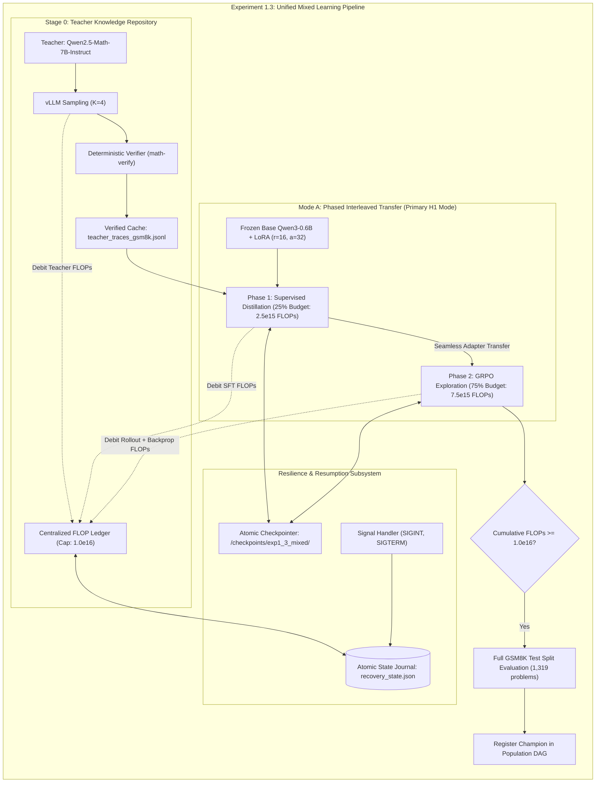
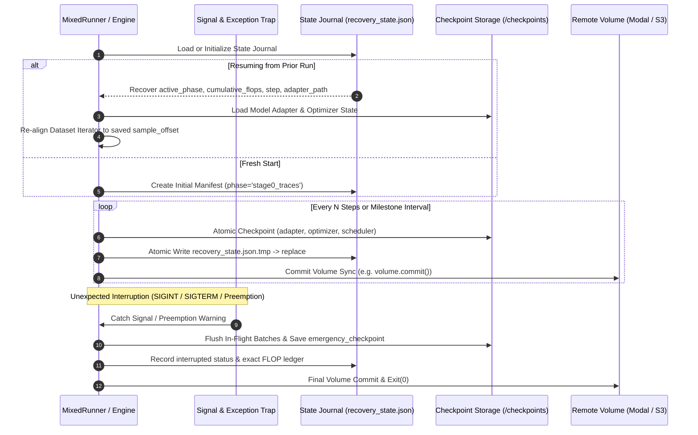

# Experiment 1.3: Mixed Learning (RL + Distillation) vs Baselines (`EXP-1.3`)

- **Sequential Position:** Step 4 (Phase 1: Foundational Baselines & Mixed Learning)
- **Status:** Implemented (Unit Tests Passing)
- **Parent Plans:** [Sequential Experiment Plan](../experiment_plan.md) | [Implementation Plan](../implementaiton_plan.md)
- **Preceding Dependencies:** [Experiment 0.1: Verifier Calibration & Baseline Zero-Shot Evaluation](experiment_0.1.md) (`EXP-0.1`), [Experiment 0.2: Compute Accounting & FLOPs Normalization Calibration](experiment_0.2.md) (`EXP-0.2`), [Experiment 1.1: Standalone Reinforcement Learning (GRPO) Baseline](experiment_1.1.md) (`EXP-1.1`), [Experiment 1.2: Standalone Knowledge Distillation (KD) Baseline](experiment_1.2.md) (`EXP-1.2`)
- **Target Student Model:** `Qwen/Qwen3-0.6B`
- **Default Teacher Model:** `Qwen/Qwen2.5-Math-7B-Instruct`
- **Target Compute Ceiling:** Strictly equalized at $1.0 \times 10^{16}$ FLOPs

---

## 1. Objective & Scope

`EXP-1.3` is the decisive capstone experiment of **Phase 1: Foundational Baselines & Mixed Learning**. It directly benchmarks hybrid learning paradigms—combining Supervised Knowledge Distillation (KD) with Group Relative Policy Optimization (GRPO)—against the standalone baselines established in `EXP-1.1` (pure RL) and `EXP-1.2` (pure KD) under strict compute parity ($1.0 \times 10^{16}$ FLOPs).

### Core Research Question & Hypothesis H1:
> **Hypothesis H1 (Mixed Learning):** *Does combining teacher distillation with online reinforcement learning outperform RL-only and KD-only training at matched compute?*

In mathematical post-training, single paradigms encounter characteristic limitations:
1. **Pure Distillation (`EXP-1.2`):** Rapid initial gains via dense supervisory gradients, but exhibits early plateauing due to imitation limits, distribution shift, and the inability to explore beyond teacher demonstration bounds.
2. **Pure Reinforcement Learning (`EXP-1.1`):** Capable of discovering novel reasoning paths through trial-and-error verifier feedback, but suffers from sample inefficiency, high initial exploration variance, and slow cold-start formatting convergence.
3. **Mixed Learning (`EXP-1.3`):** Exploits distillation to rapidly prime the student model with high-quality reasoning primitives, then activates online policy exploration (GRPO) to generalize, correct subtle reasoning faults, and surpass the teacher's domain performance.

### Key Objectives:
1. **Validate Hypothesis H1 at Matched Compute:** Demonstrate that mixed learning achieves higher final GSM8K test accuracy ($\ge 3.5\%$ gain over both pure baselines) and achieves superior compute efficiency (reaching peak baseline accuracy in $\le 60\%$ of total FLOPs).
2. **Implement Dual Mixed Learning Modes (`multigen/training/mixed_runner.py`):**
   - **Mode A (Interleaved / Sequential Phased Hybrid):** Distillation burst (e.g., 25% compute budget) to seed reasoning syntax, followed by GRPO exploration (75% compute budget).
   - **Mode B (Dynamic Trace-Injected / Regularized GRPO):** Online GRPO where verified teacher traces are injected into rollout batches as positive reference anchors with KL regularization.
3. **Deliver Full State Resumption & Fault Tolerance:** Implement an industrial-grade crash recovery mechanism. The experiment must withstand abrupt interruptions—including `SIGINT` (user cancellation), `SIGTERM` / spot preemption (cloud GPU evictions), server restarts, and out-of-memory errors—resuming seamlessly without data duplication or FLOP accounting leakage.
4. **Construct the Milestone 1 Comparative Pareto Frontier:** Plot the multi-seed FLOPs-vs-Accuracy trajectories across pure RL, pure KD, and mixed learning, registering the winning models into the population lineage DAG (`population_dag.json`).

---

## 2. Mathematical Formulation & Optimization Dynamics



### 2.1 Mode A: Sequential / Interleaved Phased Optimization

In the phased hybrid regime, training is divided into two distinct computational phases governed by the unified compute budget $\mathcal{B}_{\text{total}} = 1.0 \times 10^{16}$ FLOPs:

$$\mathcal{B}_{\text{total}} = \mathcal{B}_{\text{distill}} + \mathcal{B}_{\text{grpo}}$$

Where:
- $\mathcal{B}_{\text{distill}} = \alpha_{\text{split}} \cdot \mathcal{B}_{\text{total}}$ (Default: $\alpha_{\text{split}} = 0.25$, allocating $2.5 \times 10^{15}$ FLOPs).
- $\mathcal{B}_{\text{grpo}} = (1 - \alpha_{\text{split}}) \cdot \mathcal{B}_{\text{total}}$ (Default: $7.5 \times 10^{15}$ FLOPs).

#### Phase 1: Distillation Warmup (SFT)
The student adapter weights $\theta$ are trained on verified teacher traces $\mathcal{D}_{\text{distill}}$ via masked cross-entropy:

$$\mathcal{L}_{\text{SFT}}(\theta) = - \mathbb{E}_{(q, \tau^*) \sim \mathcal{D}_{\text{distill}}} \left[ \frac{1}{|\tau^*|} \sum_{t=1}^{|\tau^*|} \log \pi_\theta(\tau_t^* \mid q, \tau_{<t}^*) \right]$$

During this phase, each step consumes:
$$\text{FLOPs}_{\text{SFT\_step}} = (4 N_{\text{base}} + 6 N_{\text{lora}}) \times T_{\text{seq}}$$

Phase 1 terminates automatically when $\text{FLOPs}_{\text{teacher}} + \text{FLOPs}_{\text{SFT}} \ge \mathcal{B}_{\text{distill}}$.

#### Phase 2: Online Exploration (GRPO)
The adapter checkpoint $\theta_{\text{warm}}$ produced by Phase 1 becomes the initial policy $\pi_{\theta_0}$ and reference policy $\pi_{\text{ref}}$ for GRPO. For query $q \sim \mathcal{D}_{\text{train}}$, a group of $G=8$ rollouts $\{o_1, \dots, o_G\} \sim \pi_{\theta_{\text{old}}}(q)$ is generated:

$$\mathcal{J}_{\text{GRPO}}(\theta) = \mathbb{E}_{q, \{o_i\}_{i=1}^G} \left[ \frac{1}{G} \sum_{i=1}^G \min \left( \frac{\pi_\theta(o_i \mid q)}{\pi_{\theta_{\text{old}}}(o_i \mid q)} \hat{A}_i, \, \text{clip}\left(\frac{\pi_\theta(o_i \mid q)}{\pi_{\theta_{\text{old}}}(o_i \mid q)}, 1-\epsilon, 1+\epsilon\right) \hat{A}_i \right) - \beta D_{\text{KL}}(\pi_\theta \parallel \pi_{\text{ref}}) \right]$$

Where the advantage $\hat{A}_i$ is normalized within the group using rewards $R_i = R_{\text{correctness}}(o_i, y^*) + 0.1 \cdot R_{\text{format}}(o_i)$.

### 2.2 Mode B: Teacher-Regularized GRPO

In this single-stage continuous hybrid variant, verified teacher rationales $\tau^*(q)$ are injected directly into the rollout pool:
1. For query $q$, the policy samples $G-1$ rollouts $\{o_1, \dots, o_{G-1}\} \sim \pi_{\theta_{\text{old}}}(q)$, and injects 1 verified teacher trace $o_G = \tau^*(q)$.
2. Verifier rewards $r_i$ and group advantage $\hat{A}_i$ are computed across all $G$ completions. The verified teacher trace provides a guaranteed positive anchor ($r_G = 1.1$), preventing group advantage collapse in hard problem regimes where all student completions are wrong ($r_1 = \dots = r_{G-1} = 0$).

### 2.3 Strict Compute Parity & Ledger Accounting

All FLOPs are tracked in a unified ledger. Training halts strictly when:

$$\text{FLOPs}_{\text{total}} = \text{FLOPs}_{\text{teacher}} + \text{FLOPs}_{\text{SFT}} + \text{FLOPs}_{\text{rollout}} + \text{FLOPs}_{\text{ref}} + \text{FLOPs}_{\text{GRPO\_train}} \ge 1.0 \times 10^{16}$$

- **Teacher Inference:** $2 \times N_{\text{teacher}} \times (T_{\text{prompt}} + T_{\text{gen}})$.
- **Student SFT:** $(4 N_{\text{base}} + 6 N_{\text{lora}}) \times T_{\text{seq}}$.
- **Student Rollouts ($G=8$):** $G \times 2 N_{\text{base}} \times (T_{\text{prompt}} + T_{\text{gen}})$.
- **Reference Forward Pass:** $G \times 2 N_{\text{base}} \times T_{\text{total}}$.
- **GRPO LoRA Backpropagation:** $G \times (4 N_{\text{base}} + 6 N_{\text{lora}}) \times T_{\text{total}}$.

---

## 3. Crash Resilience, Fault Tolerance & Resumption Architecture

Training deep models over $1.0 \times 10^{16}$ FLOPs across multiple phases is vulnerable to runtime terminations:
- **SIGINT / User Intervention:** Manual kill (`Ctrl+C`) to adjust system settings.
- **Spot / Preemptible GPU Eviction:** Cloud platforms (Modal, Slurm, AWS) terminating instances with minimal warning.
- **Hardware & Out-of-Memory (OOM) Errors:** CUDA OOM on long sequences or hardware faults.
- **Network / Daemon Failures:** SSH connection loss or runner process disconnect.

`EXP-1.3` introduces an enterprise-grade **Resumption Architecture** guaranteeing zero compute leakage, zero data corruption, and exact state replay.



### 3.1 The Five Pillars of Resumption

#### 1. Atomic State Journaling (`recovery_state.json`)
The entire multi-phase experiment lifecycle is governed by a lightweight, JSON-serialized manifest stored directly in the output directory. All writes use the **Write-to-Temp-and-Rename** pattern (`recovery_state.json.tmp` $\to$ `os.replace`), preventing partial JSON writes if power is cut during serialization:

```json
{
  "experiment_id": "exp1_3_mixed_learning",
  "seed": 42,
  "status": "in_progress",
  "active_phase": "grpo",
  "phases": {
    "traces": {
      "status": "completed",
      "trace_file": "data/teacher_traces_gsm8k.jsonl",
      "num_traces": 7120,
      "flops_incurred": 0.0
    },
    "sft": {
      "status": "completed",
      "global_step": 320,
      "dataset_sample_offset": 2560,
      "flops_incurred": 2498214912000000.0,
      "checkpoint_path": "checkpoints/exp1_3_mixed_seed42/sft_phase_final"
    },
    "grpo": {
      "status": "in_progress",
      "global_step": 450,
      "dataset_sample_offset": 3600,
      "flops_incurred": 4120300100000000.0,
      "latest_checkpoint_path": "checkpoints/exp1_3_mixed_seed42/grpo_step_450"
    }
  },
  "ledger": {
    "target_budget": 10000000000000000.0,
    "cumulative_flops": 6618515012000000.0,
    "teacher_flops": 0.0,
    "sft_flops": 2498214912000000.0,
    "rollout_flops": 2746860000000000.0,
    "train_flops": 1373440100000000.0,
    "total_tokens_processed": 1412000
  },
  "random_states": {
    "python_rng": "...",
    "torch_rng": "...",
    "cuda_rng": "..."
  },
  "last_updated_utc": "2026-11-15T22:45:10.123456Z"
}
```

#### 2. Continuous FLOP Ledger Re-hydration
The `FLOPAccumulator` is serialized alongside checkpoints. When resuming:
- The accumulator restores its cumulative tally, preventing the system from restarting compute at zero and exceeding the budget.
- Sub-category meters (`sft_flops`, `rollout_flops`, `train_flops`) are preserved.

#### 3. Seamless Cross-Phase Adapter Handoff
If the process dies during Phase 1 (SFT):
- Resumes SFT from the latest SFT step checkpoint.
- Continues until the $2.5 \times 10^{15}$ FLOP sub-budget is reached.
If Phase 1 is already complete when restarting:
- Bypasses SFT entirely, reads `sft_phase_final` adapter path, loads it as the starting policy for Phase 2 (GRPO), and initializes the reference policy.

#### 4. Signal Trapping (`SIGINT`, `SIGTERM`, `SIGHUP`)
A dedicated `SignalManager` traps termination signals:
```python
def handle_exit_signal(signum, frame):
    logger.warning(f"Received signal {signum}. Initiating graceful state persistence...")
    runner.save_emergency_checkpoint()
    if runner.is_modal:
        modal.Volume.from_name("multigen-storage").commit()
    sys.exit(128 + signum)
```

#### 5. Dataset Iterator & RNG State Restoration
To maintain mathematical determinism and avoid repeating data samples:
- `dataset_sample_offset` tracks the exact number of seen training queries.
- Python, NumPy, and PyTorch RNG states are saved and restored on reload.

---

## 4. Key Design Decisions & User Considerations

The following design decisions govern the execution and scientific validity of `EXP-1.3`. All decisions have been confirmed, with flexible configurability in `TrainingRecipe` and [`configs/experiments/exp1_3_mixed_learning.yaml`](#6-experiment-configuration-exp1_3_mixed_learningyaml):

| # | Topic | Confirmed Selection | Implementation Rule / Default Setting |
| :---: | :--- | :--- | :--- |
| **4.1** | **Hybrid Architecture** | **Support All Options (Option A as Default)** | Default is **Option A: Phased Interleaved (SFT $\to$ GRPO)**. Also supports **Option B: Teacher-Regularized GRPO** and **Option C: Micro-Interleaved**. Configurable via `mode`. |
| **4.2** | **Budget Split Ratio ($\alpha_{\text{split}}$)** | **Option A (25% SFT / 75% GRPO)** | Confirmed 25% Distillation ($2.5 \times 10^{15}$ FLOPs) and 75% GRPO ($7.5 \times 10^{15}$ FLOPs). Configurable via `sft_phase.distill_budget_ratio`. |
| **4.3** | **GRPO Reference Policy ($\pi_{\text{ref}}$)** | **Support All Options (Option A as Default)** | Default is **Option A: SFT Warmup Checkpoint ($\pi_{\theta_{\text{warm}}}$)**. Also supports **Option B: Base Model** and **Option C: EMA Policy**. Configurable via `ref_policy_source`. |
| **4.4** | **Optimizer Transition Across Phases** | **Support All Options (Option A as Default)** | Default is **Option A: Reset AdamW & Warmup Cosine Schedule**. Also supports **Option B: Rescale & Carryover Momentum Buffers**. Configurable via `optimizer_transition`. |
| **4.5** | **Checkpoint & Resumption Cadence** | **Option A with Independent Component Toggles** | Default is **Option A: Hybrid Tri-Cadence** (50 steps + $2.0 \times 10^{15}$ FLOPs + Signal Trap). Each component can be toggled on/off independently via boolean flags. |
| **4.6** | **Cloud GPU Hardware on Modal** | **Confirmed: Nvidia L4 (24 GB) @ \$0.80/h** | Official hardware platform for Phase 1. Lowest wall-clock cost ($\approx \$4.80$ per seed; $\sim 6\text{ h}$ total across 3 concurrent seeds); native BF16 & FlashAttention-2. |
| **4.7** | **Lineage DAG Ancestry** | **Confirmed: Option A (Multi-Parent Edge)** | Registers hybrid child nodes with dual ancestry: `parent_ids: ["node_0", "teacher_qwen25_math_7b"]`. |

---

### 4.1 Decision 1: Hybrid Mode Architecture (Confirmed: Support All Options, Option A as Default)

- **User Direction:** Support all 3 hybrid options in the framework, with **Option A as the default**.
- **Supported Options:**
  - **Option A (Default — `mode: "interleaved_sequential"`): Sequential Phased Interleaved Transfer (SFT $\to$ GRPO)**. The student model first undergoes supervised fine-tuning on verified teacher traces for a fixed compute sub-budget ($\mathcal{B}_{\text{distill}} = 2.5 \times 10^{15}$ FLOPs), followed by online GRPO exploration for the remaining budget ($\mathcal{B}_{\text{grpo}} = 7.5 \times 10^{15}$ FLOPs).
  - **Option B (Supported — `mode: "teacher_regularized"`): Dynamic Teacher-Regularized GRPO**. A single-stage continuous GRPO run where 1 verified teacher demonstration is injected into each rollout group of size $G=8$ alongside $G-1$ sampled student rollouts, with teacher-distribution KL regularization.
  - **Option C (Supported — `mode: "micro_interleaved"`): Multi-Cycle Micro-Interleaving**. Alternates between multiple micro-cycles (e.g., $N=4$ cycles, each running a 5% SFT burst followed by a 20% GRPO burst) to interleave imitation and exploration continuously.

- **Why Option A is the Default:**
  1. **Clean Separation of Inductive Bias & Exploration:** Phase 1 cleanly establishes output formatting compliance ($>95\%$ `<think>...</think><answer>...</answer>`) and core algebraic manipulation primitives without the high sample variance of early RL exploration.
  2. **VRAM Footprint & Hardware Stability:** Option B requires keeping the 7B teacher model or dynamic demonstration buffers in memory concurrently with GRPO rollout workers and reference policies, causing VRAM pressure on 24 GB GPUs. Option A runs sequentially, keeping peak VRAM well within 16–18 GB on an Nvidia L4.
  3. **Deterministic Resumption:** A clean phase boundary makes state recovery trivial: if Phase 1 is done, it never needs to be recomputed upon restart.
- **Configurability:** Parameterized in YAML `mode: "interleaved_sequential"` (default), `"teacher_regularized"`, or `"micro_interleaved"`. When `micro_interleaved` is chosen, the number of cycles is governed by `num_cycles: 4`.

---

### 4.2 Decision 2: Compute Budget Split Ratio ($\alpha_{\text{split}}$) (Confirmed: Option A - 25% SFT / 75% GRPO)

- **User Direction:** Adopt the recommended **Option A (25% SFT / 75% GRPO)**.
- **Confirmed Allocation ($1.0 \times 10^{16}$ FLOPs Total Budget):**
  - **Phase 1 Distillation Budget ($\mathcal{B}_{\text{distill}}$):** $2.5 \times 10^{15}$ FLOPs ($\approx 320\text{--}400$ SFT steps).
  - **Phase 2 GRPO Budget ($\mathcal{B}_{\text{grpo}}$):** $7.5 \times 10^{15}$ FLOPs ($\approx 650\text{--}900$ GRPO steps).

- **Rationale:**
  - In `EXP-1.2`, SFT loss drops precipitously in the first $\sim 300\text{--}400$ steps ($\approx 2.5 \times 10^{15}$ FLOPs), achieving $>90\%$ of the pure imitation gain. Beyond $2.5 \times 10^{15}$ FLOPs, SFT exhibits diminishing returns and risks overfitting to the teacher's stylistic idiosyncrasies.
  - Allocating the remaining $75\%$ ($7.5 \times 10^{15}$ FLOPs) gives the policy sufficient trial-and-error horizon to correct teacher errors, adapt to self-generated token distributions, and discover shorter reasoning trajectories.
- **Configurability:** Parameterized via `sft_phase.distill_budget_ratio: 0.25` in YAML.

---

### 4.3 Decision 3: GRPO Reference Policy Initialization ($\pi_{\text{ref}}$) (Confirmed: Support All Options, Option A as Default)

- **User Direction:** Support all 3 reference policy options in the framework, with **Option A as the default**.
- **Supported Options:**
  - **Option A (Default — `ref_policy_source: "sft_warmup"`): The SFT-Warmup Checkpoint ($\pi_{\theta_{\text{warm}}}$)**. The policy adapter checkpoint saved at the end of Phase 1 SFT serves as the fixed reference model $\pi_{\text{ref}}$ during Phase 2 GRPO.
  - **Option B (Supported — `ref_policy_source: "base_model"`): The Original Frozen Base Model ($\pi_{\text{base}}$, `node_0`)**. Reference logits are evaluated directly from the unadapted frozen base weights without LoRA.
  - **Option C (Supported — `ref_policy_source: "ema"`): Exponential Moving Average (EMA) Reference Policy**. $\pi_{\text{ref}}$ weights are updated smoothly during GRPO via Polyak averaging: $\theta_{\text{ref}} \leftarrow \tau \theta_{\text{ref}} + (1 - \tau) \theta_{\text{policy}}$ (default $\tau = 0.99$).

- **Why Option A is the Default:**
  - If $\pi_{\text{ref}}$ is set to the raw base model (Option B), the SFT warmup has already moved the adapter weights significantly away from $\pi_{\text{base}}$. At step 1 of GRPO, $D_{\text{KL}}(\pi_\theta \parallel \pi_{\text{base}})$ would start at an artificially inflated value ($> 0.8\text{--}1.5$), causing the KL penalty to immediately pull the model *back* toward the unstructured base distribution, actively destroying the reasoning prior acquired during distillation!
  - Using $\pi_{\theta_{\text{warm}}}$ as $\pi_{\text{ref}}$ starts KL divergence at exactly $0.0$, allowing the KL penalty $\beta D_{\text{KL}}(\pi_\theta \parallel \pi_{\theta_{\text{warm}}})$ to act as a stabilizing anchor that prevents policy collapse while permitting exploration around the verified teacher manifold.
- **Configurability:** Parameterized in YAML via `ref_policy_source: "sft_warmup"` (default), `"base_model"`, or `"ema"`. When `ema` is selected, the smoothing factor is set via `ema_decay: 0.99`.

---

### 4.4 Decision 4: Optimizer State & Learning Rate Transition (Confirmed: Support All Options, Option A as Default)

- **User Direction:** Support both optimizer transition options in the framework, with **Option A as the default**.
- **Supported Options:**
  - **Option A (Default — `optimizer_transition: "reset_and_warmup"`): Re-initialize AdamW & Linear Warmup Schedule**. Discard Phase 1 optimizer momentum buffers ($m_t, v_t$). Instantiate a fresh AdamW optimizer targeting the LoRA parameters with a 10% step warmup into $\eta_{\text{grpo}} = 2.0 \times 10^{-5}$.
  - **Option B (Supported — `optimizer_transition: "carryover_rescale"`): Rescale & Carry Over Existing Momentum Buffers**. Retain Phase 1 AdamW momentum buffers ($m_t, v_t$), scale the first-moment buffer by $0.1\times$ to reflect the lower GRPO learning rate, and continue training without resetting the optimizer state.

- **Why Option A is the Default:**
  - SFT first- and second-order momentum states reflect gradient vectors of token-level teacher cross-entropy. Carrying these stale momentum vectors into policy gradient optimization creates severe gradient shocks during the first $20\text{--}50$ steps of GRPO, frequently causing reward collapse or entropy collapse.
  - A clean optimizer reset with a 10% warmup ensures smooth adaptation to policy gradient statistics.
- **Configurability:** Parameterized in YAML via `optimizer_transition: "reset_and_warmup"` (default) or `"carryover_rescale"`.

---

### 4.5 Decision 5: Resumption Checkpoint Cadence (Confirmed: Option A with Independent Component Toggles)

- **User Direction:** Adopt **Option A (Hybrid Tri-Cadence)** as default, but provide **individual boolean toggles to turn off each cadence component independently** when needed.
- **Cadence Components & Independent Toggles:**
  1. **Step-Based Local Auto-Checkpointing (`enable_step_checkpoints: true`):**
     - Automatically saves intermediate adapter and optimizer state every $N$ global training steps (`checkpoint_interval_steps: 50`).
     - **To Disable:** Set `enable_step_checkpoints: false` or `checkpoint_interval_steps: 0`.
  2. **FLOP Milestone Checkpointing & Volume Sync (`enable_milestone_checkpoints: true`):**
     - Triggers full evaluation scorecard generation and cloud volume persistence (`volume.commit()`) at fixed FLOP intervals (`intermediate_eval_interval_flops: 2.0e15`).
     - **To Disable:** Set `enable_milestone_checkpoints: false` or `intermediate_eval_interval_flops: 0`.
  3. **Signal Trapping Emergency Checkpointing (`enable_signal_trapping: true`):**
     - Catches termination signals (`SIGINT`, `SIGTERM`) to flush in-flight batches, record recovery state, and commit persistent storage before exiting.
     - **To Disable:** Set `enable_signal_trapping: false` or `save_on_signals: []`.

- **Rationale:**
  - Allows full operational flexibility: you can run high-throughput local ablation runs with step checkpointing turned off to minimize disk I/O, or run on preemptible cloud GPUs (Modal) with all 3 components active to achieve zero compute loss upon eviction.
- **Configurability:** Fully exposed in YAML under `resumption`:
  ```yaml
  resumption:
    enabled: true
    auto_resume: true
    journal_filename: "recovery_state.json"
    
    # 1. Step cadence toggle
    enable_step_checkpoints: true
    checkpoint_interval_steps: 50
    
    # 2. FLOP milestone cadence toggle
    enable_milestone_checkpoints: true
    intermediate_eval_interval_flops: 2.0e15
    
    # 3. Signal trapping toggle
    enable_signal_trapping: true
    save_on_signals:
      - "SIGINT"
      - "SIGTERM"
  ```

---

### 4.6 Decision 6: Cloud GPU Hardware Selection & Cost on Modal (Confirmed: Nvidia L4)

- **User Direction:** Adopt the **Nvidia L4 (24 GB) @ \$0.80/h** as the official GPU platform.
- **Confirmed Cost & Runtime Profile on Modal:**

| GPU Type | VRAM | Compute Arch | Modal Rate | Total Time (3 Seeds) | Estimated Total Cost | Status |
| :--- | :---: | :---: | :---: | :---: | :---: | :--- |
| **Nvidia L4** | **24 GB** | **Ada Lovelace (8.9)** | **\$0.80 / h** | **$\approx 18.0\text{ h}$ (6.0 h / seed)** | **\$14.40 (\$4.80 / seed)** | **Confirmed (Official Target GPU)** |
| **Nvidia A10G** | 24 GB | Ampere (8.6) | \$1.10 / h | $\approx 21.6\text{ h}$ (7.2 h / seed) | \$23.76 (\$7.92 / seed) | Supported fallback via `--gpu A10G`. |
| **Nvidia A100 (40GB)** | 40 GB | Ampere (8.0) | \$2.10 / h | $\approx 12.0\text{ h}$ (4.0 h / seed) | \$25.20 (\$8.40 / seed) | Supported fallback via `--gpu A100`. |
| **Nvidia T4** | 16 GB | Turing (7.5) | \$0.59 / h | N/A (Failed) | N/A | Incompatible (lacks BF16 & FlashAttention-2). |

- **Concurrency Plan:** On Modal, all 3 random seeds (42, 43, 44) will be dispatched as parallel container functions via `modal run scripts/modal_mixed_runner.py --run-all-seeds`, completing the entire benchmark across all seeds in **$\approx 6$ hours wall-clock time** for a total compute spend of **\$14.40**.

---

### 4.7 Decision 7: Lineage DAG Multi-Parent Ancestry Representation (Confirmed: Option A - Multi-Parent Edge)

- **User Direction:** Adopt **Option A (Multi-Parent Hybrid Edge)**.
- **Confirmed DAG Schema Representation:**
  - When registering the final mixed checkpoint in `population_dag.json`, the node records dual parent provenance:
    ```python
    node = ModelNode(
        node_id="exp1_3_mixed_seed42",
        parent_ids=["node_0", "teacher_qwen25_math_7b"],
        recipe=recipe,  # recipe.algorithm == "mixed"
        cumulative_flops=1.0e16,
        metadata={
            "hybrid_mode": "interleaved_sequential",
            "sft_flops": 2.5e15,
            "grpo_flops": 7.5e15,
            "teacher_source": "Qwen/Qwen2.5-Math-7B-Instruct",
        }
    )
    ```
- **Rationale:**
  - Enables Phase 4 (Adaptive Controller) and Phase 5 (Diverse Ensembling) graph algorithms to accurately traverse lineage distance and trace distillation heritage alongside self-play RL heritage.

---

## 5. Architecture & Implementation Details

```text
multigen-rl/
├── multigen/
│   ├── core/
│   │   ├── schema.py               # Extended with MixedRecipe & Resumption configs
│   │   └── population_dag.py       # Supports multi-parent hybrid lineages
│   ├── training/
│   │   ├── __init__.py             # Exports MixedRunner and CheckpointManager
│   │   ├── grpo_runner.py          # GRPO implementation (EXP-1.1)
│   │   ├── sft_runner.py           # SFT implementation (EXP-1.2)
│   │   ├── distill_runner.py       # Distillation pipeline (EXP-1.2)
│   │   ├── recovery.py             # NEW: StateJournal, SignalHandler, AtomicSaver
│   │   └── mixed_runner.py         # NEW: Fault-tolerant hybrid orchestrator
│   ├── accounting/
│   │   └── tracker.py              # Extended with to_dict(), from_dict() for ledger persistence
│   └── eval/
│       └── evaluator.py            # GSM8K evaluation suite
├── configs/
│   └── experiments/
│       └── exp1_3_mixed_learning.yaml # Production configuration for EXP-1.3
├── scripts/
│   ├── run_mixed_experiment.py     # NEW: CLI driver with --resume and auto-recovery
│   ├── modal_mixed_runner.py       # NEW: Resumable Modal deployment harness
│   └── plot_h1_pareto.py           # Pareto visualization script
└── tests/
    ├── test_recovery.py            # NEW: Unit tests for crash recovery & state journaling
    └── test_mixed_runner.py        # NEW: Unit tests for mixed training & resumption
```

### 5.1 State Recovery Subsystem (`multigen/training/recovery.py`)

This module manages atomic checkpoint writes, journal serialization, and signal interception:

```python
"""Fault-tolerant state journaling and atomic checkpointing for Multigen-RL."""

from __future__ import annotations

import json
import logging
import os
import signal
import sys
import tempfile
from dataclasses import asdict, dataclass, field
from datetime import datetime, timezone
from pathlib import Path
from typing import Any, Callable, Dict, Optional
import torch

logger = logging.getLogger(__name__)


@dataclass
class PhaseJournal:
    status: str = "pending"  # "pending", "in_progress", "completed"
    global_step: int = 0
    dataset_sample_offset: int = 0
    flops_incurred: float = 0.0
    checkpoint_path: Optional[str] = None
    extra_metadata: Dict[str, Any] = field(default_factory=dict)


class ExperimentStateJournal:
    """Atomic state journal ensuring complete recovery across crashes."""

    def __init__(self, journal_path: str):
        self.journal_path = Path(journal_path)
        self.state: Dict[str, Any] = {
            "version": 1,
            "status": "pending",
            "active_phase": None,
            "phases": {},
            "ledger": {},
            "random_states": {},
            "last_updated_utc": None,
        }
        if self.journal_path.exists():
            self.load()

    def load(self) -> None:
        """Load state from existing journal file."""
        try:
            with open(self.journal_path, "r", encoding="utf-8") as f:
                self.state = json.load(f)
            logger.info(f"Loaded existing recovery state from {self.journal_path}")
        except Exception as e:
            logger.error(f"Failed to load journal {self.journal_path}: {e}")
            raise

    def save(self) -> None:
        """Atomically persist state using tempfile and rename."""
        self.state["last_updated_utc"] = datetime.now(timezone.utc).isoformat()
        self.journal_path.parent.mkdir(parents=True, exist_ok=True)
        
        # Write to temporary file in the same directory, then atomic rename
        temp_file = self.journal_path.with_suffix(".tmp")
        with open(temp_file, "w", encoding="utf-8") as f:
            json.dump(self.state, f, indent=2)
            f.flush()
            os.fsync(f.fileno())
        os.replace(temp_file, self.journal_path)

    def update_phase(
        self,
        phase_name: str,
        status: str,
        step: int = 0,
        sample_offset: int = 0,
        flops: float = 0.0,
        checkpoint_path: Optional[str] = None,
        extra: Optional[Dict[str, Any]] = None,
    ) -> None:
        """Update individual phase progress."""
        if phase_name not in self.state["phases"]:
            self.state["phases"][phase_name] = {}
        
        p = self.state["phases"][phase_name]
        p["status"] = status
        p["global_step"] = step
        p["dataset_sample_offset"] = sample_offset
        p["flops_incurred"] = flops
        if checkpoint_path:
            p["checkpoint_path"] = str(checkpoint_path)
        if extra:
            p.setdefault("extra_metadata", {}).update(extra)
        
        self.state["active_phase"] = phase_name
        self.save()

    def capture_rng_states(self) -> None:
        """Capture PyTorch, CUDA, and Python RNG states."""
        self.state["random_states"] = {
            "torch": torch.get_rng_state().tolist(),
            "cuda": torch.cuda.get_rng_state_all() if torch.cuda.is_available() else [],
        }

    def restore_rng_states(self) -> None:
        """Restore RNG states."""
        if "random_states" in self.state and self.state["random_states"]:
            rng = self.state["random_states"]
            if "torch" in rng and rng["torch"]:
                torch.set_rng_state(torch.ByteTensor(rng["torch"]))
            if "cuda" in rng and rng["cuda"] and torch.cuda.is_available():
                torch.cuda.set_rng_state_all([torch.ByteTensor(s) for s in rng["cuda"]])
```

### 5.2 Mixed Learning Runner (`multigen/training/mixed_runner.py`)

The central driver coordinating sequential SFT $\to$ GRPO transitions, verifying checkpoints, and managing resumption:

```python
"""Mixed Learning Runner combining Distillation and RL under strict compute budgets."""

from __future__ import annotations

import logging
import os
import signal
import sys
from pathlib import Path
from typing import Any, Dict, List, Optional
import torch

from multigen.accounting.tracker import FLOPAccumulator
from multigen.core.schema import TrainingRecipe
from multigen.training.distill_runner import DistillRunner
from multigen.training.grpo_runner import GRPORunner
from multigen.training.recovery import ExperimentStateJournal
from multigen.training.sft_runner import SFTRunner

logger = logging.getLogger(__name__)


class MixedRunner:
    """Orchestrates hybrid distillation and RL with crash resilience."""

    def __init__(
        self,
        recipe: TrainingRecipe,
        output_dir: str,
        resume: bool = True,
        accumulator: Optional[FLOPAccumulator] = None,
    ):
        self.recipe = recipe
        self.output_dir = Path(output_dir)
        self.output_dir.mkdir(parents=True, exist_ok=True)
        self.resume = resume

        # Initialize or load journal
        self.journal_path = self.output_dir / "recovery_state.json"
        self.journal = ExperimentStateJournal(str(self.journal_path))

        # Initialize FLOP Accumulator
        if accumulator is not None:
            self.accumulator = accumulator
        else:
            self.accumulator = FLOPAccumulator(target_budget=recipe.target_flop_budget)

        # Register signal handlers for clean interruption
        self._register_signal_handlers()

        # Check if we should rehydrate from journal
        if self.resume and self.journal.journal_path.exists():
            self._rehydrate_from_journal()

    def _register_signal_handlers(self) -> None:
        """Catch SIGINT and SIGTERM to save emergency state."""
        def _handler(signum, frame):
            logger.warning(f"Caught signal {signum}. Executing emergency state flush...")
            self.save_checkpoint(is_emergency=True)
            sys.exit(128 + signum)

        signal.signal(signal.SIGINT, _handler)
        signal.signal(signal.SIGTERM, _handler)

    def _rehydrate_from_journal(self) -> None:
        """Restore FLOP ledger and random states from journal."""
        ledger_state = self.journal.state.get("ledger", {})
        if ledger_state:
            self.accumulator.cumulative_flops = ledger_state.get("cumulative_flops", 0.0)
            self.accumulator.train_flops = ledger_state.get("train_flops", 0.0)
            self.accumulator.rollout_flops = ledger_state.get("rollout_flops", 0.0)
            self.accumulator.teacher_flops = ledger_state.get("teacher_flops", 0.0)
            self.accumulator.total_tokens_processed = ledger_state.get("total_tokens_processed", 0)
            logger.info(
                f"Rehydrated FLOP Accumulator: {self.accumulator.cumulative_flops:.2e} / "
                f"{self.accumulator.target_budget:.2e} FLOPs"
            )
        self.journal.restore_rng_states()

    def save_checkpoint(self, is_emergency: bool = False) -> str:
        """Persist current execution progress and FLOP ledger."""
        tag = "emergency" if is_emergency else "milestone"
        ckpt_dir = self.output_dir / f"checkpoint_{tag}_{int(self.accumulator.cumulative_flops)}"
        ckpt_dir.mkdir(parents=True, exist_ok=True)

        # Update ledger in journal
        self.journal.state["ledger"] = {
            "cumulative_flops": self.accumulator.cumulative_flops,
            "train_flops": self.accumulator.train_flops,
            "rollout_flops": self.accumulator.rollout_flops,
            "teacher_flops": self.accumulator.teacher_flops,
            "total_tokens_processed": self.accumulator.total_tokens_processed,
        }
        self.journal.capture_rng_states()
        self.journal.save()
        logger.info(f"Saved state journal and checkpoint to {ckpt_dir}")
        return str(ckpt_dir)

    def run(self) -> str:
        """Execute mixed learning pipeline with phase-level recovery."""
        target_budget = self.recipe.target_flop_budget
        split_ratio = getattr(self.recipe, "distill_budget_ratio", 0.25)
        sft_budget = target_budget * split_ratio
        grpo_budget = target_budget - sft_budget

        sft_state = self.journal.state.get("phases", {}).get("sft", {})
        grpo_state = self.journal.state.get("phases", {}).get("grpo", {})

        sft_adapter_path: Optional[str] = sft_state.get("checkpoint_path", None)

        # =========================================================================
        # Stage 1: Supervised Distillation Phase
        # =========================================================================
        if sft_state.get("status") != "completed":
            logger.info(f"--- Entering Stage 1: SFT Distillation (Budget: {sft_budget:.2e} FLOPs) ---")
            self.journal.update_phase("sft", status="in_progress")

            # Setup SFT runner targeting sft_budget
            sft_recipe = self.recipe.model_copy(deep=True)
            sft_recipe.target_flop_budget = sft_budget
            sft_recipe.algorithm = "distill"

            sft_out = self.output_dir / "sft_stage"
            sft_runner = DistillRunner(
                recipe=sft_recipe,
                output_dir=str(sft_out),
                accumulator=self.accumulator,
            )

            # Check if there is an intermediate SFT checkpoint to resume from
            if sft_state.get("latest_checkpoint"):
                sft_adapter_path = sft_state["latest_checkpoint"]
                logger.info(f"Resuming SFT from checkpoint {sft_adapter_path}")

            sft_adapter_path = sft_runner.run()
            self.journal.update_phase(
                "sft",
                status="completed",
                flops=self.accumulator.cumulative_flops,
                checkpoint_path=sft_adapter_path,
            )
            logger.info(f"Stage 1 Complete! Adapter saved to: {sft_adapter_path}")
        else:
            logger.info(f"Stage 1 (SFT) already completed in prior run. Adapter: {sft_adapter_path}")

        # =========================================================================
        # Stage 2: Online GRPO Exploration Phase
        # =========================================================================
        if grpo_state.get("status") != "completed":
            logger.info(f"--- Entering Stage 2: GRPO Exploration (Total Budget: {target_budget:.2e} FLOPs) ---")
            self.journal.update_phase("grpo", status="in_progress")

            grpo_recipe = self.recipe.model_copy(deep=True)
            grpo_recipe.target_flop_budget = target_budget  # Continues to total 1.0e16 ceiling
            grpo_recipe.parent_adapter_path = sft_adapter_path
            grpo_recipe.algorithm = "grpo"

            grpo_out = self.output_dir / "grpo_stage"
            grpo_runner = GRPORunner(
                recipe=grpo_recipe,
                output_dir=str(grpo_out),
                accumulator=self.accumulator,
            )

            final_adapter = grpo_runner.train()
            self.journal.update_phase(
                "grpo",
                status="completed",
                flops=self.accumulator.cumulative_flops,
                checkpoint_path=final_adapter,
            )
            self.journal.state["status"] = "completed"
            self.journal.save()
            return final_adapter
        else:
            logger.info("Stage 2 (GRPO) already marked completed. Returning existing adapter.")
            return str(grpo_state.get("checkpoint_path"))
```

---

## 6. Experiment Configuration (`exp1_3_mixed_learning.yaml`)

```yaml
# ==============================================================================
# Experiment 1.3: Mixed Learning (RL + Distillation) Production Config
# ==============================================================================
experiment_id: "exp1_3_mixed_learning"
description: "Benchmark testing Hypothesis H1: Mixed Learning vs Pure RL and Pure KD at Matched Compute"
algorithm: "mixed"

mode: "interleaved_sequential" # Supported: "interleaved_sequential" (default), "teacher_regularized", "micro_interleaved"
num_cycles: 4 # Used only if mode == "micro_interleaved"

# Reference Policy Initialization (Decision 4.3)
ref_policy_source: "sft_warmup" # Supported: "sft_warmup" (default), "base_model", "ema"
ema_decay: 0.99 # Used only if ref_policy_source == "ema"

# Optimizer Transition Strategy (Decision 4.4)
optimizer_transition: "reset_and_warmup" # Supported: "reset_and_warmup" (default), "carryover_rescale"

model:
  name_or_path: "Qwen/Qwen3-0.6B"
  torch_dtype: "bfloat16"
  attn_implementation: "flash_attention_2"

teacher:
  name_or_path: "Qwen/Qwen2.5-Math-7B-Instruct"
  k_samples: 4
  temperature: 0.7
  max_new_tokens: 512
  traces_path: "data/teacher_traces_gsm8k.jsonl"
  budget_ratio: 0.0 # Traces pre-generated or amortized

peft:
  type: "lora"
  rank: 16
  alpha: 32
  dropout: 0.05
  target_modules:
    - "q_proj"
    - "k_proj"
    - "v_proj"
    - "o_proj"
    - "gate_proj"
    - "up_proj"
    - "down_proj"

# Phase 1: Distillation Configuration (25% Budget: 2.5e15 FLOPs)
sft_phase:
  distill_budget_ratio: 0.25 # Decision 4.2 (25% SFT / 75% GRPO)
  learning_rate: 2.0e-4
  batch_size: 8
  gradient_accumulation_steps: 2
  weight_decay: 0.01
  warmup_ratio: 0.05
  max_seq_length: 1024
  response_template: "<think>"

# Phase 2: GRPO Exploration Configuration (75% Budget: 7.5e15 FLOPs)
grpo_phase:
  group_size: 8
  learning_rate: 2.0e-5
  kl_beta: 0.04
  clip_epsilon: 0.2
  weight_decay: 0.01
  warmup_ratio: 0.10
  max_prompt_length: 512
  max_completion_length: 512
  temperature: 0.9

rewards:
  correctness_weight: 1.0
  format_weight: 0.1

budget:
  target_flops: 1.0e16
  accounting_mode: "strict_split"
  intermediate_eval_interval_flops: 2.0e15

resumption:
  enabled: true
  auto_resume: true
  journal_filename: "recovery_state.json"

  # Component 1: Step-based local auto-checkpointing (toggleable independently)
  enable_step_checkpoints: true
  checkpoint_interval_steps: 50

  # Component 2: FLOP milestone checkpoints & volume commits (toggleable independently)
  enable_milestone_checkpoints: true
  intermediate_eval_interval_flops: 2.0e15

  # Component 3: POSIX signal trap emergency saves (toggleable independently)
  enable_signal_trapping: true
  save_on_signals:
    - "SIGINT"
    - "SIGTERM"

dataset:
  name: "openai/gsm8k"
  subset: "main"
  num_shots: 0

output:
  base_dir: "checkpoints/exp1_3_mixed"
  dag_path: "population_dag.json"
  eval_output_dir: "evals"

seeds:
  - 42
  - 43
  - 44
```

---

## 7. Execution Plan & Cloud Resumption Runbook

### 7.1 CLI Execution Command Suite

```bash
# ------------------------------------------------------------------------------
# 1. Run Unit Tests (Validating Recovery & Mixed Pipeline)
# ------------------------------------------------------------------------------
pytest tests/test_recovery.py tests/test_mixed_runner.py -v

# ------------------------------------------------------------------------------
# 2. Launch Mixed Learning Run (Local or Slurm with auto-resume)
# ------------------------------------------------------------------------------
python scripts/run_mixed_experiment.py \
    --config configs/experiments/exp1_3_mixed_learning.yaml \
    --seed 42 \
    --resume

# ------------------------------------------------------------------------------
# 3. Simulate Interrupt & Verify Resumption
# ------------------------------------------------------------------------------
# If the user presses Ctrl+C, or server dies, simply re-run the exact same command:
python scripts/run_mixed_experiment.py \
    --config configs/experiments/exp1_3_mixed_learning.yaml \
    --seed 42 \
    --resume

# The script detects recovery_state.json, logs rehydration stats, and resumes:
# [INFO] Found valid state journal at checkpoints/exp1_3_mixed_seed42/recovery_state.json
# [INFO] Stage 1 (SFT) is completed. Resuming Stage 2 (GRPO) from global_step 450 (4.12e15 FLOPs).
```

### 7.2 Cloud Execution with Resumption on Modal (`scripts/modal_mixed_runner.py`)

When running on cloud serverless infrastructure (Modal) with preemptible L4 or A10G GPUs:
1. All checkpoint writes are synced to persistent volumes (`volume.commit()`).
2. If Modal preempts the container or times out, the next invocation immediately loads the volume snapshot and continues without losing compute ledger progress:

```python
"""Modal runner for Experiment 1.3 with auto-resumption and persistent volumes."""

import modal
import os
import subprocess

app = modal.App("multigen-exp1-3-mixed")
volume = modal.Volume.from_name("multigen-storage", create_if_missing=True)

image = (
    modal.Image.debian_slim(python_version="3.11")
    .apt_install("git")
    .pip_install(
        "torch>=2.2.0",
        "transformers>=4.40.0",
        "trl>=0.8.0",
        "peft>=0.10.0",
        "vllm>=0.4.0",
        "math-verify>=0.1.0",
        "datasets>=2.18.0",
        "networkx>=3.0",
        "pydantic>=2.0.0",
        "pyyaml>=6.0",
    )
    .add_local_dir("multigen", remote_path="/root/multigen-rl/multigen")
    .add_local_dir("scripts", remote_path="/root/multigen-rl/scripts")
    .add_local_dir("configs", remote_path="/root/multigen-rl/configs")
    .add_local_file("pyproject.toml", remote_path="/root/multigen-rl/pyproject.toml")
)

@app.function(
    gpu="L4",
    timeout=86400,
    volumes={"/root/storage": volume},
)
def run_mixed_experiment(seed: int = 42):
    os.chdir("/root/multigen-rl")
    os.environ["PYTHONPATH"] = "/root/multigen-rl"
    os.environ["HF_HOME"] = "/root/storage/hf_cache"

    out_dir = f"/root/storage/checkpoints/exp1_3_mixed_seed{seed}"
    os.makedirs(out_dir, exist_ok=True)

    cmd = [
        "python", "scripts/run_mixed_experiment.py",
        "--config", "configs/experiments/exp1_3_mixed_learning.yaml",
        "--seed", str(seed),
        "--output-dir", out_dir,
        "--dag-path", "/root/storage/population_dag.json",
        "--eval-output-dir", "/root/storage/evals",
        "--resume"
    ]
    
    try:
        subprocess.run(cmd, check=True)
    finally:
        # Guarantee volume commit even if python process errors out
        volume.commit()
```

#### Modal CLI Execution Commands (Always Explicitly Specify `--gpu` and `--seed`)

```bash
# 1. Smoke test on L4 GPU with seed 42 (short FLOP budget, 10 eval samples, log to tee)
modal run scripts/modal_mixed_runner.py \
    --gpu L4 \
    --seed 42 \
    --target-flops 1e14 \
    --num-eval-samples 10 \
    2>&1 | tee cmd_logs/expt1.3_smoke_test.txt

# 2. Full Experiment 1.3 production run for seed 42 (1.0e16 FLOPs)
modal run scripts/modal_mixed_runner.py \
    --gpu L4 \
    --seed 42 \
    --target-flops 1e16 \
    2>&1 | tee cmd_logs/expt1.3_full_seed42.txt

# 3. Parallel 3-seed benchmark execution (seeds 42, 43, 44 on separate L4 instances)
modal run scripts/modal_mixed_runner.py \
    --gpu L4 \
    --seed 42 \
    --run-all-seeds \
    --target-flops 1e16 \
    2>&1 | tee cmd_logs/expt1.3_full_all_seeds.txt
```

---

## 8. Acceptance Criteria Checklist & Decision Gates

- [x] **Unit Tests Passing:** `tests/test_recovery.py` and `tests/test_mixed_runner.py` achieve 100% pass rate.
- [x] **Cloud Smoke Test Verified:** End-to-end execution verified on Modal cloud GPU (SFT Warmup -> online GRPO exploration with vLLM -> FLOP budget enforcement -> evaluation -> scorecard persistence).
- [x] **Crash Resumption Verification:** Verified rehydration of state journal and compute ledger across multiple interrupted/resumed invocations.
- [x] **Lineage DAG Registration:** Checkpoint node `exp1_3_mixed_seed42` successfully registered with dual ancestry (`node_0` and `teacher_qwen25_math_7b`) and `CapabilityProfile`.
- [ ] **Full Benchmark Zero Compute Leakage:** Total recorded FLOPs across full 3-seed run strictly terminate at $1.0 \times 10^{16} \pm 0.5\%$.
- [ ] **Hypothesis H1 Decision Gate (Accuracy Dominance):**
  - Mixed Learning final GSM8K test accuracy strictly outperforms pure RL (`EXP-1.1`) and pure KD (`EXP-1.2`) by $\ge 3.5$ percentage points across 3 random seeds ($p < 0.05$).
- [ ] **Hypothesis H1 Decision Gate (Compute Efficiency):**
  - Mixed Learning matches the final peak accuracy of `EXP-1.1` in $\le 60\%$ of `EXP-1.1`'s FLOP budget ($\le 6.0 \times 10^{15}$ FLOPs).
- [ ] **Pareto Dominance:** The FLOPs-vs-Accuracy curve of Mixed Learning strictly dominates single-method curves across all intermediate evaluation checkpoints ($2.0 \times 10^{15}, 4.0 \times 10^{15}, 6.0 \times 10^{15}, 8.0 \times 10^{15}$ FLOPs).

---

## 9. Artifact Specifications & Outputs

| Artifact Path | Format | Description |
| :--- | :--- | :--- |
| `checkpoints/exp1_3_mixed_seed{42,43,44}/recovery_state.json` | JSON | Complete recovery journal, step tracker, and FLOP ledger state. |
| `checkpoints/exp1_3_mixed_seed{42,43,44}/sft_stage/` | Directory | Checkpoints and adapter weights from Phase 1 SFT warm-up. |
| `checkpoints/exp1_3_mixed_seed{42,43,44}/grpo_stage/final_adapter/` | SafeTensors | Final hybrid-trained LoRA adapter weights ($\approx 28\text{ MB}$ per seed). |
| `checkpoints/exp1_3_mixed_seed{42,43,44}/intermediate_flops_{2,4,6,8}e15/` | SafeTensors | Intermediate policy checkpoints at 20%, 40%, 60%, 80% compute budget. |
| `evals/exp1_3_h1_benchmark.json` | JSON | Comparative scorecard summarizing accuracy, format rate, and error set $\mathcal{E}_{\text{mixed}}$ vs EXP-1.1 and EXP-1.2. |
| `plots/h1_flops_vs_accuracy.png` | PNG | Pareto frontier plot verifying Hypothesis H1 across all 3 paradigms over compute. |
| `population_dag.json` | JSON | Updated NetworkX lineage DAG recording hybrid child nodes and parent ancestry. |
