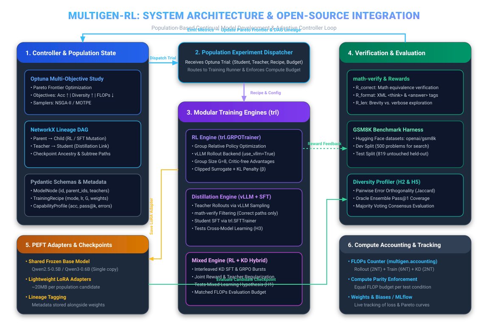
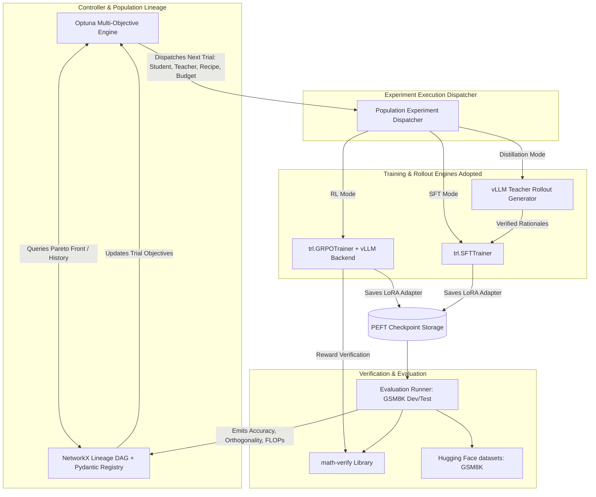
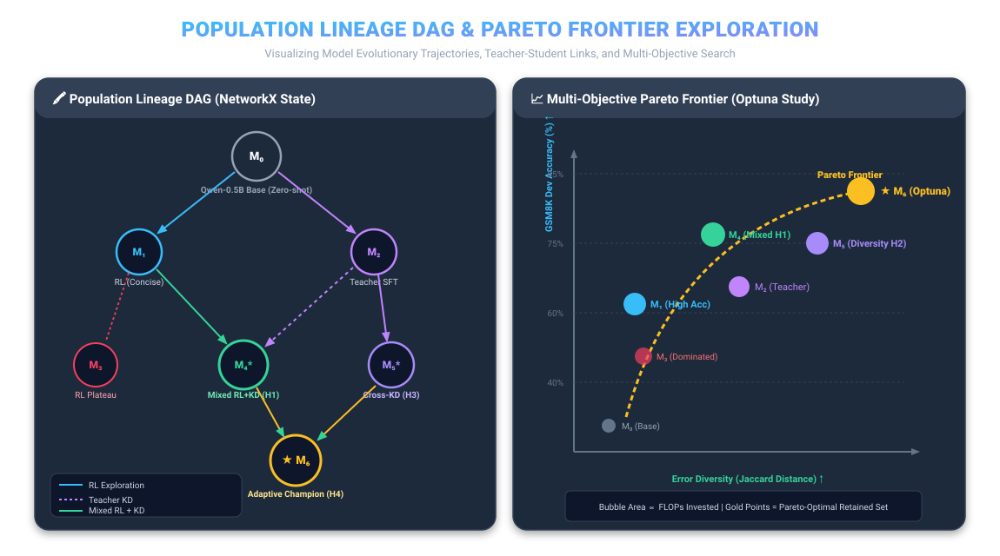
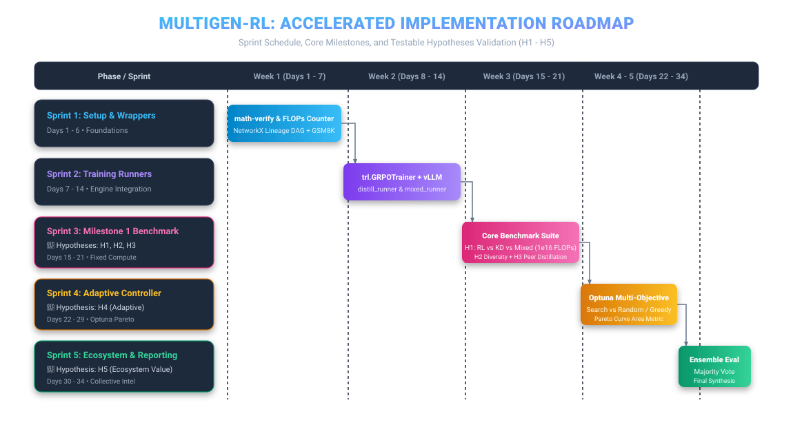
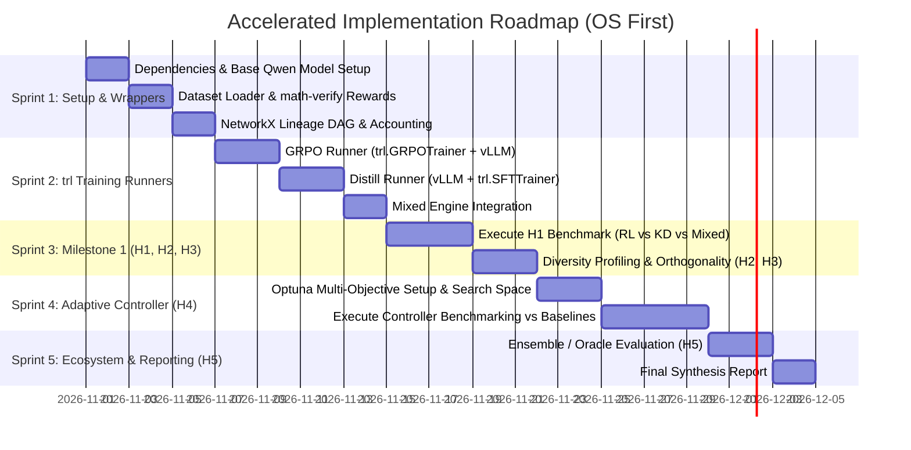

# Implementation Plan: Population-Based Continual Model Development & Adaptive Experimentation
*(Open-Source-First Architecture)*

---

## 1. Executive Summary & Design Philosophy

### 1.1 Context and Problem Statement
Conventional language model post-training pipelines follow rigid, monolithic recipes: standard Supervised Fine-Tuning (SFT) followed by Reinforcement Learning from Human/Rule Feedback (RLHF/RLAIF) in a strictly linear, single-checkpoint chain. This approach has critical drawbacks:
1. **Sample and Compute Inefficiency:** Linear pipelines discard intermediate discoveries and struggle to escape local minima or collapse under narrow reward signals.
2. **Homogeneity and Mode Collapse:** Standard optimization pushes the model toward a single dominant reasoning mode, sacrificing solution diversity, edge-case coverage, and complementarity.
3. **Lack of Cross-Model Synergies:** Knowledge transfer is typically unidirectional (e.g., a static massive teacher distilling into a smaller student) rather than bidirectional or multi-agent co-evolution within a dynamic population.

This project implements an experimental framework for the **continual improvement of language models through an interacting population of model variants governed by an adaptive experiment controller**. The framework maintains a diverse ecosystem of models with varying training histories, reward objectives, capabilities, and teacher–student dynamics, navigating the Pareto frontier of performance, reasoning diversity, and compute efficiency.

### 1.2 Core Research Question
> *Can population-based model development, combined with adaptive experiment selection, discover better models—or more useful collections of models—with less compute than conventional, fixed training pipelines?*

### 1.3 Hypotheses Matrix
| ID | Hypothesis | Key Question | Primary Metric |
| :--- | :--- | :--- | :--- |
| **H1** | **Mixed Learning** | Does combining RL with teacher distillation outperform RL-only training at matched compute? | Accuracy on held-out test split under equal token/FLOP budgets. |
| **H2** | **Useful Diversity** | Do varied rewards and training objectives yield models with complementary failure modes rather than simple monotonic rankings? | Error orthogonality, union pass@k (Ensemble Oracle pass@1), distinct solution path clustering. |
| **H3** | **Cross-Model Learning**| Can distillation from a peer population member unblock or accelerate a student beyond its isolated RL trajectory? | Student delta performance ($\Delta \text{Acc}$) post-distillation vs continuation of self-RL. |
| **H4** | **Adaptive Selection** | Can a controller utilizing historical lineage and evaluation outcomes choose more productive experiments than static or random schedules? | Area under the Pareto curve (Performance vs Compute) and discovery speed of top models. |
| **H5** | **Ecosystem-Level Value**| Does preserving a complementary ensemble/pool of models outperform a single highest-scoring checkpoint on real-world test distributions? | Consensus/Selection-based evaluation (e.g., Best-of-$N$, Majority Voting, MoE routing) vs Single-best model. |

### 1.4 Initial Scope & Guardrails
- **Base Model:** `Qwen2.5-Math-0.5B` / `Qwen2.5-0.5B` / `Qwen3-0.6B` (fast iteration, low memory overhead, strong baseline reasoning capability).
- **Task Domain:** Mathematical reasoning on **GSM8K** (clean ground-truth verification, deterministic reward signals, tractable rollout generation).
- **Budget Control:** Standardized compute accounting measured in **Total Active Floating Point Operations (FLOPs)** and **Normalized Training/Rollout Tokens**, ensuring strict parity across baseline comparisons.

---

## 2. Open-Source Component Breakdown & What We Use It For

To maximize development velocity and reliability, we directly adopt battle-tested open-source libraries for standard infrastructure:

| Open-Source Tool | Subsystem Category | What We Will Use It For (Specific Role in Project) |
| :--- | :--- | :--- |
| **Hugging Face `trl` (`GRPOTrainer`)** | Reinforcement Learning | **Executing RL operations on student models:** Trains student checkpoints using Group Relative Policy Optimization without needing a separate critic model, computing advantages directly on group rollouts. |
| **`vLLM`** | Inference & Rollout Engine | **Accelerating rollout generation:** Integrated directly into `GRPOTrainer` (`use_vllm=True`) for fast policy rollouts, and used independently to synthesize high-throughput teacher reasoning traces during distillation. |
| **Hugging Face `trl` (`SFTTrainer`)** | Supervised Fine-Tuning | **Executing SFT and distillation updates:** Trains student adapters on verified reasoning traces (either seed demonstrations or teacher distillation trajectories). |
| **`math-verify`** (Hugging Face / DeepSeek) | Answer Parsing & Verification | **Evaluating mathematical answers deterministically:** Parses candidate solution strings and verifies correctness against GSM8K ground truth (handling LaTeX formatting, fractions, decimals, and units) to provide binary reward signals. |
| **Hugging Face `datasets`** | Data Ingestion | **Standardized benchmark loading:** Loads the official `openai/gsm8k` dataset, manages deterministic train (7,473), dev (500), and test (819) splits, and handles tokenized caching. |
| **`peft` (LoRA / QLoRA)** | Parameter-Efficient Fine-Tuning | **Saving lightweight model branches:** Saves each population candidate as a compact LoRA adapter (~20MB to ~50MB) attached to the frozen shared base model, enabling large population trees on standard disk storage. |
| **`Optuna`** | Adaptive Experiment Controller | **Governing adaptive experiment selection:** Solves the multi-objective Pareto optimization problem (maximizing accuracy, maximizing diversity, minimizing FLOPs), choosing candidate students, teachers, recipes, and token budgets for the next experiment. |
| **`NetworkX`** | Lineage Graph & DAG Management | **Tracking population lineage:** Maintains the Directed Acyclic Graph (DAG) of all model checkpoints, recording parent-child connections, teacher-student relationships, and cumulative compute paths. |
| **`Pydantic`** | Data Modeling & Validation | **Enforcing structured schemas:** Validates and serializes metadata for `ModelNode`, `TrainingRecipe`, `CapabilityProfile`, and experiment logs across all components. |
| **`Weights & Biases` (`wandb`) / `MLflow`** | Experiment Tracking | **Visualizing experiment outcomes:** Logs loss trajectories, reward distributions, per-trial capability profiles, and live Pareto frontier curves across generations. |
| **`calflops`** | Compute Accounting | **Enforcing compute parity:** Calculates theoretical FLOPs across rollouts, inference, and backpropagation steps ($6 \times N \times T$) to ensure rigorous, fair budget enforcement. |

---

## 3. High-Level Architecture & Integration Flow



The framework acts as an orchestration layer connecting these open-source tools:



---

## 4. Subsystem Details, Roles, & Explicit Use Cases

This section specifies every component of the codebase, detailing its exact purpose, role, inputs, and outputs.

### 4.1 Compute Accounting Subsystem (`multigen.accounting`)

#### `multigen.accounting.flops`
- **What we will use it for:**
  - Measuring and enforcing **strict compute parity** across all training conditions (RL vs Distillation vs Mixed).
  - Calculating theoretical FLOPs for:
    1. **Rollout generation:** $2 \times N_{\text{params}} \times N_{\text{tokens}}$
    2. **Backpropagation training:** $6 \times N_{\text{params}} \times N_{\text{tokens}}$
    3. **Teacher inference:** $2 \times N_{\text{teacher\_params}} \times N_{\text{tokens}}$
  - Preventing unfair baselines where one training method consumes more compute than another.
- **Inputs:** Number of model parameters ($N$), prompt token count, generation token count, training token count, backward pass flag.
- **Outputs:** Standardized FLOP value (float) and token count (int) logged to the experiment trial.

---

### 4.2 Population State & Lineage Subsystem (`multigen.core`)

#### `multigen.core.schema`
- **What we will use it for:**
  - Providing strongly-typed data contracts (`Pydantic` models) for the entire framework.
  - Representing:
    - `TrainingRecipe`: Specifies training mode (`grpo`, `distill`, `sft`, `mixed`), learning rate, group size $G$, reward weights, teacher ID, and token budget.
    - `CapabilityProfile`: Holds evaluation outcomes (GSM8K Dev Accuracy, Pass@$k$, average solution length, error signature set).
    - `ModelNode`: Checkpoint metadata (unique ID, parent IDs, teacher IDs, LoRA adapter path, cumulative FLOPs, creation timestamp).
- **Inputs:** Raw experiment configuration and evaluation dictionaries.
- **Outputs:** Validated Pydantic objects serialized to/from JSON.

#### `multigen.core.population_dag`
- **What we will use it for:**
  - Managing the evolutionary population tree via an in-memory and persisted `NetworkX.DiGraph`.
  - Storing parent $\to$ child edges (mutation via RL or SFT) and teacher $\to$ student edges (distillation).
  - Querying candidate parents and teachers for the controller.
  - Computing lineage metrics: generational depth, ancestral paths, and total compute invested in a model's subtree.
  - Managing disk garbage collection: Pruning or offloading low-performing checkpoints while preserving the Pareto frontier.
- **Inputs:** New `ModelNode` additions, edge definitions, query requests.
- **Outputs:** Subgraphs, lists of candidate parent IDs, ancestor lineages, and GraphML visualizations.

---

### 4.3 Evaluation & Verification Subsystem (`multigen.eval`)

#### `multigen.eval.rewards`
- **What we will use it for:**
  - Providing reward function callbacks to `trl.GRPOTrainer`.
  - **Correctness Reward ($R_{\text{correct}}$):** Extracts candidate answers from model completions and uses `math-verify` to check mathematical equivalence against the GSM8K gold answer ($+1.0$ if correct, $0.0$ if incorrect).
  - **Format Reward ($R_{\text{format}}$):** Enforces structured reasoning by awarding points for valid `<think> ... </think>` and `<answer> ... </answer>` tags.
  - **Length Penalty ($R_{\text{len}}$):** Modulates reward based on completion length to train both succinct and exploratory reasoning variants (testing Hypothesis **H2**).
- **Inputs:** Prompts, model completions, reference answers.
- **Outputs:** List of float rewards passed directly to the `GRPOTrainer` loss computation.

#### `multigen.eval.evaluator`
- **What we will use it for:**
  - Executing standardized, repeatable evaluations on the held-out GSM8K dev set (500 problems) and test set (819 problems).
  - Generating model predictions using `vLLM` in greedy mode ($T=0$) or sampling mode ($T=0.7$) for Pass@$k$.
  - Computing accuracy, response latency, and extracting the exact set of failed problem indices for diversity profiling.
- **Inputs:** Model checkpoint (LoRA adapter path) and target evaluation split.
- **Outputs:** `CapabilityProfile` containing accuracy, Pass@1, Pass@4, and error indices.

#### `multigen.eval.diversity`
- **What we will use it for:**
  - Testing Hypotheses **H2** (Useful Diversity) and **H5** (Ecosystem Value).
  - **Error Orthogonality:** Calculating pairwise Jaccard distance between the error sets of two population models:
    $$D_{\text{err}}(A, B) = 1 - \frac{|\mathcal{E}_A \cap \mathcal{E}_B|}{|\mathcal{E}_A \cup \mathcal{E}_B|}$$
  - **Oracle Ensemble Pass@1:** Measuring the percentage of problems solved by *at least one* model in a candidate pool.
  - **Majority Voting (Self-Consistency):** Evaluating whether an ensemble of diverse population models outperforms self-consistency from a single top model.
- **Inputs:** Evaluation results (error index sets) from multiple population models.
- **Outputs:** Pairwise distance matrix, oracle ensemble score, and majority-vote accuracy.

---

### 4.4 Modular Training Runners (`multigen.training`)

#### `multigen.training.grpo_runner`
- **What we will use it for:**
  - Running reinforcement learning experiments on a selected student checkpoint using `trl.GRPOTrainer`.
  - Utilizing `vLLM` under the hood to generate candidate reasoning traces in parallel groups of size $G$ (e.g., $G=8$).
  - Computing relative advantages across the group and updating model weights with clipped surrogate objectives and KL penalties.
  - Saving the resulting weights as a new PEFT LoRA adapter.
- **Inputs:** Student model adapter path, training split, reward functions (`multigen.eval.rewards`), compute budget (epochs/steps).
- **Outputs:** Newly trained LoRA adapter checkpoint, training loss curves, and token consumption logs.

#### `multigen.training.sft_runner`
- **What we will use it for:**
  - Executing standard supervised fine-tuning using `trl.SFTTrainer`.
  - Fine-tuning base models on initial human/seed demonstration reasoning traces.
  - Training student models on curated reasoning datasets.
- **Inputs:** Base model or student checkpoint, dataset of question-reasoning pairs, training hyperparameters.
- **Outputs:** Trained LoRA adapter checkpoint and training metrics.

#### `multigen.training.distill_runner`
- **What we will use it for:**
  - Executing peer-to-peer and teacher-to-student knowledge distillation to test Hypothesis **H3**.
  - **Two-Stage Process:**
    1. **Teacher Generation:** Uses `vLLM` to load the designated teacher checkpoint and sample multiple reasoning rollouts for GSM8K training problems.
    2. **Verifier Filtering:** Filters rollouts using `math-verify`, keeping only reasoning paths that arrive at the correct answer.
    3. **Student SFT:** Uses `trl.SFTTrainer` to train the student adapter on the teacher's verified reasoning traces.
- **Inputs:** Student checkpoint ID, teacher checkpoint ID, training problem queries, token budget.
- **Outputs:** Distilled student LoRA adapter checkpoint and compute consumption records.

#### `multigen.training.mixed_runner`
- **What we will use it for:**
  - Executing hybrid training combining RL exploration with teacher guidance to test Hypothesis **H1** (Mixed Learning).
  - Supports two operational modes:
    1. **Interleaved Cycles:** Alternates between a distillation burst (SFT on peer verified traces via `distill_runner`) and an RL burst (exploration via `grpo_runner`).
    2. **Teacher-Regularized GRPO:** Samples student rollouts, scores them with verifiers, and injects teacher guidance as reference logit penalties or preference regularization.
- **Inputs:** Student checkpoint ID, teacher checkpoint ID, training config, compute allocation.
- **Outputs:** Hybrid-trained LoRA adapter checkpoint.

---

### 4.5 Experiment Controller Subsystem (`multigen.controller`)



#### `multigen.controller.controller_study`
- **What we will use it for:**
  - Acting as the brain of the ecosystem, governing how the population evolves over time (testing Hypothesis **H4**).
  - Wrapping an **`Optuna` Multi-Objective Study** (using `NSGAIISampler` or `TPESampler`).
  - At each step, Optuna suggests the next experiment trial by sampling from the search space:
    - `student_id`: Which existing model in the population DAG to train next.
    - `recipe_type`: Which training mode to run (`grpo`, `distill`, `mixed`).
    - `teacher_id`: Which peer model to use as a teacher (if distillation/mixed).
    - `reward_weights`: Objective weights for correctness, formatting, and brevity.
    - `token_budget`: How much compute to allocate to this experiment.
  - Receives evaluation results (Dev Accuracy, Diversity Distance, Cumulative FLOPs) and updates the **Pareto frontier**.
- **Inputs:** Current population state from `NetworkX`, historical experiment results, global compute budget.
- **Outputs:** Next trial configuration to execute, updated Pareto front analysis.

#### `multigen.controller.baselines`
- **What we will use it for:**
  - Providing control baselines to rigorously validate whether the adaptive controller is genuinely superior (Hypothesis **H4**):
    - **`RandomController`:** Randomly selects a parent checkpoint, training recipe, and teacher.
    - **`GreedyController`:** Always selects the highest-accuracy checkpoint in the population and applies a fixed, standard training schedule.
- **Inputs:** Current population state and fixed budget constraints.
- **Outputs:** Next trial configuration according to baseline logic.

---

### 4.6 Experiment Runner Scripts (`scripts/`)

#### `scripts/run_mixed_experiment.py`
- **What we will use it for:**
  - Executing the Milestone 1 benchmark to test **H1** (Mixed Learning vs RL-only vs Distill-only).
  - Running each condition under identical compute constraints ($1.0 \times 10^{16}$ FLOPs) on `Qwen2.5-0.5B` and logging held-out GSM8K accuracy curves.

#### `scripts/run_controller.py`
- **What we will use it for:**
  - Executing the main autonomous population evolution loop.
  - Coordinates the controller (Optuna), the training dispatchers (`grpo_runner`, `distill_runner`), the evaluator, and the lineage DAG until the cumulative compute budget is exhausted.

#### `scripts/evaluate_population.py`
- **What we will use it for:**
  - Performing comprehensive post-hoc analysis on the evolved population.
  - Computing the full error orthogonality matrix (testing **H2**), peer distillation boost (testing **H3**), and ensemble/majority-voting performance vs single-best model (testing **H5**).

---

## 5. Annotated Repository Layout & Component File Mapping

Every file in the repository has a dedicated, single responsibility:

```text
multigen-rl/
├── README.md                           # Project overview, quickstart, and reproducibility instructions
├── pyproject.toml                      # Package configuration & dependencies (torch, trl, vllm, math-verify, etc.)
├── docs/
│   ├── implementaiton_plan.md          # Primary plan with component purposes (this document)
│   ├── experiment_plan.md              # Sequential experiment roadmap, hypotheses, success & failure metrics
│   ├── architecture.md                 # Detailed interaction diagrams and data flows
│   └── experiment_protocol.md          # Compute budgeting rules, FLOP calculations, and evaluation splits
├── configs/
│   ├── default_env.yaml                # Base paths, base model name (Qwen2.5-0.5B), default output dir
│   └── experiments/
│       ├── h1_mixed_learning.yaml      # Compute budget and hyperparameters for H1 benchmark
│       └── h4_adaptive_search.yaml     # Search space, sampler settings, and budget for H4 controller search
├── multigen/
│   ├── __init__.py
│   ├── accounting/
│   │   ├── __init__.py
│   │   └── flops.py                    # WHAT WE USE IT FOR: Enforces exact token and FLOP compute parity
│   ├── core/
│   │   ├── __init__.py
│   │   ├── schema.py                   # WHAT WE USE IT FOR: Pydantic schemas (ModelNode, Recipe, Metrics)
│   │   └── population_dag.py           # WHAT WE USE IT FOR: NetworkX DAG tracking checkpoint ancestry & lineages
│   ├── eval/
│   │   ├── __init__.py
│   │   ├── rewards.py                  # WHAT WE USE IT FOR: trl reward callbacks using math-verify
│   │   ├── evaluator.py                # WHAT WE USE IT FOR: Batch GSM8K dev/test evaluator with vLLM
│   │   └── diversity.py                # WHAT WE USE IT FOR: Error orthogonality & ensemble oracle metrics (H2/H5)
│   ├── training/
│   │   ├── __init__.py
│   │   ├── grpo_runner.py              # WHAT WE USE IT FOR: Executes RL training via trl.GRPOTrainer + vLLM
│   │   ├── sft_runner.py               # WHAT WE USE IT FOR: Executes supervised fine-tuning via trl.SFTTrainer
│   │   ├── distill_runner.py           # WHAT WE USE IT FOR: Generates teacher traces with vLLM & distills into student
│   │   └── mixed_runner.py             # WHAT WE USE IT FOR: Orchestrates joint/interleaved RL + KD training (H1)
│   └── controller/
│       ├── __init__.py
│       ├── controller_study.py         # WHAT WE USE IT FOR: Optuna multi-objective search governing population evolution
│       └── baselines.py                # WHAT WE USE IT FOR: Random and Greedy baseline controllers for H4 comparison
├── scripts/
│   ├── run_mixed_experiment.py         # WHAT WE USE IT FOR: CLI to run Milestone 1 (H1: RL vs Distill vs Mixed)
│   ├── run_controller.py               # WHAT WE USE IT FOR: CLI to run autonomous population evolution loop (H4)
│   └── evaluate_population.py          # WHAT WE USE IT FOR: CLI to profile population diversity and ensembles (H2/H5)
└── tests/
    ├── test_rewards.py                 # WHAT WE USE IT FOR: Validates math-verify edge cases (fractions, negative nums)
    ├── test_population_dag.py          # WHAT WE USE IT FOR: Validates DAG parent-child and teacher links
    └── test_flops.py                   # WHAT WE USE IT FOR: Validates theoretical FLOP calculation formulas
```

---

## 6. Phased Implementation Roadmap (Accelerated by Reuse)





### Sprint 1: Environment, Verification, & State (Days 1–6)
- **Goal:** Establish dependencies, ground-truth verification, compute tracking, and the lineage DAG.
- **Tasks:**
  - Setup `pyproject.toml` with `torch`, `transformers`, `trl`, `peft`, `vllm`, `math-verify`, `datasets`, `optuna`, `networkx`.
  - Implement `multigen/accounting/flops.py` for token and FLOP accounting.
  - Implement `multigen/eval/rewards.py` wrapping `math-verify` for correctness, formatting, and brevity rewards.
  - Implement `multigen/core/schema.py` and `population_dag.py` wrapping `NetworkX` and `Pydantic`.
  - Verify with unit tests in `tests/`.

### Sprint 2: Training Runners (Days 7–14)
- **Goal:** Connect open-source training backends to the framework.
- **Tasks:**
  - Implement `multigen/training/grpo_runner.py` wrapping `trl.GRPOTrainer` with `vLLM` rollout backend.
  - Implement `multigen/training/distill_runner.py` (vLLM teacher sampling $\to$ math-verify filter $\to$ `trl.SFTTrainer`).
  - Implement `multigen/training/mixed_runner.py` for interleaved/joint training.
  - Run a 100-sample test run on GSM8K to verify loss convergence and reward improvement.

### Sprint 3: Milestone 1 Validation (H1, H2, H3) (Days 15–21)
- **Goal:** Execute first experimental benchmark under matched compute ($1.0 \times 10^{16}$ FLOPs each).
- **Conditions:**
  1. Base model baseline (`Qwen2.5-0.5B`)
  2. Pure RL (`grpo_runner`)
  3. Pure Distillation (`distill_runner` with a stronger reference teacher)
  4. Mixed RL + Distillation (`mixed_runner`)
- **Evaluation:**
  - Test **H1**: Compare test accuracy curves under fixed FLOP constraints.
  - Test **H2**: Profile error orthogonality between models trained with different reward weights.
  - Test **H3**: Measure peer-distillation improvements on plateaued RL students.

### Sprint 4: Adaptive Controller & H4 Validation (Days 22–29)
- **Goal:** Validate adaptive experiment selection against fixed and random schedules.
- **Tasks:**
  - Implement `multigen/controller/controller_study.py` using `Optuna`.
  - Implement `multigen/controller/baselines.py` (`RandomController`, `GreedyController`).
  - Run comparative searches under an identical total compute budget ($B_{\text{search}}$).
  - Test **H4**: Measure area under the Pareto curve and speed of discovering top-performing models.

### Sprint 5: Ecosystem Analysis & H5 Validation (Days 30–34)
- **Goal:** Test whether a complementary population outperforms any single model.
- **Tasks:**
  - Implement `scripts/evaluate_population.py`.
  - Evaluate Majority Voting and Best-of-$N$ across diverse population members vs self-consistency from the single best checkpoint.
  - Test **H5**: Quantify ecosystem-level problem coverage.
  - Produce final benchmark synthesis report.

---

## 7. Immediate Action Items

1. [x] Implementation Plan documented with open-source mapping and explicit component purposes.
2. [ ] Initialize project configuration (`pyproject.toml`) and environment dependencies.
3. [ ] Implement core math verification reward functions in `multigen/eval/rewards.py`.
4. [ ] Implement FLOP counter in `multigen/accounting/flops.py`.
5. [ ] Implement Population DAG in `multigen/core/population_dag.py`.
6. [ ] Implement GRPO training runner in `multigen/training/grpo_runner.py`.
