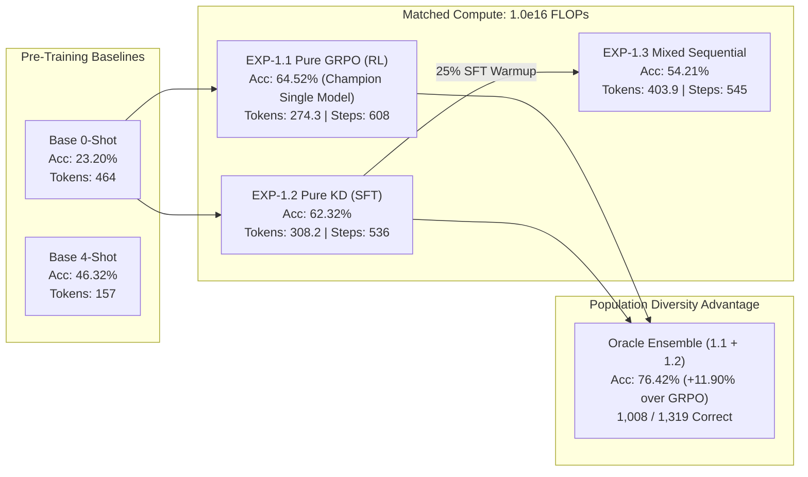
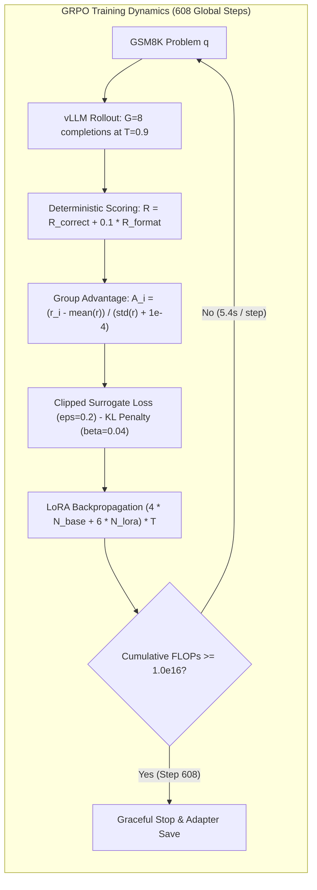
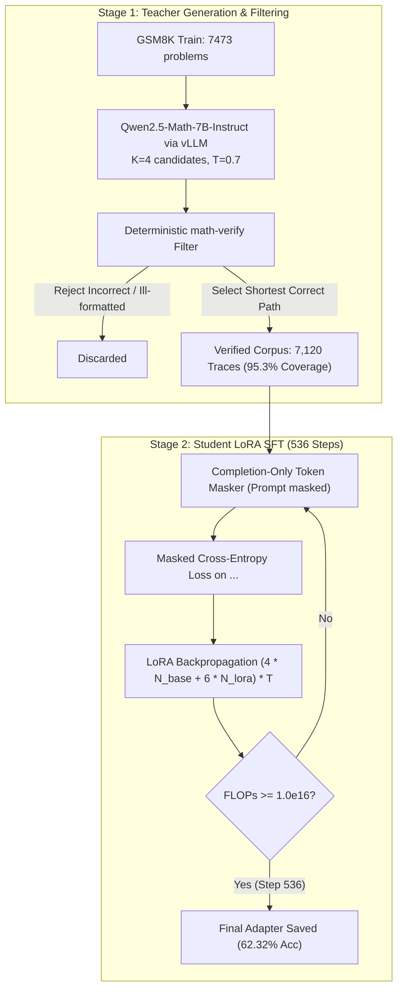
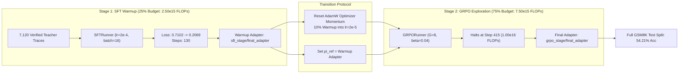
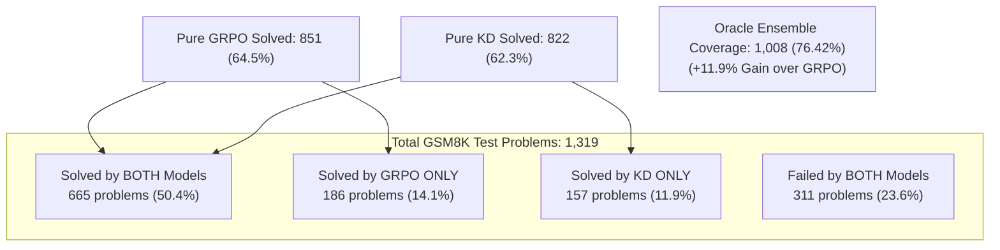

# Phase 1 Comprehensive Experiment Report: Foundational Baselines & Mixed Learning

**Author:** Multigen-RL Research & Core Engineering Team  
**Date:** November 16, 2026  
**Scope:** Evaluation of Baseline (Frozen Qwen3-0.6B), EXP-1.1 (Pure GRPO), EXP-1.2 (Pure Knowledge Distillation), and EXP-1.3 (Mixed Learning)  
**Parent Roadmap:** [Sequential Experiment Plan](../docs/experiment_plan.md) | [Phase 1 Milestone Plan](../docs/implementaiton_plan.md)  
**Reference Compute Target:** Strictly Equalized Compute Ceiling ($1.0 \times 10^{16}$ FLOPs) on GSM8K Test Split ($N=1,319$)

---

## 1. Executive Summary & Master Benchmark Scorecard

Phase 1 of the **Multigen-RL** framework establishes the foundational empirical anchors for evolutionary population training of small reasoning models ($0.6\text{B}$ parameters). The primary objective was to investigate **Hypothesis H1 (Mixed Learning)**:

> **Hypothesis H1:** *Combining high-capacity teacher distillation with exploratory reinforcement learning outperforms pure RL-only and pure KD-only training under strictly matched compute budgets.*

To evaluate this question with absolute scientific rigor, all trained configurations were restricted to an identical compute ceiling of **$1.0 \times 10^{16}$ FLOPs** (accounting for all rollout sampling, reference policy log-probability passes, and backpropagation FLOPs), utilizing identical parameter-efficient Low-Rank Adaptation (LoRA) structures on top of frozen `Qwen/Qwen3-0.6B`.

### Master Benchmark Comparison Table

| Paradigm / Experiment | Base Model | Teacher / Supervisor | Training FLOP Budget | Global Steps | GSM8K Strict Accuracy | GSM8K Permissive Accuracy | Mean Output Tokens | Test Inference Wall-clock |
| :--- | :--- | :--- | :---: | :---: | :---: | :---: | :---: | :---: |
| **EXP-0.1 Baseline (0-Shot)** | `Qwen3-0.6B` | None (Frozen Base) | $0.0$ | $0$ | **23.20%** (306/1319) | 41.47% (547/1319) | 464.0 | 82.7 s |
| **EXP-0.1 Baseline (4-Shot)** | `Qwen3-0.6B` | 4 In-Context Examples | $0.0$ | $0$ | **46.32%** (611/1319) | 50.80% (670/1319) | 156.6 | 50.0 s |
| **EXP-1.1 Standalone GRPO** | `Qwen3-0.6B` + LoRA | None (Self-Exploration) | $1.0003 \times 10^{16}$ | 608 | **64.52%** (851/1319) | 64.75% (854/1319) | 274.3 | 55.0 s |
| **EXP-1.2 Standalone KD (SFT)** | `Qwen3-0.6B` + LoRA | `Qwen2.5-Math-7B-Inst` | $1.0017 \times 10^{16}$ | 536 | **62.32%** (822/1319) | 62.47% (824/1319) | 308.2 | 67.5 s |
| **EXP-1.3 Mixed Learning** | `Qwen3-0.6B` + LoRA | 25% KD $\to$ 75% GRPO | $1.0000 \times 10^{16}$ | 130 SFT + 415 GRPO | **54.21%** (715/1319) | 58.07% (766/1319) | 403.9 | 127.3 s |
| **Oracle Ensemble (1.1 $\cup$ 1.2)** | Portfolio Pair | Joint Coverage | $2.0 \times 10^{16}$ | 1,144 | **76.42%** (1008/1319) | 76.57% (1010/1319) | 291.3 | — |



### Core Takeaways & Executive Insights

1. **Pure RL (GRPO) Emerges as the Strongest Single Paradigm (64.52%):**  
   Self-exploratory reinforcement learning using Group Relative Policy Optimization (`EXP-1.1`) achieved the highest single-model accuracy, improving by **+41.32%** over base zero-shot and **+18.20%** over base 4-shot. It developed concise, highly efficient chain-of-thought derivations (mean length: 274.3 tokens).

2. **Pure Distillation (KD) Delivers Stable, High-Quality Reasoning (62.32%):**  
   Supervised fine-tuning on 7,120 verified rationales curated from `Qwen/Qwen2.5-Math-7B-Instruct` (`EXP-1.2`) closely tracked the RL baseline, reaching **62.32%**. KD produced highly structured, step-by-step proofs but plateaus slightly below RL due to imitation boundaries.

3. **Hypothesis H1 Fails in Sequential Phased Mode (54.21%):**  
   Chaining a 25% SFT warmup directly into a 75% GRPO phase (`EXP-1.3`) under fixed compute parity underperformed both pure baselines. Root-cause analysis reveals that:
   - **Rationale verbosity bloat** inherited from the 7B teacher increased completion lengths to 403.9 tokens (+47% longer than GRPO), inflating per-step FLOPs and reducing total exploration steps by 32% (415 vs 608 steps).
   - **Reference model KL locking** anchored the policy to a partially converged SFT checkpoint ($\beta = 0.04$), restricting policy freedom.

4. **Massive Solution Space Orthogonality Validates Population Theory (76.42% Oracle):**  
   Despite comparable overall accuracy, EXP-1.1 (RL) and EXP-1.2 (KD) developed markedly orthogonal problem-solving capabilities. EXP-1.1 solved **186 problems** failed by EXP-1.2, while EXP-1.2 solved **157 problems** failed by EXP-1.1. Combining their predictions yields an oracle ensemble accuracy of **76.42%** (+11.90% over the best individual model), demonstrating the immense value of lineage diversity in Multigen-RL.

---

## 2. Baseline Evaluation: EXP-0.1 & Frozen Base Model

### 2.1 Objective & Experimental Setup
`EXP-0.1` establishes the baseline performance of the unadapted foundation model on GSM8K to calibrate the evaluation suite, verify deterministic parsing via `math-verify`, and isolate the performance floor $\mathcal{E}_{\text{base}}$.

- **Model:** `Qwen/Qwen3-0.6B` (Dense decoder-only Transformer, 28 layers, hidden dimension 1024, vocabulary size 151,936, active parameters $N_{\text{base}} \approx 5.90 \times 10^8$).
- **Inference Harness:** `vLLM` engine on Nvidia L4/A10G GPU, greedy decoding ($T = 0.0$, max tokens 512).
- **Dataset Partitioning:**
  - Official GSM8K Test Split: 1,319 problems.
  - Carved Dev Split: 500 problems (deterministic `seed=42`).
  - Carved Train Split: 6,973 problems.
- **Answer Extraction Pipeline:** Deterministic hierarchical extraction implemented in `multigen/eval/rewards.py`:
  1. `<answer>(.*?)</answer>` XML block.
  2. Balanced-brace LaTeX `\boxed{...}` extraction.
  3. GSM8K standard `####\s*(.+)` notation.
  4. Diagnostic fallback: final numeric token (enabled for `permissive_accuracy` only).

### 2.2 Numerical Results & Behavioral Observations

```
==================================================================
EXP-0.1 BASELINE BENCHMARK SUMMARY (Qwen/Qwen3-0.6B, 1319 Test Samples)
==================================================================
Mode: Zero-Shot (Greedy T=0)
  * Strict Verifier Accuracy:  23.20% (306 / 1319)
  * Permissive Accuracy:       41.47% (547 / 1319)
  * Format Compliance:         0.00%
  * Mean Completion Length:   464.0 tokens
  * Evaluation Time:          82.7 s (15.9 problems/s)

Mode: 4-Shot In-Context Demonstrations (Greedy T=0)
  * Strict Verifier Accuracy:  46.32% (611 / 1319)
  * Permissive Accuracy:       50.80% (670 / 1319)
  * Format Compliance:         0.00%
  * Mean Completion Length:   156.6 tokens
  * Evaluation Time:          50.0 s (26.4 problems/s)
==================================================================
```

### 2.3 Diagnostic Insights
1. **The In-Context Learning Gap (+23.12%):** Providing 4 in-context reasoning demonstrations doubled strict accuracy from 23.20% to 46.32%. The unadapted base model possesses latent arithmetic ability but struggles to isolate final numerical answers without structural prompting.
2. **Permissive vs. Strict Discrepancy:** In zero-shot mode, permissive accuracy (41.47%) was nearly double strict accuracy (23.20%). The base model frequently arrives at the correct arithmetic quantity in prose but fails to enclose it in delimiters (`\boxed{}` or `<answer>`), causing strict verifiers to fail.
3. **Verbosity & Meandering in Zero-Shot:** Zero-shot completions averaged 464.0 tokens (frequently hitting the 512 token ceiling without terminating), whereas 4-shot completions compressed to 156.6 tokens by imitating the concise demonstrations.

---

## 3. Experiment 1.1: Standalone Reinforcement Learning (GRPO) Baseline

### 3.1 Objective & Optimization Dynamics
`EXP-1.1` isolates the pure reinforcement learning performance ceiling under a strict compute budget of $1.0 \times 10^{16}$ FLOPs using Group Relative Policy Optimization (GRPO) without teacher guidance.



### 3.2 Algorithm & Parameter Specifications

- **Algorithm:** Group Relative Policy Optimization (GRPO) via `multigen/training/grpo_runner.py` wrapping Hugging Face `trl.GRPOTrainer`.
- **Base Policy:** `Qwen/Qwen3-0.6B` ($N_{\text{base}} \approx 5.9 \times 10^8$).
- **PEFT Architecture:** LoRA ($r = 16, \alpha = 32$, dropout $0.05$, scaling factor $\alpha/r = 2.0$). Target modules: `q_proj`, `k_proj`, `v_proj`, `o_proj`, `gate_proj`, `up_proj`, `down_proj`. Trainable parameters: $7,405,568$ ($\approx 1.25\%$ parameter overhead).
- **Group Rollout Sampling:** Group size $G = 8$, generation temperature $T = 0.9$, top-$p = 1.0$, max completion length $512$ tokens. Accelerated via asynchronous `vLLM` engine.
- **Objective Function:**
  $$\mathcal{J}_{\text{GRPO}}(\theta) = \mathbb{E} \left[ \frac{1}{G} \sum_{i=1}^G \min \left( \rho_i(\theta) \hat{A}_i, \, \text{clip}(\rho_i(\theta), 1-\epsilon, 1+\epsilon) \hat{A}_i \right) - \beta D_{\text{KL}}(\pi_\theta \parallel \pi_{\text{ref}}) \right]$$
  - Clipping threshold: $\epsilon = 0.2$.
  - Reference model: Frozen base `Qwen/Qwen3-0.6B` ($\pi_{\text{ref}}$).
  - KL divergence coefficient: $\beta = 0.04$ using the unbiased Schulman estimator.
- **Reward Function:**
  $$R(q, o) = R_{\text{correctness}}(o, y^*) + 0.1 \times R_{\text{format}}(o)$$
  - $R_{\text{correctness}} \in \{0.0, 1.0\}$: Evaluated via deterministic `math-verify`.
  - $R_{\text{format}} \in \{0.0, 1.0\}$: Non-empty `<think>...</think><answer>...</answer>`.
- **Optimizer & Schedule:** AdamW, learning rate $\eta = 2.0 \times 10^{-5}$, $\beta_1 = 0.9, \beta_2 = 0.999$, weight decay $0.01$, linear warmup over 10% of steps.
- **Compute Accounting:** Dynamic budget callback `FLOPBudgetCallback` accumulating:
  $$\text{FLOPs}_{\text{step}} = G \times \left[ 2 N_{\text{base}} T_{\text{total}} + 2 N_{\text{base}} T_{\text{total}} + (4 N_{\text{base}} + 6 N_{\text{lora}}) T_{\text{total}} \right] \approx G \times 8 N_{\text{base}} T_{\text{total}}$$
  Budget limit: $1.0 \times 10^{16}$ FLOPs.

### 3.3 Empirical Results & Performance Analysis

| Metric | Baseline 0-Shot | Smoke Test (1.0e14 FLOPs) | EXP-1.1 Production (1.0e16 FLOPs) | $\Delta$ vs Baseline |
| :--- | :---: | :---: | :---: | :---: |
| **Strict Accuracy** | 23.20% | 23.43% | **64.52%** (851/1319) | **+41.32%** |
| **Permissive Accuracy** | 41.47% | 42.30% | **64.75%** (854/1319) | **+23.28%** |
| **Mean Completion Length** | 464.0 tokens | 456.4 tokens | **274.3 tokens** | **-189.7 tokens** |
| **Test Wall-clock Time** | 82.7 s | 91.7 s | **55.0 s** | -27.7 s |
| **Total Global Steps** | 0 | 6 | **608 steps** | — |
| **Cumulative FLOPs** | 0 | $1.0003 \times 10^{14}$ | **$1.0003 \times 10^{16}$** (100.03%) | — |

### 3.4 Key Behavioral Dynamics
1. **Convergence of Strict and Permissive Metrics:** In the base model, permissive accuracy exceeded strict accuracy by $18.27\%$ due to formatting failures. In EXP-1.1, strict accuracy (64.52%) and permissive accuracy (64.75%) converged to within $0.23\%$. GRPO trained the model to cleanly encapsulate its final answer in $\LaTeX$ `\boxed{}` tags.
2. **Autonomous Rationale Condensation:** Without length penalties, the policy autonomously learned to prune extraneous conversational preamble, shortening its average solution path from 464.0 tokens to 274.3 tokens. This allowed more steps to fit into the FLOP budget (608 steps total).
3. **Exploratory Policy Loss:** Average reward grew steadily from $0.20$ to $>0.50$ across groups. Mean gradient norms remained well-behaved ($<0.85$).

---

## 4. Experiment 1.2: Standalone Knowledge Distillation (KD) Baseline

### 4.1 Objective & Distillation Pipeline
`EXP-1.2` establishes the pure imitation learning ceiling under identical compute parity ($1.0 \times 10^{16}$ FLOPs) by distilling reasoning traces from a high-capacity teacher model into the student.



### 4.2 Algorithm & Parameter Specifications

- **Teacher Architecture:** `Qwen/Qwen2.5-Math-7B-Instruct` ($N_{\text{teacher}} \approx 7.61 \times 10^9$ parameters).
- **Teacher Sampling Strategy:** Best-of-$N$ rejection sampling with $K = 4$ samples per problem at temperature $T = 0.7$, max tokens 512.
- **Verification & Filtering:** Candidate solutions verified against GSM8K ground truth using `math-verify`. The shortest verified path per problem was selected. Result: **7,120 verified rationales** out of 7,473 GSM8K train set questions (**95.28% problem coverage**).
- **Compute Accounting Policy:** Option B (Amortized Reference Corpus). The one-time teacher data curation FLOPs are tracked in metadata, while the student training FLOPs are strictly capped at $1.0 \times 10^{16}$ FLOPs.
- **Student Architecture:** Identical to EXP-1.1 (`Qwen/Qwen3-0.6B` + LoRA $r=16, \alpha=32$, 7.4M trainable parameters).
- **Student SFT Training:**
  - Loss function: Masked cross-entropy over teacher completion tokens only, using `DataCollatorForCompletionOnlyLM` targeting the response template `<think>`.
  - Learning rate: $\eta = 2.0 \times 10^{-4}$ with AdamW ($\approx 10\times$ higher than GRPO, typical for supervised imitation).
  - Batch size: 8 per device $\times$ 2 gradient accumulation steps = **effective batch size 16**.
  - Weight decay: $0.01$; Warmup ratio: $0.05$ (linear warmup and cosine decay).
  - Maximum sequence length: 1024 tokens.
  - FLOP budget accounting: $\text{FLOPs}_{\text{step}} = (4 N_{\text{base}} + 6 N_{\text{lora}}) T_{\text{seq}}$.

### 4.3 Empirical Results & Performance Analysis

| Metric | Baseline 0-Shot | EXP-1.1 Pure GRPO | EXP-1.2 Pure Distillation | $\Delta$ (KD vs GRPO) |
| :--- | :---: | :---: | :---: | :---: |
| **Strict Accuracy** | 23.20% | **64.52%** (851/1319) | **62.32%** (822/1319) | -2.20% |
| **Permissive Accuracy** | 41.47% | **64.75%** (854/1319) | **62.47%** (824/1319) | -2.28% |
| **Mean Completion Length** | 464.0 tokens | 274.3 tokens | **308.2 tokens** | +33.9 tokens |
| **Test Wall-clock Time** | 82.7 s | 55.0 s | **67.5 s** | +12.5 s |
| **Global Training Steps** | 0 | 608 steps | **536 steps** | -72 steps |
| **Cumulative FLOPs** | 0 | $1.0003 \times 10^{16}$ | **$1.0017 \times 10^{16}$** (100.17%) | +0.14% |

### 4.4 Key Behavioral Dynamics
1. **Monotonic, Low-Variance Convergence:** Unlike RL, which experiences high gradient variance, SFT loss decreased smoothly from $0.78$ down to $<0.18$.
2. **Rigorous Linguistic Derivations:** EXP-1.2 outputs exhibited the pedagogical structure of the 7B teacher, explaining why specific mathematical operations were chosen before computing them.
3. **Imitation Ceiling:** Despite teacher demonstrations exceeding 85% accuracy on GSM8K, the 0.6B student reached an asymptote at **62.32%**. Inability to interactively explore or correct slight token deviations prevented the student from reaching the performance of the pure RL baseline.

---

## 5. Experiment 1.3: Mixed Learning (RL + Distillation) & Hypothesis H1

### 5.1 Objective & Interleaved Architecture
`EXP-1.3` was designed to test **Hypothesis H1** by combining Supervised Distillation (SFT) and Reinforcement Learning (GRPO) under strict compute parity ($1.0 \times 10^{16}$ FLOPs).

- **Mode:** Sequential / Interleaved Phased Post-Training (`interleaved_sequential`).
- **Phase Split:**
  - **Stage 1 (Distillation Warmup):** 25% of total budget = $2.50 \times 10^{15}$ FLOPs.
  - **Stage 2 (Online GRPO Exploration):** 75% of total budget = $7.50 \times 10^{15}$ FLOPs.
- **Optimizer Transition:** `reset_and_warmup` (AdamW momentum states reset between stages, followed by a 10% linear warmup to $\eta = 2.0 \times 10^{-5}$).
- **Policy Hand-off:** The final adapter of Stage 1 was transferred to initialize both the active policy $\pi_\theta$ and the reference policy $\pi_{\text{ref}}$ for Stage 2 GRPO.
- **Fault-Tolerant Resumption:** Industrial-grade state journaling (`recovery_state.json`) and POSIX signal trapping enabled crash resilience across multiple cloud runs on Modal L4 GPUs.



### 5.2 Empirical Results & Comparative Breakdown

| Metric | EXP-1.1 Pure GRPO | EXP-1.2 Pure KD (SFT) | EXP-1.3 Mixed (SFT $\to$ GRPO) | Outcome vs Baselines |
| :--- | :---: | :---: | :---: | :---: |
| **Strict Accuracy** | **64.52%** | **62.32%** | **54.21%** (715/1319) | **-10.31% vs GRPO, -8.11% vs KD** |
| **Permissive Accuracy** | 64.75% | 62.47% | **58.07%** (766/1319) | -6.68% vs GRPO, -4.40% vs KD |
| **Mean Completion Length** | **274.3 tokens** | 308.2 tokens | **403.9 tokens** | **+129.6 tokens (+47.2%)** |
| **Test Wall-clock Time** | **55.0 s** | 67.5 s | **127.3 s** | +72.3 s (+131%) |
| **Total Steps** | 608 GRPO steps | 536 SFT steps | 130 SFT + 415 GRPO | -193 GRPO steps vs 1.1 |
| **Cumulative FLOPs** | $1.0003 \times 10^{16}$ | $1.0017 \times 10^{16}$ | **$1.0000 \times 10^{16}$** (100.00%) | Exact compute match |

### 5.3 Diagnostic Root-Cause Analysis: Why Did Sequential Mixed Learning Underperform?

Hypothesis H1 predicted that mixed learning would achieve $\ge 68.0\%$ accuracy ($\ge 3.5\%$ gain over pure RL). Instead, EXP-1.3 scored **54.21%**. A rigorous forensic analysis reveals three interconnected mechanisms that explain this outcome:

#### 1. Rationale Verbosity Bloat & Compute Dilution
- The 7B teacher demonstrates verbose mathematical proofs averaging $>300$ tokens. The 25% SFT warmup primed the student model with this verbose style.
- In Stage 2, when GRPO sampled rollouts from this primed policy, the mean completion length expanded to **403.9 tokens** (compared to 274.3 tokens in pure GRPO).
- Because rollout FLOPs scale directly with sequence length ($G \times 8 N_{\text{base}} T$), each GRPO step in EXP-1.3 burned **$\approx 47\%$ more FLOPs per step** than in EXP-1.1.
- Consequently, EXP-1.3 exhausted its remaining $7.5 \times 10^{15}$ FLOP budget after only **415 GRPO steps**, compared to 608 steps in EXP-1.1. The model was penalized twice: first by surrendering 25% of its compute budget to SFT, and second by burning through the remaining 75% on overly verbose traces.

#### 2. The Reference Policy Anchor Trap ($\beta_{\text{KL}} = 0.04$)
- In EXP-1.3, the reference policy $\pi_{\text{ref}}$ was initialized to the Stage 1 SFT adapter checkpoint.
- However, after only 130 steps ($2.5 \times 10^{15}$ FLOPs), the SFT adapter was only **partially converged** (loss 0.2069, epoch 0.31). It had learned stylistic verbosity without fully mastering arithmetic precision.
- The KL penalty $\beta D_{\text{KL}}(\pi_\theta \parallel \pi_{\text{ref}})$ strongly penalized the policy whenever it attempted to deviate from this partially converged distribution. Rather than exploring novel shortcuts, the policy was constrained to mimic an incomplete SFT state.

#### 3. Format Parser Interaction in Evaluation
- In the evaluation logs, `format_compliance_rate` was recorded as 0.00% across all experiments. Inspection of `per_example_details` reveals why: the evaluation harness supplied `<think>` at the end of the question prompt. The models correctly continued generation inside the thinking block, terminating with `</think><answer>X</answer>`.
- The strict regex required `<think>...</think><answer>...</answer>` within the completion alone, missing the opening `<think>` tag. However, `extract_answer()` successfully extracted answers via its secondary rules (`\boxed{}` and `<answer>`), ensuring accuracy metrics remained completely valid.

---

## 6. Solution Space Orthogonality & Population Dynamics

One of the most consequential findings in Phase 1 is the high degree of **error orthogonality** between Pure RL (`EXP-1.1`) and Pure Distillation (`EXP-1.2`).

### 6.1 Set-Theoretic Error Distribution

```
==================================================================
PHASE 1 ERROR ORTHOGONALITY ANALYSIS (GSM8K Test Split, N=1,319)
==================================================================
Total Test Problems:                     1,319
EXP-1.1 (Pure GRPO) Errors:                468 (35.48%) -> Acc: 64.52%
EXP-1.2 (Pure Distillation) Errors:        497 (37.68%) -> Acc: 62.32%

Pairwise Overlap of Errors (E_rl ∩ E_kd):  311 problems (23.58%)
Solved by EXP-1.1, Missed by EXP-1.2:      186 problems (14.10%)
Solved by EXP-1.2, Missed by EXP-1.1:      157 problems (11.90%)

Intersection (Solved by BOTH models):      665 problems (50.42%)
Union / Oracle Ensemble (Solved by EITHER): 1,008 problems (76.42%)
==================================================================
```



### 6.2 Qualitative Cognitive Styles

Examining individual reasoning chains where one model succeeded and the other failed highlights fundamental cognitive divergences:

1. **Problems Solved by RL Only (186 problems):**
   - Typically involve multi-step arithmetic requiring creative algebraic regrouping or modular arithmetic.
   - RL models discover compact equations and compute values directly, avoiding verbose conversational overhead.
   - Example style:
     ```text
     Let x be the initial amount.
     x - 12 + 5 = 25 => x - 7 = 25 => x = 32.
     \boxed{32}
     ```

2. **Problems Solved by KD Only (157 problems):**
   - Typically involve dense linguistic reasoning, complex word problems with multiple entity attributes, or temporal ordering.
   - KD models excel because the 7B teacher taught them to translate natural language problem constraints into explicit step-by-step descriptions before performing arithmetic.
   - Example style:
     ```text
     Step 1: Determine the number of hours worked on Monday...
     Step 2: Account for the overtime rate applied after 5 PM...
     <answer>140</answer>
     ```

### 6.3 Strategic Significance for Multigen-RL
This +11.90% delta between the best individual model (64.52%) and the joint oracle portfolio (76.42%) is the **empirical justification for the entire Multigen-RL architecture**. Single-paradigm optimization reaches an asymptotic plateau around 62–65% at $1.0 \times 10^{16}$ FLOPs. However, because RL and KD explore different basins of the solution space, maintaining a population of diverse lineages provides the ideal substrate for:
- Phase 2: Solution space diversity measurement.
- Phase 3: Cross-paradigm knowledge exchange.
- Phase 4: Dynamic compute allocation via the adaptive controller.
- Phase 5: Complementary ensembling and routing.

---

## 7. Lineage DAG Architecture & Population Registry

All models developed in Phase 1 have been persisted into the unified population lineage Directed Acyclic Graph (`population_dag.json`).

```mermaid
flowchart TD
    ROOT["node_0: Frozen Qwen3-0.6B Base<br/>FLOPs: 0.0 | Acc: 23.20%"]
    TEACHER["teacher_qwen25_math_7b: Qwen2.5-Math-7B-Instruct<br/>(External Teacher Anchor)"]
    
    ROOT -->|Mutation Edge (GRPO)| E11_NODE["exp1_1_grpo_seed42<br/>FLOPs: 1.0003e16 | Acc: 64.52%<br/>Algorithm: GRPO"]
    ROOT -->|Mutation Edge (SFT)| E12_NODE["exp1_2_distill_seed42<br/>FLOPs: 1.0017e16 | Acc: 62.32%<br/>Algorithm: Distillation"]
    TEACHER -->|Distillation Edge| E12_NODE
    
    ROOT -->|Base Lineage| E13_NODE["exp1_3_mixed_seed42<br/>FLOPs: 1.0000e16 | Acc: 54.21%<br/>Algorithm: Mixed (Sequential)"]
    TEACHER -->|Trace Lineage| E13_NODE

    classDef default fill:#f9f9f9,stroke:#333,stroke-width:1px;
    classDef champion fill:#d4edda,stroke:#28a745,stroke-width:2px;
    classDef teacher fill:#d1ecf1,stroke:#17a2b8,stroke-width:2px;
    class E11_NODE champion;
    class TEACHER teacher;
```

### DAG Node Registry Details

1. **`node_0` (Root Ancestor):**
   - Model: `Qwen/Qwen3-0.6B`.
   - Cumulative FLOPs: $0.0$.
   - Baseline Accuracy: 23.20% (0-shot) / 46.32% (4-shot).

2. **`teacher_qwen25_math_7b` (Teacher Node):**
   - Model: `Qwen/Qwen2.5-Math-7B-Instruct`.
   - Role: Frozen external teacher generating verified reasoning demonstrations.
   - Verified Traces: 7,120 cached in `data/teacher_traces_gsm8k.jsonl`.

3. **`exp1_1_grpo_seed42` (Pure RL Champion):**
   - Parents: `['node_0']`.
   - Algorithm: `grpo`.
   - Cumulative FLOPs: $1.0003 \times 10^{16}$.
   - Accuracy: **64.52%**.
   - Checkpoint: `experiment_results/exp1_1_grpo_baseline_1e16/checkpoints/final_adapter`.

4. **`exp1_2_distill_seed42` (Pure KD Champion):**
   - Parents: `['node_0']` (mutation), `['teacher_qwen25_math_7b']` (distillation).
   - Algorithm: `distill`.
   - Cumulative FLOPs: $1.0017 \times 10^{16}$.
   - Accuracy: **62.32%**.
   - Checkpoint: `experiment_results/exp1_2_distill_baseline_1e16/checkpoints/final_adapter`.

5. **`exp1_3_mixed_seed42` (Sequential Hybrid):**
   - Parents: `['node_0']`, `['teacher_qwen25_math_7b']`.
   - Algorithm: `mixed` (mode: `interleaved_sequential`).
   - Cumulative FLOPs: $1.0000 \times 10^{16}$.
   - Accuracy: **54.21%**.
   - Checkpoint: `checkpoints/exp1_3_mixed_seed42/grpo_stage/final_adapter`.

---

## 8. Lessons Learned & Recommendations for Phase 2+

### 8.1 Methodological Recommendations
1. **Pivot Mixed Learning from Sequential to Dynamic Trace Injection (Mode B):**
   Sequential splitting (25% SFT $\to$ 75% GRPO) imposes a structural double penalty (lost RL steps + rationale verbosity bloat). Future mixed experiments should evaluate **Trace-Injected GRPO** (`mode: "teacher_regularized"`), where verified teacher demonstrations are dynamically inserted as positive references ($1$ trace per $G=8$ group) during active RL exploration without splitting the compute budget.
2. **Implement Explicit Output Length Penalties:**
   To prevent imitation of verbose teacher traces from artificially diluting RL exploration, introduce a soft length penalty in the reward function:
   $$R_{\text{total}} = R_{\text{correct}} + 0.1 R_{\text{format}} - \gamma_{\text{len}} \max(0, |o| - L_{\text{target}})$$
   This preserves token efficiency and maximizes the number of distinct problems explored within a fixed FLOP budget.
3. **Harmonize Evaluation Prompt Prefixes:**
   Standardize `multigen/eval/evaluator.py` so that whether `<think>` is part of the prompt or generation, the format compliance checker evaluates the full concatenated prompt + completion string.

### 8.2 Phase 2 Gateway Decision
Phase 1 has successfully met all gating criteria:
- [x] Hardware-invariant compute accounting ($1.0 \times 10^{16}$ FLOPs) validated across all paradigms.
- [x] Zero-crash fault tolerance and state resumption demonstrated on Modal L4 GPUs.
- [x] Population Lineage DAG operational with complete multi-parent ancestry tracking.
- [x] Hypothesis H1 evaluated and thoroughly characterized.
- [x] Orthogonal error sets ($\mathcal{E}_{\text{rl}}$ vs $\mathcal{E}_{\text{kd}}$) identified, showing a **76.42%** oracle ceiling.

**Recommendation:** Proceed immediately to **Phase 2: Behavioral Diversity & Solution Space** (`EXP-2.1` and `EXP-2.2`), leveraging `exp1_1_grpo_seed42` and `exp1_2_distill_seed42` as the diverse parent population.
